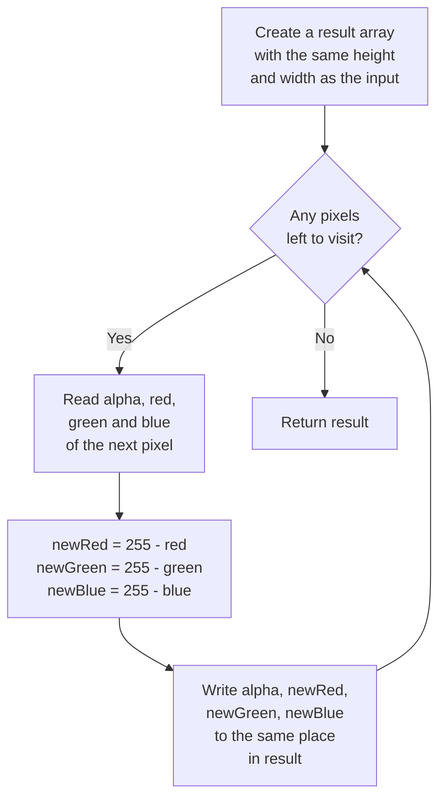

# Exercise 10 — Invert: algorithm

This flowchart shows the algorithm in [InvertFilter.java](InvertFilter.java). Try the exercise first: see [Exercise 10 — Invert](../../../../../notes/topics/t09_interface/exercises/t09_interface_supplement_image_filters_exercises.md#exercise-10--invert) on the image filters exercise sheet.

Each pixel is handled on its own. Each colour channel is replaced by its distance from 255, and alpha is kept.

