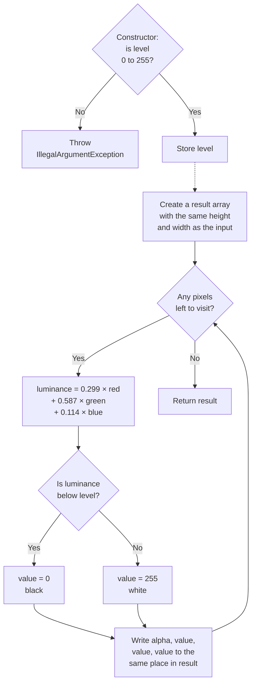

# Exercise 11 — Threshold: algorithm

This flowchart shows the algorithm in [ThresholdFilter.java](ThresholdFilter.java). Try the exercise first: see [Exercise 11 — Threshold](../../../../../notes/topics/t09_interface/exercises/t09_interface_supplement_image_filters_exercises.md#exercise-11--threshold) on the image filters exercise sheet.

The constructor checks and stores the level. Then each pixel becomes pure black or pure white, depending on its brightness.

