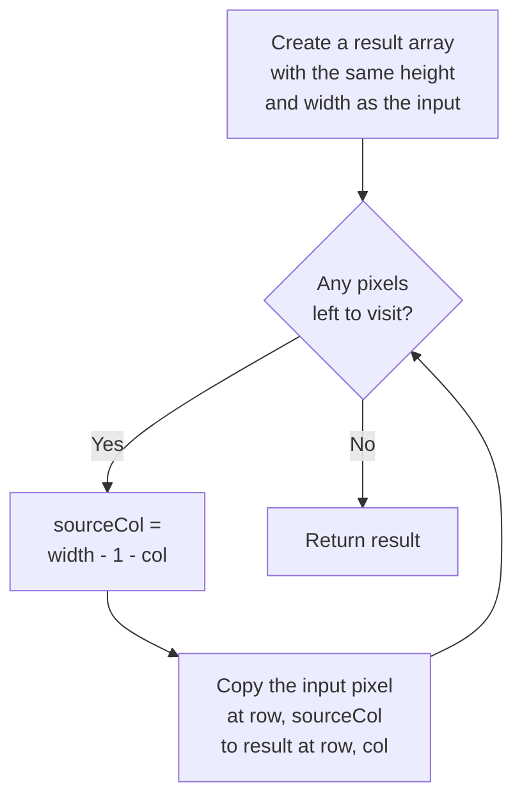

# Exercise 12 — Flip: algorithm

This flowchart shows the algorithm in [FlipHorizontalFilter.java](FlipHorizontalFilter.java). Try the exercise first: see [Exercise 12 — Flip](../../../../../notes/topics/t09_interface/exercises/t09_interface_supplement_image_filters_exercises.md#exercise-12--flip) on the image filters exercise sheet.

Each output pixel copies the pixel in the same row at the mirrored column.

