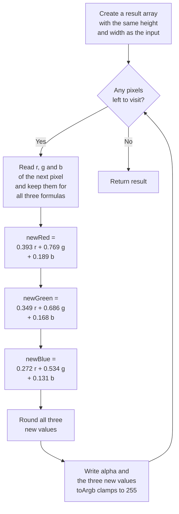

# Exercise 13 — Sepia: algorithm

This flowchart shows the algorithm in [SepiaFilter.java](SepiaFilter.java). Try the exercise first: see [Exercise 13 — Sepia](../../../../../notes/topics/t09_interface/exercises/t09_interface_supplement_image_filters_exercises.md#exercise-13--sepia) on the image filters exercise sheet.

Each new channel is a weighted sum of all three old channels. The weights in each row add up to more than 1, so the result is clamped.

