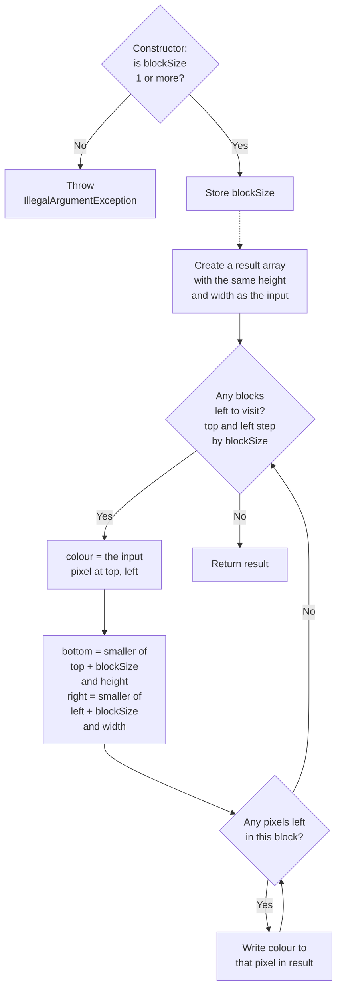

# Exercise 16 — Pixelate: algorithm

This flowchart shows the algorithm in [PixelateFilter.java](PixelateFilter.java). Try the exercise first: see [Exercise 16 — Pixelate](../../../../../notes/topics/t09_interface/exercises/t09_interface_supplement_image_filters_exercises.md#exercise-16--pixelate) on the image filters exercise sheet.

The outer loops jump from the top-left corner of one block to the next. The inner loops fill one block, and stop at the edge of the image.

