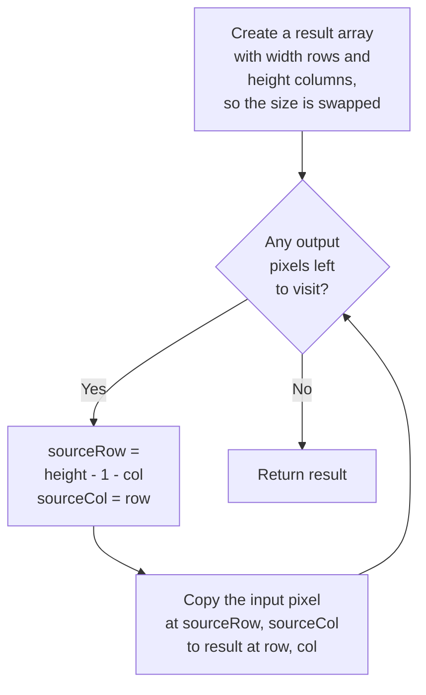

# Exercise 17 — Rotate: algorithm

This flowchart shows the algorithm in [Rotate90Filter.java](Rotate90Filter.java). Try the exercise first: see [Exercise 17 — Rotate](../../../../../notes/topics/t09_interface/exercises/t09_interface_supplement_image_filters_exercises.md#exercise-17--rotate) on the image filters exercise sheet.

The result has the width and height swapped. The loop visits each output pixel and works back to the input pixel it copies.

