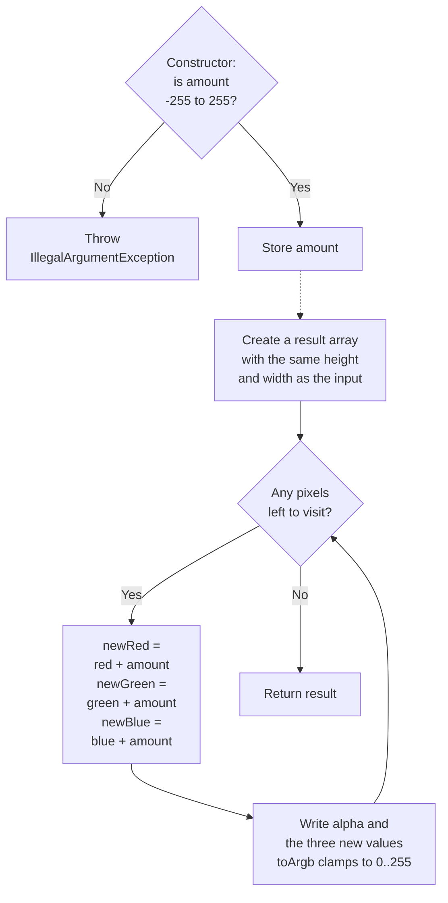

# Exercise 18 — Brightness: algorithm

This flowchart shows the algorithm in [BrightnessFilter.java](BrightnessFilter.java). Try the exercise first: see [Exercise 18 — Brightness](../../../../../notes/topics/t09_interface/exercises/t09_interface_supplement_image_filters_exercises.md#exercise-18--brightness) on the image filters exercise sheet.

The constructor checks and stores the amount. Then the same amount is added to each colour channel, and toArgb clamps the result at both ends.

