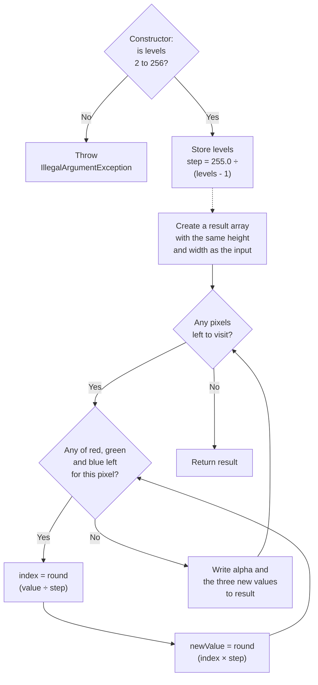

# Exercise 19 — Posterize: algorithm

This flowchart shows the algorithm in [PosterizeFilter.java](PosterizeFilter.java). Try the exercise first: see [Exercise 19 — Posterize](../../../../../notes/topics/t09_interface/exercises/t09_interface_supplement_image_filters_exercises.md#exercise-19--posterize) on the image filters exercise sheet.

The constructor works out the gap between two allowed values. Then each colour channel is rounded to the nearest allowed value.

