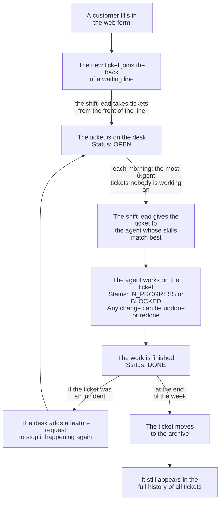

# ICA2 - Individual Project: Help Desk

In this project you build a **help desk** in Java. A help desk is the system a software company uses to keep track of problems and requests from its customers. Each problem or request is called a **ticket**.

The project tests what you have learned in five topics: Collections I, II and III (t05 to t07), Inheritance (t08) and Interfaces (t09). You work on your own. You show your progress twice in the lab, and you explain your work in a short interview at the end.

| Item | Details |
|:--|:--|
| **Weight** | 20% of your module grade |
| **Who** | Individual - this is your own work |
| **Show and tell 1** | Semester 3, Week 11 lab - push the tag `st1` before your lab |
| **Show and tell 2** | Semester 4, Week 1 lab - push the tag `st2` before your lab |
| **Hand in** | Monday of Semester 4, Week 2, at 21:00 - push the tag `final` |
| **Interviews** | Semester 4, Week 2, 15 minutes each, in the lab (book a slot on Moodle) |
| **How to submit** | Put the link to your private GitHub repository on Moodle. Name the repository `L8-Y2-OOP-ICA2-STUDENT_NAME` (section 10). Add the lecturer as a collaborator on the repository. |
| **Interview** | The interview is a big part of your grade. You must be able to explain your own code (section 9). |
| **AI tools** | **Not allowed.** This includes the AI features inside IntelliJ and other IDEs (section 11). |
| **Late work** | Institute policy applies ([continuous assessment procedures](https://www.dkit.ie/about/policies/continuous-assessment-procedures)) |
| **Academic integrity** | Institute policy applies ([academic integrity policy](https://www.dkit.ie/about/policies/academic-integrity-policy-and-procedures)) |

---

## 1. What This Project Assesses

These are the module learning outcomes (MLOs) this project checks, and where in the project you show each one.

| Learning outcome | Where you show it |
|:--|:--|
| **MLO1** - Solve problems using OOP and console input and output | Your help desk works, and your demo shows it working |
| **MLO2** - Use OOP ideas to build code in well-organised parts | Your class hierarchy, your interfaces, your command classes and your UML diagram |
| **MLO3** - Choose the right collections and algorithms, and use them | The collections you pick for each job, and the reasons you give for them |
| **MLO5** - Use version control, testing and debugging | Your Git history, your JUnit tests and coverage, and your debugging log |

---

## 2. The Scenario

### 2.1 The help desk and the people who use it

A small software company needs a help desk. Four kinds of people use it:

| Who | What they do |
|:--|:--|
| **Customer** | Reports a problem, or asks for a new feature, by filling in a web form |
| **Shift lead** | Decides which tickets get worked on next, and who works on them |
| **Agent** | A support worker who fixes the problem on a ticket. Each agent has skills, such as `database` or `login`. |
| **Manager** | Asks questions about the work, such as "how many tickets are blocked?" |

There are four kinds of ticket:

| Ticket type | Example |
|:--|:--|
| **Bug report** | "The app crashes when I upload a photo." |
| **Feature request** | "Please add a dark mode." |
| **Incident** | "Nobody can log in." This is urgent and affects many users. |
| **A type you design** | For example, a security audit or a data migration (section 4.4) |

Each kind of ticket takes a different amount of work to finish. Your code works out an **effort** score for each ticket.

### 2.2 How a ticket moves through the help desk

This diagram shows the path every ticket takes. The section after it explains each step and names the help desk method that does that step.

| Step | What happens | Help desk method |
|:--|:--|:--|
| 1. Submit | A customer fills in the form. The ticket does **not** go straight onto the desk. It waits in line with the other new tickets. | `submit` |
| 2. Take from the line | The shift lead moves tickets from the waiting line onto the desk. The ticket that arrived first goes on first. | `processIntake` |
| 3. Triage | Each morning, the shift lead asks for the five most urgent tickets that nobody is working on yet. **Triage** means deciding what to deal with first. | `nextForTriage` |
| 4. Assign | For each of those tickets, the desk suggests the agent whose skills best match the ticket's tags. The shift lead gives the ticket to that agent. | `bestAgentFor`, then `execute` |
| 5. Work | The agent changes the ticket's status as they work. Only some changes are allowed: for example, a finished ticket cannot become blocked again. If someone makes a mistake, they can **undo** it, and **redo** it if they change their mind. | `execute`, `undo`, `redo` |
| 6. Finish | When an incident is finished, the desk adds a feature request straight after it, so that someone works out how to stop it happening again. The follow-up has a new id, the same priority, tags and posting date as the incident, and it refers to the incident's id. | `insertFollowUps` |
| 7. Archive | At the end of the week, finished tickets are moved off the desk into an archive. They still appear in the full history. Archiving cannot be undone, and it clears every change that could be undone or redone. | `archiveDone`, `timeline` |

### 2.3 Questions the manager asks

Your help desk must also answer the manager's questions:

- How many tickets are in each status?
- Which tickets were reported between Monday and Wednesday?
- What is the oldest ticket that is still open?
- How much work does each agent have?
- Which tags are being used, and which tags do two tickets have in common?
- Which escalated tickets need a manager to look at them?

### 2.4 What you will build

1. **Ticket classes.** A family of ticket classes built with inheritance (section 4).
2. **Interfaces.** Three interfaces are given to you (section 3). You write two more yourself (section 4.5).
3. **The help desk class.** One class that does everything in sections 2.2 and 2.3. **You decide which collections it uses.** You explain each choice in your README.
4. **Evidence.** JUnit tests, a README with diagrams and explanations, a debugging log, and a progress log.

Each help desk method is either **Core** or **Extended**:

- **Core** methods are the essentials. If you do all the Core work well, you can reach the Satisfactory (C) band.
- **Extended** methods are harder. You need them for the Good (B) and Excellent (A) bands.

Do all the Core work first.

---

## 3. The Interfaces You Are Given

The starter code contains three Java interfaces. You will find it in the [ica2_starter](ica2_starter/) folder next to this brief, and as a zip file on Moodle. You must use all three interfaces.

| Interface | What it is for | What you write |
|:--|:--|:--|
| `HelpDesk` | Lists what the help desk can do | One class that implements it |
| `TicketFilter` | A test that a ticket passes or fails, such as "is this ticket open?" | Lambdas, and one anonymous class (section 4.5) |
| `DeskCommand` | One change to the desk that can be undone, such as "assign this ticket to Aoife" | At least three command classes (section 4.6) |

### 3.1 `HelpDesk` is only half finished

Some of the help desk's methods are already written in `HelpDesk`. The rest are described in a **TODO comment block** at the end of the file. **You add those methods yourself.** For each one, the TODO block tells you:

- the method name, which you must use;
- what the method must do;
- whether it is Core or Extended;
- any **constraint**: a rule about how the method must work. For example, "must not examine every ticket on the desk" means that you cannot just loop through all the tickets.

The TODO block does **not** tell you the parameter types or the return type. You choose them. **Why:** if the return type was given, it would tell you which collection to use. Choosing the right collection for each job is the most important thing this project assesses.

### 3.2 Rules for the interfaces

- [ ] Put the three files in a package called `ica2.api`.
- [ ] Put your own model classes in a package called `ica2.model`, and use these exact names: `Ticket`, `Agent`, `Status` and `Priority`. The interfaces use these names, so the interfaces will not compile until you create these classes.
- [ ] Do **not** change or delete any method that is already in the interfaces.
- [ ] Add every Core method from the TODO block to `HelpDesk`. Add each Extended method when you build it.
- [ ] You may add extra `default`, `static` and `private` methods to any of the three interfaces.
- [ ] `canTransition` is a Core method that is already in `HelpDesk`. Implement it in your class.
- [ ] `redo` is an Extended method that is already in `HelpDesk`. It has a `default` version that just throws `UnsupportedOperationException`. When you build it, override it in your class.
- [ ] Your help desk class must have a public constructor that takes no arguments.

---

## 4. Requirements - Ticket Classes and Interfaces (t08, t09)

Each class and interface below has its own requirements table. Each requirement is a numbered task, such as **Task 3**, so that you can refer to it in your README, your `PROGRESS.md` and the interview. Tick the **Done** column in your own copy as you go.

This is the family of ticket classes you build. Section 4.4 explains the two choices for your own type.

| Class | Kind | Extends | Implements |
|:--|:--|:--|:--|
| `Ticket` | `public sealed abstract` class | - | `Comparable<Ticket>`, `Summarisable` |
| `BugReport` | `final` class | `Ticket` | `Escalatable` |
| `FeatureRequest` | `final` class | `Ticket` | - |
| `Incident` | `final` class | `Ticket` | `Escalatable` |
| Your own type | `sealed abstract` or `non-sealed` class | `Ticket` | Your choice (Task 17) |
| Classes below your type | At least one class | Your own type | Your choice |

### 4.1 The `Ticket` class

`Ticket` is the parent class of every kind of ticket. You decide which fields it has. Whatever fields you choose, the help desk must be able to get these six things from every ticket:

| The help desk needs | Because of |
|:--|:--|
| An id that is different for every ticket and never changes | Finding a ticket by its id, and spotting duplicates |
| A priority (`LOW` to `CRITICAL`) | Deciding which tickets are most urgent |
| A status (`OPEN`, `IN_PROGRESS`, `BLOCKED` or `DONE`) | Changing status, archiving, counting |
| The date and time the ticket was posted, as a `LocalDateTime` | Date searches, finding the oldest ticket, the full history |
| A set of tags, such as `login` or `payments` | Tag questions, and matching tickets to agents |
| The agent working on it, if there is one | Assigning tickets, and working out each agent's workload |

Explain the fields you chose, and why, in your README.

| Task | Requirement | Details | Done |
|:--|:--|:--|:--:|
| 1 | Declare it `public sealed abstract` | **Sealed** means the class lists exactly which classes may extend it, using `permits` (t08, Core Idea 6). **Abstract** means you cannot create a plain `Ticket`, only one of its subclasses. | [ ] |
| 2 | Keep every field `private` | Make the id `final`, so it cannot change. | [ ] |
| 3 | Check every constructor argument | If an argument is invalid, throw an `IllegalArgumentException` with a message that says which field was wrong and what the bad value was. **Why:** if a ticket can never be created in a bad state, no other code has to check for one. | [ ] |
| 4 | Never hand out its own collections | For example, a `getTags()` method must not return the ticket's actual tag set, because other code could then change the tags. | [ ] |
| 5 | Work out effort with a template method | See the effort table below (t08, Core Idea 4). | [ ] |
| 6 | Write `equals` and `hashCode` **only in `Ticket`** | Use the id, and make both methods `final`. `equals` must use `instanceof Ticket`, not `getClass()`, so that two tickets with the same id are equal even if they are different kinds of ticket. In your README, explain why `instanceof` is the right check here, and why making `equals` `final` keeps it safe (t08, Core Idea 7). | [ ] |
| 7 | Implement `Comparable<Ticket>` | You choose the natural order, and explain it in your README. | [ ] |
| 8 | Hold the ticket's agent as a field | A ticket **has an** agent; it is not a kind of agent. This is called **composition** (t08, Core Idea 9). The field may be `null`, but the getter must be `Optional<Agent> getAgent()`, so that no caller ever receives `null`. | [ ] |
| 9 | Override `toString()` | Each ticket class overrides it again and calls `super.toString()`. | [ ] |

**The effort template method (Task 5).** A template method is a method in the parent class that sets out the steps of a calculation, and lets each subclass fill in one or more of the steps. Write these three methods in `Ticket`:

| Method | What it does |
|:--|:--|
| `public final int effortEstimate()` | Adds together the results of the two methods below. It is `final`, so no subclass can change how the total is worked out. |
| `protected int baseEffort()` | Gives a starting effort. It has a body in `Ticket`. At least one subclass overrides it and calls `super.baseEffort()` inside it. |
| `protected abstract int effortAdjustment()` | Has no body. Each subclass writes its own. |

### 4.2 The `Priority` and `Status` enums

| Enum | Values, in this order | Notes | Done |
|:--|:--|:--|:--:|
| `Priority` | `LOW`, `MEDIUM`, `HIGH`, `CRITICAL` | - | [ ] |
| `Status` | `OPEN`, `IN_PROGRESS`, `BLOCKED`, `DONE` | A ticket whose status is `DONE` is **finished**. | [ ] |

### 4.3 `BugReport`, `FeatureRequest` and `Incident`

These rules apply to all three classes.

| Task | Requirement | Details | Done |
|:--|:--|:--|:--:|
| 10 | Make each class `final` | Nothing can extend it. | [ ] |
| 11 | Call the `Ticket` constructor | Use `super(...)` in each constructor. | [ ] |
| 12 | Add at least one field of its own | Use that field in the class's `effortAdjustment()`, and explain the rule in a Javadoc comment. For example, a bug report might take more effort if it cannot be reproduced. **Why:** if a subclass's fields make no difference to how it behaves, it does not need to be a subclass. | [ ] |
| 13 | Implement `Escalatable` in `BugReport` and `Incident` only | `FeatureRequest` does not implement it (section 4.5). | [ ] |

### 4.4 Your own ticket type

Design a fourth kind of ticket that is different from the other three. Your new type must make the family of classes **three levels deep**: `Ticket`, then your type, then at least one class below your type. Pick one of these two designs and explain your choice in your README:

| Design | What you write | Example |
|:--|:--|:--|
| **Closed** | Your type is `sealed abstract`, and permits at least two `final` subclasses | `SecurityAudit`, with subclasses `InternalAudit` and `ExternalAudit` |
| **Open** | Your type is `non-sealed`, so any class may extend it. Write at least one subclass, in a different package. | `DataMigration`, with subclass `CloudMigration` in another package |

| Task | Requirement | Details | Done |
|:--|:--|:--|:--:|
| 14 | Make the family three levels deep | Use one of the two designs above. | [ ] |
| 15 | Give each lowest-level class its own `effortAdjustment()` | - | [ ] |
| 16 | Build on a parent's effort at least once | At least one lowest-level class calls `super.effortAdjustment()`. | [ ] |
| 17 | Decide whether your type implements `Escalatable` | Explain why in your README. | [ ] |

### 4.5 The interfaces you write or add to

#### `Summarisable` - you write this one

Implemented by `Ticket` and `Agent`. **Why:** `Ticket` and `Agent` are not related by inheritance, but a list of `Summarisable` objects can still hold both and print them the same way. That is polymorphism through an interface (t09, Core Idea 4).

| Task | Member | Kind | What it does | Done |
|:--|:--|:--|:--|:--:|
| 18 | `String summary()` | abstract | Returns a short summary of the object | [ ] |
| 19 | `String summaryLine(int width)` | `default` | Returns `summary()` cut down or padded with spaces to exactly `width` characters | [ ] |
| 20 | `String label()` | `default` | Returns a label for the object | [ ] |
| 21 | At least one helper, named by you | `private` | Used by the `default` methods | [ ] |

#### `Escalatable` - you write this one

To **escalate** a ticket means to raise it to a more senior person. Implemented by `BugReport` and `Incident`, and by your own type if you choose (Task 17).

| Task | Member | Kind | What it does | Done |
|:--|:--|:--|:--|:--:|
| 22 | `int escalationLevel()` | abstract | Returns how far the ticket has been escalated | [ ] |
| 23 | `void escalate()` | abstract | Raises the ticket one level | [ ] |
| 24 | `boolean needsManager()` | `default` | Uses only Tasks 22 and 23 | [ ] |
| 25 | `String label()` | `default` | The same signature as the one in `Summarisable`, but its own body | [ ] |
| 26 | A method that returns a `Comparator`, named by you | `static` | Used to sort escalatable tickets | [ ] |

#### The `label()` clash

`BugReport` and `Incident` now get two different `default` versions of `label()`, one from each interface. Java will not choose between them, so the code will not compile until you fix it (t09, Core Idea 7).

| Task | Requirement | Details | Done |
|:--|:--|:--|:--:|
| 27 | Override `label()` in `BugReport` and `Incident` | Call both versions, using `Summarisable.super.label()` and `Escalatable.super.label()`. | [ ] |

#### `TicketFilter` - you add to this one

`matches(Ticket)` is given. Do not change it.

| Task | Member | Kind | What it does | Done |
|:--|:--|:--|:--|:--:|
| 28 | `and`, `or`, `negate` | `default` | Combine filters, for example `isOpen.and(isUrgent)` | [ ] |
| 29 | At least four filter makers, named by you | `static` | Each one creates a useful filter. For example: `withStatus(...)`, `taggedWith("login")`, `postedBefore(date)`, `priorityAtLeast(Priority.HIGH)`. | [ ] |
| 30 | Filters in your code | lambdas | Use lambdas to create filters. In your demo, also write one filter as an **anonymous class**, so you can compare the two styles. | [ ] |

#### Rules for the interfaces, and for the code that uses them

| Task | Requirement | Details | Done |
|:--|:--|:--|:--:|
| 31 | `escalationReport()` finds escalatable tickets with `instanceof` pattern matching | It sorts them with `Escalatable`'s static comparator (Task 26). | [ ] |
| 32 | `totalEffort()` does not use `instanceof` at all | Each ticket works out its own effort, so the desk can just ask every ticket. | [ ] |
| 33 | No constants in any interface | t09, Core Idea 2 | [ ] |

### 4.6 `Agent` and the command classes

#### `Agent`

| Task | Requirement | Details | Done |
|:--|:--|:--|:--:|
| 34 | Give `Agent` a name and a set of skills | `bestAgentFor` uses the name to break ties. You decide the other fields. | [ ] |
| 35 | Store skills and tags in the same form | `bestAgentFor` compares an agent's skills with a ticket's tags. For example, decide whether `"Login "` and `"login"` count as the same tag. | [ ] |
| 36 | Write `equals` and `hashCode` using a field that never changes | **Why:** the workload question uses agents as map keys. | [ ] |
| 37 | Implement `Summarisable` | See section 4.5. | [ ] |

#### The command classes

Write at least three classes that implement `DeskCommand`. Each one changes a ticket only by calling methods of your help desk (section 5.1).

| Task | Command | What it does | Done |
|:--|:--|:--|:--:|
| 38 | Status command | Changes a ticket's status. It must refuse any change that `canTransition` rejects. | [ ] |
| 39 | Assign command | Assigns a ticket to an agent. | [ ] |
| 40 | A command of your choice | For example, adding or removing a tag. | [ ] |

---

## 5. Requirements - The Help Desk Class (t05, t06, t07)

`HelpDesk` (its Javadoc and its TODO block) tells you exactly what each method must do. This table groups the methods so you can plan your work.

| Group | Core methods | Extended methods |
|:--|:--|:--|
| Agents, the waiting line, and finding tickets | `addAgent`, `submit`, `processIntake`, `add` (two versions), `findById`, `findAll` | a second `findAll` that also sorts |
| Changes | `execute`, `undo`, `canTransition` | `redo`, keeping only the last 20 changes |
| Workflow | `insertFollowUps`, `archiveDone` | `timeline`, `partitionByAssignment` |
| Manager's questions | `countByStatus`, `allTags`, `groupByTag`, `postedBetween`, `nextForTriage`, `bestAgentFor`, `totalEffort`, `escalationReport` | `compareTags`, `workloadByAgent`, `oldestOpen`, `effortRanking` |

### 5.1 Choosing your collections

**You decide which collection to use for each job.** For example, you decide how to store the waiting line, how to find a ticket quickly by its id, and how to remember changes so they can be undone. Making good choices, and explaining them, is the main thing this project assesses from t05 to t07.

- [ ] For every collection you use, explain your choice in the collection choice table in your README (section 7). Be ready to explain it in the interview as well.
- [ ] Across the whole help desk, use at least one of each of these:
  - a list;
  - a queue or a deque;
  - a set;
  - a map;
  - a collection that keeps its items in sorted order or priority order.

  **Why:** this makes you use ideas from all three collections topics.
- [ ] Follow every constraint in `HelpDesk`. Where a method has no constraint, still pick the collection that makes that method fast, and say how fast in your table.
- [ ] If you remove items from a collection while looping through it, do it safely, without causing a `ConcurrentModificationException` (t05).
- [ ] If you keep extra collections to make searches faster (for example, a map from id to ticket), keep them up to date whenever a ticket is added, changed or archived.
- [ ] A command must change a ticket only by calling methods of your help desk, never by calling the ticket's setter directly. Add your own methods to `HelpDesk` for this, such as a method that changes a ticket's status. **Why:** the desk can only keep its extra collections up to date if every change goes through it.
- [ ] Never change a field that a sorted collection uses for its order while the ticket is in that collection. Remove the ticket, change it, then add it back. **Why:** a `TreeSet` or `PriorityQueue` does not notice the change, and then loses or misplaces the ticket.
- [ ] **Do not use streams** (the Streams API, t17). Use loops and iterators, so that your choices are visible in your code.

---

## 6. Requirements - Data, Demo and Tests

### 6.1 Sample data

- [ ] Write a class called `SeedData` that creates at least **25** valid tickets and at least **4** agents. Include at least 3 tickets of each concrete (non-abstract) ticket class, including the classes you designed. Type the data straight into the code; you do not need to read from a file.
- [ ] Also include at least **6** attempts to create a ticket with bad data, each breaking a different rule. Catch each `IllegalArgumentException` with `try`/`catch` and print its message. You do not need to write your own exception classes (that is t10).

### 6.2 The demo

- [ ] Write a class called `Demo` that runs through numbered scenarios and prints clear headings. Include:
  - one scenario for each step in section 2.2;
  - one scenario for each question in section 2.3;
  - one scenario showing that bad data is rejected;
  - one scenario showing how you fixed the `label()` clash.

**Why:** in the interview, we run your demo and jump straight to the scenario we want to discuss.

### 6.3 JUnit tests and coverage

You **must** include unit tests. If there are no tests, your project is not graded (section 10).

- [ ] Write at least **20** JUnit 5 tests. Name each one `methodName_situation_expectedResult`, for example `undo_nothingToUndo_returnsFalse`. Lay each test out as Arrange, Act, Assert.
- [ ] Use at least four test classes, one for each group below. Where you test the help desk, use a variable of type `HelpDesk`, not your own class name.

| Test group | At least | Must include tests for |
|:--|:--:|:--|
| Tickets | 4 | two different kinds of bad data; the effort of each ticket class; two different kinds of ticket with the same id counting as equal |
| Interfaces | 4 | the `label()` clash; combining filters with `and`, `or` and `negate`; one of your static filter methods; `summaryLine` on a ticket and on an agent |
| Changes | 6 | `archiveDone`; `undo` when there is nothing to undo; a status change the workflow does not allow; *Extended:* undo then redo; a new change wiping out redo; the 20-change limit |
| Questions | 6 | `findById` with an id that does not exist; `postedBetween` on the first and last dates; `nextForTriage` when two tickets tie; `bestAgentFor` when two agents tie; *Extended:* `effortRanking` with two tickets of equal effort; `compareTags` |

You only need the tests marked *Extended* for the Extended methods you build. You still need the minimum number of tests in each group, so if you build only the Core methods, write extra tests for the Core methods in that group.

- [ ] **Coverage: at least 75%.** **Line coverage** is the percentage of your code's lines that your tests run. Measure it with IntelliJ's **Run with Coverage**. Include your `ica2.model` classes, your `ica2.api` interfaces (for the `default` and `static` methods you write), your help desk class and your command classes. Leave out `Demo` and `SeedData`. **Why:** to reach 75% you have to test the unusual cases, not just the ones your demo already shows.
- [ ] Export the coverage report as HTML into a folder called `reports/coverage/`, and commit it. Add a screenshot of the coverage summary to your README, and write the coverage figure in the text.
- [ ] Every test passes when you hand in.

We check your coverage figure against the report you commit. If it is below 75%, the highest you can get for testing (Q2 in Appendix A) is the Satisfactory band.

---

## 7. Requirements - README and Progress Log

Your README goes in the top folder of your repository. Word counts only count your own writing, not code, tables or diagrams.

| README section | What to include | Words |
|:--|:--|:--|
| Overview | What your own ticket type is, and why you chose it | 60-120 |
| Class diagram | A UML class diagram, drawn in Mermaid with `classDiagram`. Show every class and interface, the enums, which classes are `sealed`, `non-sealed` or `final`, and which classes hold others as fields. Add `accTitle` and `accDescr` so screen readers can describe it. Draw it **before** you start coding, and update it before each show and tell. | - |
| Workflow diagram | A Mermaid `stateDiagram-v2` showing which status changes your workflow allows, with `accTitle` and `accDescr` | - |
| Collection choice table | One row for each job your help desk does, such as the waiting line, finding by id, undo, date searches and triage. For each job, give: the collection you used; what your method returns, and why; why the collection suits the job; one collection you decided not to use, and why; and how fast the main operation is (for example, "constant time" or "has to look at every ticket"). | 250-400 |
| Design decisions | Explain: (a) your `Ticket` fields, id format and checks; (b) your template method; (c) why your `equals` uses `instanceof` and is `final`, and your natural order; (d) why a ticket **has an** agent rather than **is an** agent; (e) the design of your own ticket type, and whether it is escalatable; (f) how you fixed the `label()` clash | 300-450 |
| Testing | Your coverage screenshot and figure, and anything you chose not to test, with reasons | 80-150 |
| Debugging log | Two bugs you found using the debugger. For each: what went wrong, where you put a breakpoint, what the Variables pane showed you, and how you fixed it. Add a screenshot for each, as an HTML image with alt text. | 150-300 |
| Reflection | What you would do differently, which collection choice you were least sure about, and what you changed after the show and tell feedback | 100-200 |
| AI declaration | A statement that you did not use any AI tools, and that the AI features in your IDE were turned off the whole time (section 11) | - |

Also keep a file called `PROGRESS.md` in the top folder, with one entry for each show and tell. Use these four headings in each entry:

- **Done**: what works, and which tests prove it.
- **Next**: what you will do before the next show and tell or the hand-in.
- **Stuck on**: any problems, or "nothing".
- **Feedback received**: fill this in after the show and tell. Write down the feedback, and what you will do about it.

---

## 8. Timeline and Show and Tells

A **show and tell** is a 5-minute slot in your lab. You run your code, talk through your `PROGRESS.md` entry, and get feedback on your work so far. Show and tells are **not** graded. You must attend both, and push the tag before your lab (section 10). **Why:** feedback is most useful while you still have time to act on it.

| Milestone | When | Tag | What should be working |
|:--|:--|:--|:--|
| Show and tell 1 | Semester 3, Week 11 | `st1` | Class diagram in your README. All your ticket classes, the enums, `Agent`, `Summarisable` and `Escalatable` compile. The template method works, and the `label()` clash is fixed. A first draft of your collection choice table. Ticket tests pass. |
| Show and tell 2 | Semester 4, Week 1 | `st2` | All Core methods work and have tests. You have started the Extended methods. A first coverage report is committed. `SeedData` and `Demo` run. |
| Hand in | Monday of Semester 4, Week 2, at 21:00 | `final` | Everything is finished. README and `PROGRESS.md` are complete. All tests pass. Coverage is at least 75%. |
| Interviews | Semester 4, Week 2 | - | See section 9 |

Commit your work each time you finish a method or a group of tests. Follow the [commit message guidelines](https://github.com/nmcguinness/L8-OOP-Module-Content/blob/main/notes/shared/general/commit-message-guidelines.md). **Why:** lots of small, clear commits are the best evidence that the work is yours.

---

## 9. The Interview

Each interview lasts 15 minutes. It takes place in the lab, with your project open in IntelliJ.

1. **Demo (5 minutes).** You run `Demo`, and we pick the scenarios we want to see.
2. **Questions (10 minutes).** You talk us through the code behind those scenarios, and we ask you questions about it. Expect questions on your collection choices, your ticket classes, your interfaces, your tests and your design decisions. We may also ask about any of your commits. For example:
   - Why did you use this collection here, and what would happen if you used a different one?
   - What would you have to change to add a new status?
   - How does your `nextForTriage` decide between two tickets with the same priority?
   - What would happen if `FeatureRequest` also implemented `Escalatable`?

The interview has its own marks (Appendix A). If the interview shows that you cannot explain code you handed in, your marks for that part of the project are capped at the Limited band. This follows the Institute's academic integrity policy.

---

## 10. Must-Haves and Hand-In Checklist

The items in the first table do not earn marks. **If any of them is missing, your project is not graded.** They are required because we use them to check and mark everything else.

| Must-have | What it means | If it is missing |
|:--|:--|:--|
| **GitHub repository** | A private repository, named as shown below. Add the lecturer as a collaborator before show and tell 1. Put the link on Moodle. | Not graded |
| **Tags** | `st1`, `st2` and `final`, each pushed before its deadline | Not graded |
| **Commit history** | You commit your work regularly throughout the project, following the [commit message guidelines](https://github.com/nmcguinness/L8-OOP-Module-Content/blob/main/notes/shared/general/commit-message-guidelines.md). This means at least 30 commits, made in at least 4 different weeks. | Not graded |
| **Show and tells** | You attend both, with a `PROGRESS.md` entry for each. Only an absence accepted under Institute procedures is excused. | Not graded |
| **Given interfaces** | You implement all three, add every Core method from the TODO block, and do not change or delete any method you were given | Not graded |
| **Unit tests** | At least 20 JUnit 5 tests, all passing, and a committed coverage report (section 6.3) | Not graded |
| **AI declaration** | Included in your README (section 7) | Not graded |

**Naming your repository.** Name your repository `L8-Y2-OOP-ICA2-STUDENT_NAME`, replacing `STUDENT_NAME` with your first name and surname, separated by a hyphen. For example, `L8-Y2-OOP-ICA2-Aoife-Byrne`.

- Use only the letters A to Z and hyphens. GitHub does not allow spaces or accented letters in repository names, so leave out any accent (fada) and any apostrophe. For example, write `OBrien` rather than `O'Brien`.
- Use the same name as on your Moodle account, so we can match your repository to you.

**Why:** we clone every repository for marking, and a fixed pattern lets us find and sort them without opening each one.

Before you hand in, check each item:

| Item | Done |
|:--|:--|
| Private repository named `L8-Y2-OOP-ICA2-STUDENT_NAME`, lecturer added as collaborator, link on Moodle | [ ] |
| Tags `st1`, `st2` and `final` pushed | [ ] |
| `PROGRESS.md` has an entry for each show and tell, including the feedback you got | [ ] |
| The three interfaces are in `ica2.api`; nothing given has been changed or deleted; every Core TODO method has been added to `HelpDesk` | [ ] |
| The project compiles, and `Demo` runs, from a fresh clone of your repository | [ ] |
| No streams used | [ ] |
| At least 20 JUnit 5 tests in at least four test classes, all passing | [ ] |
| Coverage report in `reports/coverage/`, at least 75%, with a screenshot in your README | [ ] |
| Every README section in section 7, including the AI declaration | [ ] |
| AI features in your IDE turned off, and no AI tools used (section 11) | [ ] |
| Signed CA cover sheet uploaded to Moodle | [ ] |

---

## 11. Use of AI Tools

**You must not use any AI tools in this assignment.** This applies to every part of it: planning, code, tests, the README, the progress log and the interview.

This includes:

- AI chatbots and AI search tools, on any device.
- AI that writes or completes code for you, including the AI features built into IntelliJ IDEA or any other Java IDE. In IntelliJ, this means the JetBrains AI Assistant, Junie, and full line code completion. In other IDEs, it includes GitHub Copilot and similar plugins for IntelliJ, VS Code, Eclipse or NetBeans.
- Any tool that writes, completes, explains, reviews or fixes code or text for you.

Turn these features off, or uninstall them, before you start. In IntelliJ:

- full line code completion is under **Settings > Editor > General > Inline Completion**;
- AI plugins are under **Settings > Plugins**.

You **may** use the normal IDE features that are not AI, such as:

- syntax highlighting, and completion of method and class names;
- refactoring tools;
- the debugger and the coverage runner;
- **Code > Generate** for constructors, getters, `equals`, `hashCode` and `toString`.

You must still be able to explain any code you generate this way.

**Why:** this project checks your own understanding of collections, inheritance and interfaces, and the interview tests that understanding directly. Using AI tools is treated as a breach of academic integrity under Institute policy ([GenAI and your assessments](https://www.dkit.ie/about/policies/generative-artificial-intelligence-ai-and-your-assessments-a-guide-for-students)).

---

## Appendix A - Marking Scheme

Each weight is a percentage of the total ICA2 mark. Within each band, your mark depends on how complete and consistent your work is. We look at your code, commits, README, tests, demo and interview. **Core** and **Extended** are the method tiers in `HelpDesk`. Everything in section 4 is Core.

### A.1 Does it work? (60%)

| Criterion (weight) | Excellent (A) | Good (B) | Satisfactory (C) | Limited (D/E) | Unacceptable (F) |
|:--|:--|:--|:--|:--|:--|
| **F1 `Ticket`, template method and equality (8%)** | Sensible fields and checks, all explained; template method works, with a `super` call; `equals` and `hashCode` are `final`, with the `instanceof` check explained; no internal collection handed out | Good; one small gap in the checks or explanations | Works, but the template method is very simple, or a collection is handed out | Several fields not checked; `equals` gives different answers for different ticket types | Fields are public, or `Ticket` does not work |
| **F2 Class hierarchy (10%)** | Three levels, with `sealed`, `non-sealed` and `final` used correctly; your own ticket type is well designed and explained; overloading and overriding used on purpose; `instanceof` only where it is needed; composition explained | All there; one part weak | Works, but your own ticket type is very simple or copies another type | Repeated code; `protected` or `instanceof` used wrongly | The hierarchy does not work |
| **F3 Interfaces and commands (10%)** | All given interfaces used and added to well; `Summarisable` and `Escalatable` as described; `label()` clash fixed cleanly; `private` and `static` methods used well; useful filters; lambdas and the anonymous class compared; each command does one clear job | All there; one method trivial | Interfaces there, but the `label()` clash or the static filter methods are missing | Interfaces barely used | The given interfaces are not implemented |
| **F4 Waiting line, storage and workflow (8%)** | All Core and Extended methods in these groups work and follow their constraints; safe removal; `partitionByAssignment` and `timeline` each take one pass | All Core work; most Extended methods work | All Core work; Extended methods missing or wrong | Some Core methods missing, or removal while looping is unsafe | Not done |
| **F5 Changes, undo and redo (8%)** | Undo, redo, redo being wiped by a new change, and the 20-change limit all work; the workflow rules are enforced | All Core work; one Extended part wrong | All Core work; Extended parts missing | Undo does not work | Not done |
| **F6 The manager's questions (10%)** | All Core and Extended questions answered correctly, including order, tie-breaks and constraints | All Core work; most Extended work | All Core work; Extended missing | Several Core questions wrong | Not done |
| **F7 Collection choices (6%)** | Every collection suits its job and is explained; all five kinds used; no constraint broken; extra collections always kept up to date | Good choices; one weak or not explained | All five kinds used, but some choices make methods slower than they need to be | Not all five kinds used, or constraints broken | One collection used for everything |

### A.2 How well was it made? (40%)

| Criterion (weight) | Excellent (A) | Good (B) | Satisfactory (C) | Limited (D/E) | Unacceptable (F) |
|:--|:--|:--|:--|:--|:--|
| **Q1 Design evidence (8%)** | Accurate class and workflow diagrams, with descriptions, updated for each show and tell; collection table gives clear reasons, rejected options and speeds; design decisions well argued; feedback clearly acted on | Accurate; some reasons are general | Diagrams out of date, or the table is thin | Diagrams wrong; reasons missing | Missing |
| **Q2 Tests and coverage (12%)** | 20 or more clear tests covering every group in 6.3, including edge cases and empty cases; good names; coverage 90% or higher | 20 or more; one group thin; coverage 75% or higher | Enough tests, but mostly only the normal case; or coverage below 75% | Weak tests, or some failing; coverage unclear | Tests exist but almost none are useful |
| **Q3 Debugging log (4%)** | Two real entries, with breakpoint evidence and a clear fix | Two entries; evidence thin | One good entry | Entries vague or look made up | Missing |
| **Q4 Interview (16%)** | Runs the demo easily; explains every choice clearly and accurately; answers follow-up questions with confidence, including what would happen if the code changed | Explains well; most follow-up questions answered | Explains most of the code; some answers unclear or need prompting | Unsure about own code; many questions not answered | Cannot explain the code handed in |

**Total: 100%**

---

## Appendix B - Getting Started

Not sure where to begin? Follow these steps in order. Commit your work after each step.

1. Read this whole brief once. Then read sections 3 and 4 again slowly, because they tell you what to build first.
2. Turn off the AI features in IntelliJ, as described in section 11.
3. Create a **private** GitHub repository called `L8-Y2-OOP-ICA2-STUDENT_NAME` (section 10). Add the lecturer as a collaborator, and put the link on Moodle. The [ICA2 Git and GitHub setup guide](ica2_github_setup.md) shows each step in IntelliJ.
4. Create a new Java project in IntelliJ inside your repository, and add JUnit 5 to it.
5. Get the starter code from the [ica2_starter](ica2_starter/) folder or the zip on Moodle. Copy the three interfaces into a package called `ica2.api`.
6. Create empty classes `Ticket` and `Agent`, and empty enums `Status` and `Priority`, in a package called `ica2.model`. The interfaces should now compile. Make your first commit.
7. Add a `README.md` and a `PROGRESS.md` to the top folder. Draw your first UML class diagram in the README, before you write any more code (section 7).
8. Build `Ticket`: its fields, the constructor checks, the template method, `equals`, `hashCode` and `compareTo` (section 4.1). Write a JUnit test for each part as you go.
9. Build the three ticket subclasses, your own ticket type, `Summarisable` and `Escalatable`, and fix the `label()` clash (sections 4.3 to 4.5).
10. Write a first draft of your collection choice table, check your work against the show and tell 1 list (section 8), and push the tag `st1` before your lab. To do this, run `git tag st1` and then `git push origin st1`.

---
