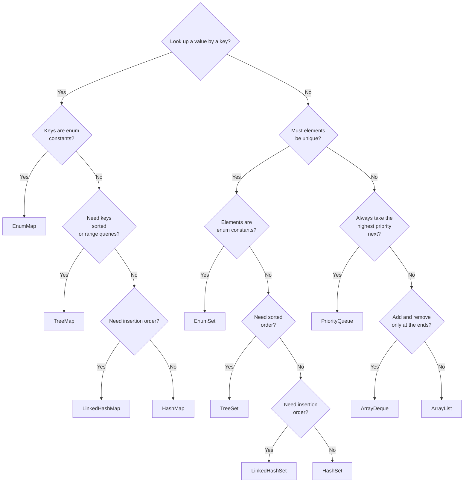

# Collections III: Set, Map & PriorityQueue

> **Prerequisites:**
> - Collections I: `ArrayList` — add, remove, contains, index-based access
> - Collections II: `LinkedList` as a list and queue
> - Equality and hashing: why `equals()` and `hashCode()` must agree, what modulo hashing does
> - Ordering: `Comparator.comparingInt(...)`, `thenComparing(...)`, lambdas and method references such as `String::length`

---

---

## In this topic

- [What you'll learn](#what-youll-learn)
- [Why this matters](#why-this-matters)
- [How this builds on previous content](#how-this-builds-on-previous-content)
- [Key terms](#key-terms)
- [Core Ideas / Concepts](#core-ideas--concepts)
- [Worked examples](#worked-examples)
- [Common mistakes](#common-mistakes)
- [Debugging and pitfalls](#debugging-and-pitfalls)
- [Practice tasks](#practice-tasks)
- [Reflective questions](#reflective-questions)
- [Further reading](#further-reading)

---

## What you'll learn

A quick summary of what **you** should be able to do after this lesson:

| Skill Type | You will be able to... |
| :-- | :-- |
| Understand | Explain why `Set` and `Map` require a correct `equals`/`hashCode` implementation. |
| Use | Choose between `HashSet`, `LinkedHashSet`, `TreeSet` and `EnumSet` for a given problem. |
| Use | Store, look up, and remove entries in `HashMap`, `LinkedHashMap`, `TreeMap` and `EnumMap`. |
| Use | Return and consume an `Optional<T>` instead of a possibly-`null` value. |
| Use | Drain a `PriorityQueue` in priority order using `poll()`. |
| Analyse | Compare the time complexity of key operations across `List`, `Set`, and `Map`. |
| Debug | Identify broken uniqueness caused by a missing `hashCode`, a mutable key, or a comparator that treats different elements as equal. |

---

## Why this matters

`ArrayList` is excellent when you need **ordered, indexed access**. But two other access patterns are just as common:

- **"Is X already in this collection?"** — fast membership check without scanning every element.
- **"Given this key, what is the value?"** — keyed lookup (like a lookup table or dictionary).

`Set` and `Map` are the Java answers to these questions. Both rely on hashing (or on ordering, for the tree versions) — which is why the equality and hashing topic comes first.

---

## How this builds on previous content

- `equals()` and `hashCode()` from [t04 Equality and Hashing](../t04_equality_hashing/t04_equality_hashing_notes.md) determine where an element lands in a `HashSet` or `HashMap`.
- Correct contracts mean `contains(x)` finds an element that is **equal** to `x`, not just identical.
- `Comparable`/`Comparator` from [t03 Ordering](../t03_ordering/t03_ordering_notes.md) drives the ordering in `TreeSet`, `TreeMap` and `PriorityQueue`.
- `Queue` and `Deque` from [t06 Collections II](../t06_collections_2/t06_collections_2_notes.md) gave you first-in, first-out order. `PriorityQueue` keeps the same `offer`/`poll`/`peek` methods but orders by priority instead.

---

## Key terms

- **Hash bucket**: the slot a hashed collection picks from an element's `hashCode()`; `equals()` is then used to compare elements inside the bucket.
- **Collision**: two different elements with the same hash code, stored in the same bucket.
- **Natural ordering**: the order defined by a class's `compareTo` method (`Comparable`).
- **Heap**: the tree structure behind `PriorityQueue`; it keeps the smallest element at the head but does not keep the rest sorted.
- **Optional**: a container that holds either one non-null value or nothing, used as a return type for lookups that might not find anything.
- **Least recently used (LRU)**: an eviction policy that removes the entry that has gone longest without being read or written.

---

## Core Ideas / Concepts

> Runnable versions of the "what goes wrong" snippets are in [the t07 demo](../../../code/src/t07_collections_3_set_map/demos/de01/Demo.java).

### Core Idea 1 — Set and HashSet: unique elements only

#### Explanation

A `Set<E>` is a collection that **cannot contain duplicates**. It has no index-based access — you cannot call `get(i)`. "Duplicate" means `equals()` returns `true` (for hashed sets) or `compare()` returns `0` (for sorted sets).

| Implementation | Order | Performance |
| :-- | :-- | :-- |
| `HashSet<E>` | None (arbitrary) | O(1) add, remove, contains |
| `LinkedHashSet<E>` | Insertion order | O(1), with slight overhead |
| `TreeSet<E>` | Sorted (natural or `Comparator`) | O(log n) |

```java
import java.util.HashSet;
import java.util.Set;

Set<String> tags = new HashSet<>();

// add returns true when the element is new, false for a duplicate
tags.add("java");
tags.add("oop");
tags.add("java");

// prints 2
System.out.println(tags.size());
// prints true
System.out.println(tags.contains("oop"));

tags.remove("oop");
// prints false
System.out.println(tags.contains("oop"));

// Iteration order is not guaranteed
for (String tag : tags) {
    System.out.println(tag);
}
```

#### Snippet explanation

The second `add("java")` returns `false` and changes nothing. `contains` is O(1) on average because the set uses `hashCode()` to jump straight to one bucket, then `equals()` to compare inside it. Never rely on the iteration order of a `HashSet`; it can change as the set grows.

---

### Core Idea 2 — LinkedHashSet and TreeSet

#### Explanation

Use `LinkedHashSet` when you need uniqueness **and** the original insertion order. Use `TreeSet` when you need the elements **sorted**, plus navigation methods such as `first()`, `last()`, `floor()` and `ceiling()`.

```java
import java.util.Comparator;
import java.util.LinkedHashSet;
import java.util.TreeSet;

LinkedHashSet<String> ordered = new LinkedHashSet<>();
ordered.add("banana");
ordered.add("apple");
ordered.add("cherry");
ordered.add("apple");
// prints [banana, apple, cherry]
System.out.println(ordered);

TreeSet<String> sorted = new TreeSet<>();
sorted.add("banana");
sorted.add("apple");
sorted.add("cherry");
// prints [apple, banana, cherry]
System.out.println(sorted);
// prints apple, then cherry
System.out.println(sorted.first());
System.out.println(sorted.last());
```

#### Snippet explanation

The duplicate `"apple"` is ignored by both sets. `LinkedHashSet` remembers when each element first arrived; `TreeSet` ignores arrival order and keeps elements sorted by `compareTo`.

#### The TreeSet trap: compare-equal means duplicate

A `TreeSet` never calls `equals()`. It decides "is this a duplicate?" by asking the comparator. If `compare(a, b)` returns `0`, the set treats `b` as a duplicate of `a` and **silently drops it**.

```java
TreeSet<String> byLength = new TreeSet<>(Comparator.comparingInt(String::length));
byLength.add("cat");
byLength.add("elephant");
byLength.add("ox");

// "dog" has the same length as "cat", so add returns false
boolean added = byLength.add("dog");
// prints false: [ox, cat, elephant]
System.out.println(added + ": " + byLength);

// Fix: add a tie-breaker so only truly identical strings compare as 0
TreeSet<String> byLengthThenText = new TreeSet<>(
        Comparator.comparingInt(String::length)
                .thenComparing(Comparator.naturalOrder()));
```

#### Snippet explanation

The first set loses `"dog"` with no error or warning. Whenever you give a `TreeSet` or `TreeMap` a comparator, make sure it returns `0` **only** for elements you consider the same. The usual fix is a `thenComparing(...)` tie-breaker — the same technique you used for sorting in t03.

---

### Core Idea 3 — Set operations (union, intersection, difference)

```java
Set<String> a = new HashSet<>(Set.of("x", "y", "z"));
Set<String> b = new HashSet<>(Set.of("y", "z", "w"));

// Union: {x, y, z, w}
Set<String> union = new HashSet<>(a);
union.addAll(b);

// Intersection: {y, z}
Set<String> intersection = new HashSet<>(a);
intersection.retainAll(b);

// Difference, a minus b: {x}
Set<String> diff = new HashSet<>(a);
diff.removeAll(b);
```

#### Snippet explanation

`addAll`, `retainAll` and `removeAll` **change the set they are called on**. Each operation therefore starts by copying `a`, so `a` and `b` are left unchanged. `Set.of(...)` builds an **immutable** set; wrapping it in `new HashSet<>(...)` gives you a copy you are allowed to modify.

---

### Core Idea 4 — What goes wrong with your own classes

#### Explanation

`String`, `Integer` and records already have correct `equals` and `hashCode`. Your own classes do not, unless you write them. Two failures are common.

**Failure 1: `equals` without `hashCode`.**

```java
final class BrokenPoint {
    private final int x;
    private final int y;

    BrokenPoint(int x, int y) {
        this.x = x;
        this.y = y;
    }

    @Override
    public boolean equals(Object o) {
        if (this == o) return true;
        if (!(o instanceof BrokenPoint other)) return false;
        return x == other.x && y == other.y;
    }

    // No hashCode override: each object keeps the identity hash from Object
}

Set<BrokenPoint> points = new HashSet<>();
points.add(new BrokenPoint(1, 2));
points.add(new BrokenPoint(1, 2));

// Usually prints 2, and contains(...) prints false
System.out.println(points.size());
System.out.println(points.contains(new BrokenPoint(1, 2)));
```

#### Snippet explanation

The two points are `equals`, but each has a different identity hash code, so they usually land in different buckets. The set never calls `equals` to compare them, and it stores both. `contains` looks in the bucket for a third hash code and finds nothing. The fix is to override `hashCode()` from the same fields as `equals()`, for example `return Objects.hash(x, y);` — or to declare `record Point(int x, int y) {}` and get both for free.

**Failure 2: changing a key after you put it in.**

```java
Map<MutableKey, Integer> scores = new HashMap<>();
MutableKey key = new MutableKey("ana");
scores.put(key, 90);

// hashCode now gives a different bucket from the one the entry is stored in
key.rename("ben");

// prints 1, then null, then null
System.out.println(scores.size());
System.out.println(scores.get(key));
System.out.println(scores.get(new MutableKey("ana")));
```

#### Snippet explanation

The entry is still in the map (`size()` is 1), but no lookup can reach it. `get(key)` looks in the bucket for `"ben"`, which is empty. `get(new MutableKey("ana"))` finds the right bucket, but `equals` fails because the stored key now says `"ben"`. Use immutable keys: `String`, `Integer`, enums, records, or classes with only `final` fields.

---

### Core Idea 5 — Map and HashMap: keyed lookup

#### Explanation

A `Map<K, V>` stores **key–value pairs**. Each key maps to exactly one value. Keys are unique; values may repeat.

| Implementation | Key order | Performance |
| :-- | :-- | :-- |
| `HashMap<K,V>` | None | O(1) get, put, remove |
| `LinkedHashMap<K,V>` | Insertion order | O(1), with slight overhead |
| `TreeMap<K,V>` | Sorted (natural or `Comparator`) | O(log n) |

```java
import java.util.HashMap;
import java.util.Map;

Map<String, Integer> scores = new HashMap<>();

scores.put("Alice", 95);
scores.put("Ben", 80);
scores.put("Clara", 92);

// Safe: "Dave" is missing, so the default 0 is returned
int unknown = scores.getOrDefault("Dave", 0);

// Returns Integer, which may be null; keep it as Integer until you have checked
Integer alice = scores.get("Alice");

System.out.println(scores.containsKey("Ben"));
System.out.println(scores.containsValue(80));

// put on an existing key replaces the old value
scores.put("Ben", 85);
scores.remove("Clara");

for (Map.Entry<String, Integer> entry : scores.entrySet()) {
    System.out.println(entry.getKey() + " -> " + entry.getValue());
}
```

#### Snippet explanation

`get` returns `null` when a key is missing. With a `Map<String, Integer>`, writing `int x = scores.get("Dave");` compiles, but it throws a `NullPointerException` at runtime when Java tries to unbox `null` into an `int`. Use `getOrDefault`, check `containsKey` first, or keep the result as `Integer` until you know it is not `null`. Iterate over `entrySet()` when you need both key and value; use `keySet()` or `values()` when you need only one.

---

### Core Idea 6 — Optional: a value that might be absent

#### Explanation

Many lookups have two outcomes: "here is the value" or "there is nothing". Returning `null` for "nothing" hides that second outcome in the method signature, and the caller can forget to check. `Optional<T>` makes it visible: a method that returns `Optional<Player>` is telling you "there may be no player".

```java
import java.util.Optional;

public Optional<String> findName(Map<Integer, String> names, int id) {
    // ofNullable: empty if get returned null, otherwise holds the value
    return Optional.ofNullable(names.get(id));
}

Optional<String> name = findName(names, 42);

// Pattern 1: supply a fallback
String shown = name.orElse("Unknown");

// Pattern 2: act only if a value is present
name.ifPresent(n -> System.out.println("Found " + n));

// Pattern 3: test explicitly
if (name.isPresent()) {
    System.out.println(name.get().toUpperCase());
}
```

#### Snippet explanation

`Optional.of(x)` holds a non-null value, `Optional.empty()` holds nothing, and `Optional.ofNullable(x)` picks between them. Prefer `orElse` or `ifPresent` to calling `get()`, because `get()` on an empty `Optional` throws. Use `Optional` as a **return type** for "might not find it" methods. Do not use it for fields or parameters. You will use it again for exception handling in t10 and for database lookups in [t15 DB Connectivity](../t15_dao/t15_dao_notes.md), which covers it in more depth.

---

### Core Idea 7 — compute patterns: counting and grouping

```java
Map<String, Integer> wordCount = new HashMap<>();
String[] words = {"cat", "dog", "cat", "bird", "dog", "cat"};

for (String w : words) {
    wordCount.put(w, wordCount.getOrDefault(w, 0) + 1);
}
// prints {cat=3, dog=2, bird=1}, in some order
System.out.println(wordCount);

// The same count using merge: put 1 if absent, otherwise combine with Integer::sum
Map<String, Integer> count2 = new HashMap<>();
for (String w : words) {
    count2.merge(w, 1, Integer::sum);
}

// computeIfAbsent: create the list only when the key is missing, then add to it
Map<String, List<String>> groups = new HashMap<>();
groups.computeIfAbsent("even", k -> new ArrayList<>()).add("2");
groups.computeIfAbsent("even", k -> new ArrayList<>()).add("4");
groups.computeIfAbsent("odd", k -> new ArrayList<>()).add("1");
// prints {even=[2, 4], odd=[1]}
System.out.println(groups);
```

#### Snippet explanation

`Map<String, List<String>>` — a map from a group name to the list of items in that group. `merge(key, 1, Integer::sum)` means "if the key is new, store 1; otherwise store old value plus 1". `Integer::sum` is a method reference, like `String::length` in t03. `computeIfAbsent` returns the list that is now in the map — either the existing one or a new empty one — so you can call `.add(...)` on it in the same line. These two methods replace most hand-written "check, then put" code.

---

### Core Idea 8 — TreeMap: sorted keys and range queries

#### Explanation

`TreeMap` keeps its keys sorted, which gives it navigation methods that `HashMap` cannot offer.

```java
import java.util.NavigableMap;
import java.util.TreeMap;

NavigableMap<Integer, String> bands = new TreeMap<>();
bands.put(0, "F");
bands.put(40, "D");
bands.put(55, "C");
bands.put(70, "B");
bands.put(85, "A");

// floorEntry: greatest key less than or equal to 62, which is 55, so prints C
System.out.println(bands.floorEntry(62).getValue());

// prints 0 and 85
System.out.println(bands.firstKey());
System.out.println(bands.lastKey());

// ceilingKey: smallest key greater than or equal to 71, so prints 85
System.out.println(bands.ceilingKey(71));

// headMap: every entry with a key below 55, so prints {0=F, 40=D}
System.out.println(bands.headMap(55));
```

#### Snippet explanation

A grade boundary table is the classic case: you look up "the band that starts at or below this score" with one `floorEntry` call instead of a chain of `if` statements. The same idea works for date ranges, price tiers or experience levels in a game. The cost is O(log n) per operation, and keys must be `Comparable` or you must supply a `Comparator`.

---

### Core Idea 9 — EnumSet and EnumMap

#### Explanation

When the keys or elements are values of an `enum`, use `EnumSet` and `EnumMap`. Internally they are arrays indexed by the enum's position, so they are faster and smaller than the hashed versions, and they always iterate in the order the constants are declared.

```java
import java.util.EnumMap;
import java.util.EnumSet;
import java.util.Map;
import java.util.Set;

enum Ability { DASH, DOUBLE_JUMP, WALL_CLIMB, GLIDE }
enum Slot { HEAD, CHEST, HANDS, FEET }

// A player's unlocked abilities
Set<Ability> unlocked = EnumSet.of(Ability.DASH, Ability.GLIDE);
unlocked.add(Ability.WALL_CLIMB);
// prints [DASH, WALL_CLIMB, GLIDE]: declaration order, not insertion order
System.out.println(unlocked);

// Every ability not yet unlocked
Set<Ability> locked = EnumSet.complementOf(EnumSet.copyOf(unlocked));

// Equipment per slot
Map<Slot, String> equipped = new EnumMap<>(Slot.class);
equipped.put(Slot.FEET, "Swift Boots");
equipped.put(Slot.HEAD, "Iron Helm");
// prints {HEAD=Iron Helm, FEET=Swift Boots}
System.out.println(equipped);
```

#### Snippet explanation

`EnumSet.of(...)` creates a set from listed constants; `EnumSet.allOf(Ability.class)` and `EnumSet.noneOf(Ability.class)` create full and empty sets. `EnumMap` needs the enum's class in its constructor so it knows how many slots to allocate. Enum constants cannot change, so they are always safe keys.

---

### Core Idea 10 — PriorityQueue: ordered processing

#### Explanation

`PriorityQueue<E>` is a **min-heap by default**: `poll()` always returns the smallest element according to natural ordering or a supplied `Comparator`. It implements `Queue`, not `List`, so there is no index-based access.

```java
import java.util.Comparator;
import java.util.PriorityQueue;

PriorityQueue<Integer> pq = new PriorityQueue<>();
pq.add(30);
pq.add(10);
pq.add(20);

// peek inspects without removing; both lines print 10
System.out.println(pq.peek());
System.out.println(pq.poll());

// Max-heap: reverse the comparator
PriorityQueue<Integer> maxPQ = new PriorityQueue<>(Comparator.reverseOrder());
maxPQ.add(30);
maxPQ.add(10);
maxPQ.add(20);
// prints 30
System.out.println(maxPQ.poll());

// Custom priority on objects: lowest priority number first
record Task(String name, int priority) {}
PriorityQueue<Task> tasks = new PriorityQueue<>(Comparator.comparingInt(Task::priority));
tasks.add(new Task("backup", 3));
tasks.add(new Task("alert", 1));
tasks.add(new Task("report", 2));

// prints alert, report, backup
while (!tasks.isEmpty()) {
    System.out.println(tasks.poll().name());
}
```

#### Snippet explanation

Only the **head** of a priority queue is guaranteed to be in order. Printing the queue, or looping over it with a for-each loop, shows the internal heap layout, which is **not sorted**:

```java
PriorityQueue<Integer> heap = new PriorityQueue<>();
heap.add(10);
heap.add(20);
heap.add(30);
heap.add(5);

// prints [5, 10, 30, 20]: heap order, not sorted order
System.out.println(heap);
```

To process elements in priority order, call `poll()` repeatedly until the queue is empty. `add` and `poll` are O(log n); `peek` is O(1).

---

### Core Idea 11 — Choosing the right collection

#### Explanation

Start from the question your code asks most often, then pick the simplest structure that answers it.



**Diagram description**
Ask the questions in this order:

1. Do you look up a value by a key? If yes, use a `Map`: `EnumMap` for enum keys, `TreeMap` if you need sorted keys or range queries, `LinkedHashMap` if you need insertion order, and otherwise `HashMap`.
2. If not, must the elements be unique? If yes, use a `Set`, chosen with the same rules: `EnumSet`, `TreeSet`, `LinkedHashSet`, otherwise `HashSet`.
3. If not, do you always want the highest-priority element next? If yes, use `PriorityQueue`.
4. If not, do you add and remove only at the front or back (a queue or a stack)? If yes, use `ArrayDeque`.
5. Otherwise, use `ArrayList`.

#### Cost of common operations

| Operation | ArrayList | HashSet / HashMap | TreeSet / TreeMap |
| :-- | :-- | :-- | :-- |
| Access by index | O(1) | not supported | not supported |
| Contains / lookup | O(n) | O(1) average | O(log n) |
| Add / insert | O(1) amortised | O(1) average | O(log n) |

#### Behaviour

| Structure | Iteration order | Duplicates allowed |
| :-- | :-- | :-- |
| ArrayList | By index | Yes |
| HashSet / HashMap | None (keys unordered) | No (map keys) |
| LinkedHashSet / LinkedHashMap | Insertion order | No (map keys) |
| TreeSet / TreeMap | Sorted | No (map keys) |
| EnumSet / EnumMap | Enum declaration order | No (map keys) |
| PriorityQueue | Only the head is ordered | Yes |

---

## Worked examples

### Step A — De-duplication with HashSet

```java
import java.util.ArrayList;
import java.util.HashSet;
import java.util.List;
import java.util.Set;

public static List<String> deduplicate(List<String> input) {
    Set<String> seen = new HashSet<>();
    List<String> result = new ArrayList<>();
    for (String s : input) {
        // add returns true only the first time s is seen
        if (seen.add(s)) {
            result.add(s);
        }
    }
    return result;
}
```

#### Snippet explanation

`seen.add(s)` returns `false` if the element was already present, so one call both tests and records. The result keeps the original order, which `new ArrayList<>(new HashSet<>(input))` would not.

---

### Step B — Word frequency with HashMap

```java
import java.util.HashMap;
import java.util.Map;

public static Map<String, Integer> frequency(String[] words) {
    Map<String, Integer> freq = new HashMap<>();
    for (String w : words) {
        freq.merge(w.toLowerCase(), 1, Integer::sum);
    }
    return freq;
}
```

#### Snippet explanation

Lowercasing before `merge` makes `"Cat"` and `"cat"` the same key.

---

### Step C — Top-N items with PriorityQueue

```java
import java.util.ArrayList;
import java.util.Comparator;
import java.util.List;
import java.util.Map;
import java.util.PriorityQueue;

// Returns the n most frequent words, most frequent first
public static List<String> topN(Map<String, Integer> freq, int n) {
    PriorityQueue<Map.Entry<String, Integer>> pq = new PriorityQueue<>(
            Map.Entry.<String, Integer>comparingByValue(Comparator.reverseOrder())
                    .thenComparing(Map.Entry.comparingByKey()));
    pq.addAll(freq.entrySet());

    List<String> result = new ArrayList<>();
    for (int i = 0; i < n && !pq.isEmpty(); i++) {
        result.add(pq.poll().getKey());
    }
    return result;
}
```

#### Snippet explanation

The comparator orders entries by count, highest first, and breaks ties by word so the result is the same on every run. The `<String, Integer>` before `comparingByValue` tells the compiler the entry types, which it cannot work out on its own here.

Do **not** write the comparator as `(a, b) -> b.getValue() - a.getValue()`. Subtraction overflows for large values. For example, `Integer.MAX_VALUE - Integer.MIN_VALUE` wraps round to a negative number, so the order comes out backwards. This is the same rule as in t03: use `Integer.compare` or the `Comparator` factory methods, never subtraction.

---

### Games example: entity registry and turn order

```java
import java.util.Collections;
import java.util.Comparator;
import java.util.HashMap;
import java.util.HashSet;
import java.util.Map;
import java.util.Optional;
import java.util.PriorityQueue;
import java.util.Set;

// Tracks which entity IDs are alive (fast membership check) and their names
public class EntityRegistry {

    private final Set<Integer> aliveIds = new HashSet<>();
    private final Map<Integer, String> names = new HashMap<>();

    public void spawn(int id, String name) {
        aliveIds.add(id);
        names.put(id, name);
    }

    public void despawn(int id) {
        aliveIds.remove(id);
        names.remove(id);
    }

    public boolean isAlive(int id) {
        return aliveIds.contains(id);
    }

    public Optional<String> getName(int id) {
        return Optional.ofNullable(names.get(id));
    }

    public Set<Integer> aliveIds() {
        return Collections.unmodifiableSet(aliveIds);
    }
}
```

```java
// Turn order: highest initiative goes first; ties go to the earlier name alphabetically
public class TurnQueue {

    private record Combatant(String name, int initiative) {}

    private final PriorityQueue<Combatant> queue = new PriorityQueue<>(
            Comparator.comparingInt(Combatant::initiative).reversed()
                    .thenComparing(Combatant::name));

    public void add(String name, int initiative) {
        queue.add(new Combatant(name, initiative));
    }

    public Optional<String> nextTurn() {
        Combatant next = queue.poll();
        return next == null ? Optional.empty() : Optional.of(next.name());
    }
}
```

#### Snippet explanation

`isAlive` is O(1) no matter how many entities exist. `aliveIds()` returns a read-only view, so callers cannot add or remove IDs behind the registry's back. `getName` returns `Optional` rather than a magic `"Unknown"` string, so the caller decides what to show. `TurnQueue.nextTurn` also returns `Optional`, because `poll()` returns `null` when the queue is empty.

---

### Software example: caching and category grouping

```java
import java.util.LinkedHashMap;
import java.util.Map;
import java.util.Optional;

// A fixed-size cache that evicts the oldest entry (first in, first out)
public class ResponseCache {

    private final Map<String, String> cache = new LinkedHashMap<>();
    private final int capacity;

    public ResponseCache(int capacity) {
        if (capacity < 1)
            throw new IllegalArgumentException("capacity must be at least 1");
        this.capacity = capacity;
    }

    public void store(String url, String response) {
        // Only a new key can push the cache over capacity
        boolean isNewKey = !cache.containsKey(url);
        if (isNewKey && cache.size() >= capacity) {
            String oldest = cache.keySet().iterator().next();
            cache.remove(oldest);
        }
        cache.put(url, response);
    }

    public Optional<String> get(String url) {
        return Optional.ofNullable(cache.get(url));
    }
}
```

```java
import java.util.ArrayList;
import java.util.List;
import java.util.Map;
import java.util.TreeMap;

// Groups task titles by category; categories come back in alphabetical order
public class TaskGrouper {

    public Map<String, List<String>> groupByCategory(List<String[]> tasks) {
        Map<String, List<String>> groups = new TreeMap<>();
        for (String[] task : tasks) {
            String category = task[0];
            String title = task[1];
            groups.computeIfAbsent(category, k -> new ArrayList<>()).add(title);
        }
        return groups;
    }
}
```

#### Snippet explanation

In a `LinkedHashMap`, the first key returned by `keySet().iterator()` is the oldest entry. Updating a key that is already present replaces its value but does **not** move it, and it must **not** trigger an eviction — the cache is not growing. Checking `isNewKey` first avoids the bug where updating an existing URL in a full cache throws out an unrelated entry. Practice task 06 turns this into a least-recently-used cache, where a read also counts as a use.

---

## Common mistakes

| Pitfall | Why it breaks | Fix |
| :-- | :-- | :-- |
| Overriding `equals()` but not `hashCode()` | Logically equal objects land in different buckets | Always override both from the same fields, or use a record |
| Mutating a key after `put` | Its hash changes, so the entry becomes unreachable | Use immutable keys (String, Integer, enums, records) |
| `int x = map.get(key)` for a missing key | Unboxing `null` throws `NullPointerException` | Use `getOrDefault`, `containsKey`, or an `Integer` local |
| A `TreeSet` comparator that returns 0 for different elements | The set treats them as duplicates and drops one | Add a `thenComparing(...)` tie-breaker |
| A subtraction comparator, `b - a` | Overflows for large values and reverses the order | Use `Integer.compare` or `Comparator` factory methods |
| Printing a `PriorityQueue` to check its order | Only the head is ordered; the rest is heap layout | Drain it with `poll()` |
| Modifying a `Set` or `Map` while iterating | `ConcurrentModificationException` | Use `Iterator.remove()` or `removeIf` |
| Expecting `TreeSet` to keep insertion order | `TreeSet` sorts by element order | Use `LinkedHashSet` for insertion order |
| Calling `get()` on an empty `Optional` | Throws `NoSuchElementException` | Use `orElse`, `ifPresent`, or check `isPresent()` first |

---

## Debugging and pitfalls

**"My set has duplicates."** Check the element class:

1. Does it override **both** `equals` and `hashCode`, using the same fields?
2. Is the `equals` parameter type `Object`? `equals(Point other)` is an overload, not an override. Adding `@Override` makes the compiler catch this.
3. Did any field used in `hashCode` change after the element was added?

**"My TreeSet or TreeMap lost an element."** Print `comparator.compare(a, b)` for the two elements. If it prints `0`, the collection considers them the same. Add a tie-breaker.

**"Removing while iterating throws."** Remove through the iterator, or use `removeIf`:

```java
// Removes every expired session without a ConcurrentModificationException
sessions.entrySet().removeIf(entry -> entry.getValue().isExpired());

Iterator<String> it = tags.iterator();
while (it.hasNext()) {
    if (it.next().startsWith("tmp")) {
        it.remove();
    }
}
```

---

## Practice tasks

Work through the [t07 exercises](exercises/t07_collections_3_set_map_exercises.md). Worked solutions are in `code/src/t07_collections_3_set_map/exercises/` and the matching JUnit tests are in `code/test/t07_collections_3_set_map/exercises/`.

---

## Reflective questions

- Why does `HashSet` require `equals()` and `hashCode()` but `ArrayList` does not?
- You have 1 million strings and need to check membership millions of times. Which collection do you choose and why?
- When would you prefer `TreeMap` over `HashMap`?
- What happens if two objects have the same `hashCode()` but are not equal?
- How would you implement a "seen before" filter in a stream of incoming messages?
- A `TreeSet<Player>` sorted by score keeps losing players. What is the most likely cause?

<details style="background:#f5f7ff; border:1px solid rgba(0,0,0,0.15); border-radius:10px;
padding:0.9rem 1rem; margin:1rem 0;">
  <summary style="cursor:pointer; font-weight:800; margin:0;">
    Check your thinking
  </summary>

**1. Why `HashSet` needs `equals`/`hashCode` but `ArrayList` does not.**
They answer different questions. `ArrayList` only has to *store in order*; it never needs to know whether two elements mean the same thing, so `add` never compares anything. (Its `contains` and `remove` *do* call `equals` — but they are a linear scan, and if you never call them the methods are irrelevant.)

`HashSet` exists precisely to answer "is this already here?", and it must answer in O(1). It does that by using `hashCode()` to pick a bucket and `equals()` to compare within it. Without correct implementations it cannot do its one job — it will happily store two objects you consider identical.

**2. One million strings, millions of membership checks.**
`HashSet<String>`. Membership is O(1) average, versus O(n) for a `List`, so a million lookups over a million items goes from ~10¹² comparisons to ~10⁶ — the difference between hours and milliseconds. `String` already has well-distributed `hashCode`/`equals`, so it works out of the box. Choose `HashSet` over `TreeSet` here because you need *membership*, not order: `TreeSet` is O(log n) and only earns that cost if you also want sorted iteration or range queries.

**3. When `TreeMap` beats `HashMap`.**
When you need the keys **in order**, not just present. `TreeMap` keeps keys sorted (by `Comparable` or a supplied `Comparator`), so iteration is ordered and you get navigation methods `HashMap` cannot offer: `firstKey`, `lastKey`, `headMap`, `tailMap`, `subMap`, `floorKey`, `ceilingKey`. Reach for it for date-range queries, leaderboards printed in rank order, or "the largest key ≤ x". The price is O(log n) instead of O(1) and a requirement that keys be orderable. If you only need *insertion* order rather than sorted order, `LinkedHashMap` is cheaper than both.

**4. Same `hashCode()`, not equal.**
That is a **collision**, and it is entirely legal — `hashCode` returns one of ~4 billion ints for an unlimited number of objects, so collisions are unavoidable. Both objects land in the same bucket, and the set uses `equals()` to distinguish them, keeping both. Correctness is unaffected; only speed suffers, because that bucket now needs a short scan. Java handles heavy collisions by converting a bucket to a balanced tree.

The contract runs in one direction only: **equal objects must have equal hash codes**, but equal hash codes do *not* imply equality. Getting that backwards is the classic exam error. The genuinely broken case is `hashCode()` returning a constant — legal, but it puts everything in one bucket and silently degrades your O(1) map to an O(n) list.

**5. A "seen before" filter.**
A `HashSet` of identifiers, relying on the fact that `add` returns `false` when the element was already present — so you test and record in one operation:

```java
private final Set<String> seen = new HashSet<>();

// Returns true the first time this id arrives, false for every repeat
public boolean isNew(String messageId) {
    return seen.add(messageId);
}
```

Key on a stable identifier (a message ID), not on the whole message object, unless that object has a correct `equals`/`hashCode`. Two practical cautions: the set grows without bound on a long-running server, so cap it — a fixed-size least-recently-used cache built on `LinkedHashMap` is exactly practice task 06. And if several threads consume the stream, plain `HashSet` is not thread-safe: use `ConcurrentHashMap.newKeySet()`. That concern reappears in [t19 Concurrency](../t19_concurrency/t19_concurrency_notes.md).

**6. A `TreeSet<Player>` that loses players.**
The comparator compares only the score, so two players with the same score compare as `0` and the second one is treated as a duplicate and silently dropped. A `TreeSet` decides uniqueness with `compare`, not with `equals`. Add a tie-breaker that only returns `0` for the same player, for example `Comparator.comparingInt(Player::score).thenComparing(Player::id)`.

</details>

---

## Further reading

- [Oracle Java Tutorials: the Set interface](https://docs.oracle.com/javase/tutorial/collections/interfaces/set.html)
- [Oracle Java Tutorials: the Map interface](https://docs.oracle.com/javase/tutorial/collections/interfaces/map.html)
- [Java SE API documentation for java.util.Optional](https://docs.oracle.com/en/java/javase/25/docs/api/java.base/java/util/Optional.html)

---

## Lesson Context

```yaml
previous_lesson:
  topic_code: t06_collections_2
  domain_emphasis: Balanced

this_lesson:
  topic_code: t07_collections_3_set_map
  primary_domain_emphasis: Balanced
  difficulty_tier: Foundation
mlos: [MLO3]
```
