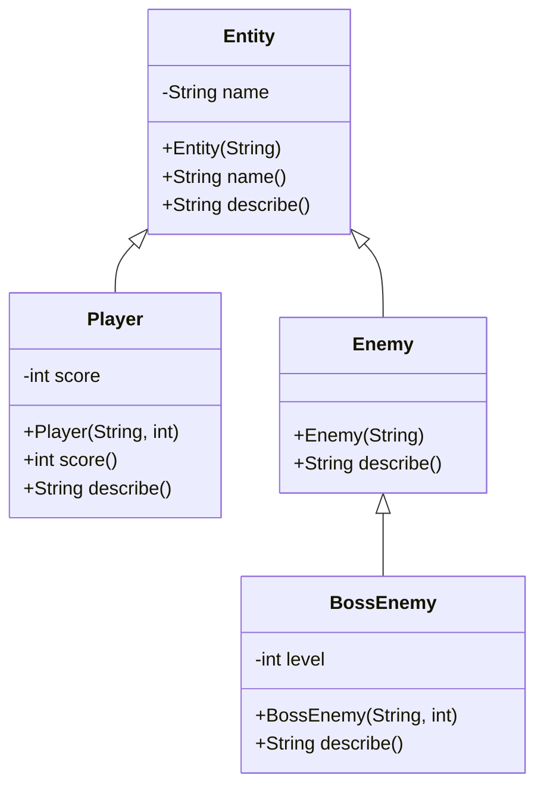
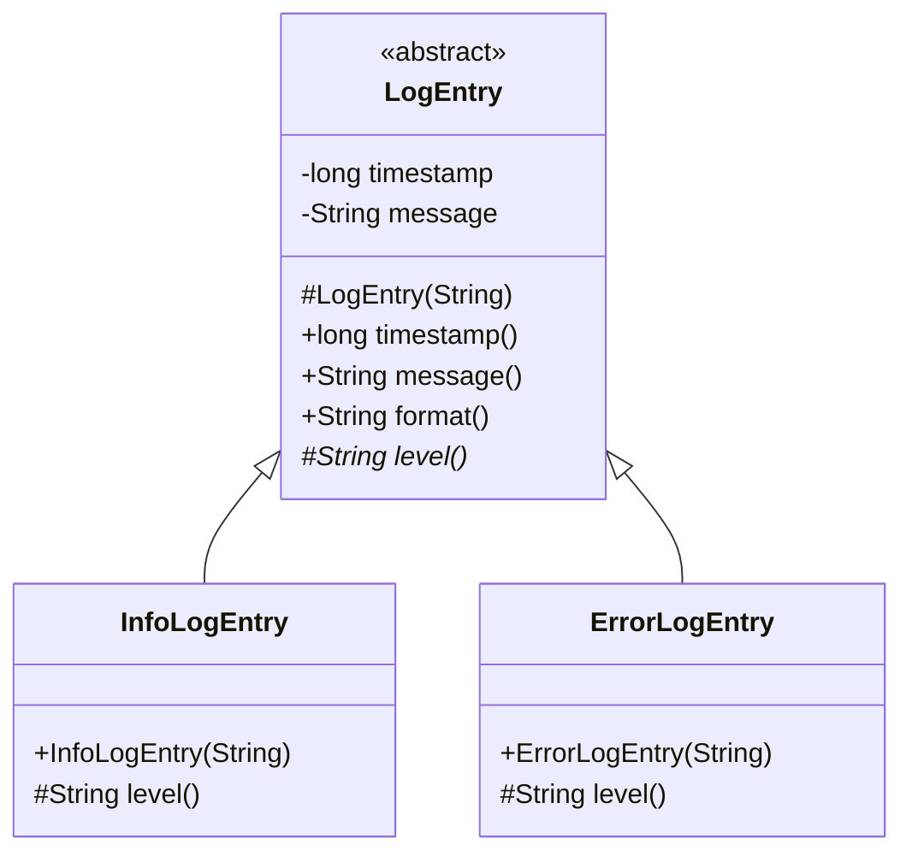

# Inheritance

> **Prerequisites:**
> - Understanding of fields, constructors, and methods
> - Experience writing small Java classes
> - Basic use of `ArrayList` and loops
> - Familiarity with `compareTo` / Comparator from earlier lessons

---

---

## In this topic

- [What you'll learn](#what-youll-learn)
- [Why this matters](#why-this-matters)
- [How this builds on previous content](#how-this-builds-on-previous-content)
- [Key terms](#key-terms)
- [Core Ideas / Concepts](#core-ideas--concepts)
- [Progressive coding steps (A then B then C)](#progressive-coding-steps-a-then-b-then-c)
- [Useful snippets (guards and helpers)](#useful-snippets-guards-and-helpers)
- [Games Example](#games-example)
- [Software Development Example](#software-development-example)
- [Common mistakes](#common-mistakes)
- [Debugging and pitfalls](#debugging-and-pitfalls)
- [Practice tasks](#practice-tasks)
- [Reflective questions](#reflective-questions)
- [Further reading](#further-reading)
- [Appendix A — Mermaid diagrams (UML-style)](#appendix-a--mermaid-diagrams-uml-style)

---

## What you'll learn

| Skill Type | You will be able to... |
| :-- | :-- |
| Understand | Explain what inheritance is and when to use it (and when not to). |
| Use | Create subclasses with `extends` and call parent constructors using `super`. |
| Use | Override methods correctly using `@Override`. |
| Analyze | Distinguish clearly between method overriding and overloading. |
| Analyze | Decide when to use an abstract base class instead of a concrete class. |
| Use | Control access and extension with `protected`, `final` and `sealed`. |
| Use | Write `equals` correctly for a class that has subclasses. |
| Use | Check an object's runtime type safely with `instanceof` pattern matching. |
| Evaluate | Choose composition (has-a) instead of inheritance when behaviour must change at runtime. |
| Debug | Identify and fix common inheritance issues (constructor chains, missing overrides, field hiding, overridable calls in constructors, static method hiding). |

---

## Why this matters

Real systems — games and software applications — rarely consist of just one kind of object. You will often have **families of related types** that share some behaviour but differ in details:

- In a **game**, you might have players, enemies, projectiles, pickups, and triggers.
- In **software**, you might have different kinds of users, accounts, documents, or log entries.

Inheritance gives you a way to:

- Put **shared behaviour** in one place (a parent class)
- Create **specialised types** (subclasses) that reuse that behaviour and add their own
- Use **polymorphism**: treat many specific objects as instances of a more general type

Used well, inheritance reduces duplication and makes systems easier to extend. Used poorly, it creates brittle hierarchies that are hard to change. This lesson helps you use inheritance **deliberately and safely**.

---

## How this builds on previous content

- From **[Arrays](../t01_arrays/t01_arrays_notes.md)** and **Collections** ([t05](../t05_collections_1/t05_collections_1_notes.md), [t06](../t06_collections_2/t06_collections_2_notes.md), [t07](../t07_collections_3_set_map/t07_collections_3_set_map_notes.md)) you learned to store and process objects in lists. Now, you’ll store collections of *different but related* objects through a shared parent.
- From **[Ordering (Comparable & Comparator)](../t03_ordering/t03_ordering_notes.md)** you already saw specialisation of behaviour (different comparison rules). Inheritance generalises that idea to whole classes.
- From **[Equality & Hashing](../t04_equality_hashing/t04_equality_hashing_notes.md)** you learned that class structure affects correctness. Here, you’ll see how subclassing impacts behaviour and contracts.

---

## Key terms

### Superclass and subclass

A **subclass** extends a **superclass** and inherits its non-private members. Java allows one superclass per class.

### Overriding

A subclass **overrides** a method by declaring one with the same name and parameters. Java chooses the version from the object's real type at run time.

### Overloading

Two methods **overload** each other when they share a name but differ in parameters. The compiler chooses between them from the declared types.

### Abstract class

An **abstract class** cannot be instantiated. It can hold state and working methods, and can leave some methods for subclasses to implement.

### Sealed class

A **sealed class** lists the only classes allowed to extend it, using `permits`.

### Composition

**Composition** means building a class from objects it holds (has-a), rather than inheriting from a parent (is-a).

---

## Core Ideas / Concepts

> For each core idea, we first explain the concept, then show a short code example, followed by a brief explanation of how the example illustrates the idea.

---

### Core Idea 1 — Basic inheritance with `extends` (the “is-a” relationship)

#### Explanation

Inheritance models an **“is-a”** relationship between classes. A subclass “is a” more specific version of its parent class and therefore:

- Inherits its fields and methods.
- Can add new fields and methods.
- Can override inherited methods to change behaviour.

You should use inheritance when there is a clear, stable “is-a” relationship — e.g. a `Player` **is an** `Entity`, or an `AdminUser` **is a** `User`.

```java
class Entity {
    private String name;

    public Entity(String name) {
        this.name = name;
    }

    public String name() {
        return name;
    }

    public String describe() {
        return "Entity: " + name;
    }
}

class Player extends Entity {
    private int score;

    public Player(String name, int score) {
        // call Entity(String) constructor
        super(name);
        this.score = score;
    }

    public int score() {
        return score;
    }

    @Override
    public String describe() {
        return "Player " + name() + " (score=" + score + ")";
    }
}
```

#### Snippet explanation

This snippet introduces a simple inheritance hierarchy. `Entity` is the general base class that stores a name and can describe itself. `Player` extends `Entity`, reuses the name handling via `super(name)` and `name()`, and overrides `describe()` to print a more specific message that includes the player’s score.

---

### Core Idea 2 — Method overriding vs method overloading

#### Explanation

Two similar-sounding concepts often cause confusion:

- **Overriding**: A subclass provides a **new implementation** of a method with the **same signature** as in the parent. This is central to polymorphism.
- **Overloading**: A class provides **multiple methods with the same name** but **different parameter lists**. This is about convenience, not polymorphism.

Overriding changes behaviour for inherited methods. Overloading just adds more ways to call a method.

```java
class Enemy extends Entity {

    public Enemy(String name) {
        super(name);
    }

    // Overriding: same name, same parameters, different body
    @Override
    public String describe() {
        return "Enemy: " + name();
    }

    // Overloading: same name "move", different parameter lists
    public void move(int dx, int dy) {
        // move by offsets
    }

    public void move(java.awt.Point p) {
        // move to absolute position
    }
}
```

#### Snippet explanation

Here `Enemy` overrides `describe()` to change how an `Entity` is described when it is specifically an enemy. The two `move` methods illustrate overloading: they share the same name but accept different parameter types. Overriding (`describe`) is what enables polymorphism; overloading (`move`) is just a convenience for callers.

---

### Core Idea 3 — Using `super` to extend parent behaviour

#### Explanation

Sometimes you don’t want to completely replace parent behaviour; you want to **build on it**. The `super` keyword lets you:

- Call the parent constructor.
- Call the parent version of an overridden method.

This is useful when the parent method already does something important (e.g. logging, reuse of formatting) and the subclass wants to add its own extra details.

```java
class BossEnemy extends Enemy {
    private int level;

    public BossEnemy(String name, int level) {
        // calls Enemy(String) then Entity(String)
        super(name);
        this.level = level;
    }

    @Override
    public String describe() {
        // Enemy.describe()
        String base = super.describe();
        return base + " [Boss Level " + level + "]";
    }
}
```

#### Snippet explanation

`BossEnemy` reuses the constructor work already done by `Enemy` (and `Entity`) by calling `super(name)`. In `describe()`, it first calls `super.describe()` to get the enemy description, then appends boss-specific information. This shows how `super` can be used to extend inherited behaviour without duplicating it.

---

### Core Idea 4 — Abstract classes as partially implemented templates

#### Explanation

An **abstract class** acts as a **template** for a set of related types. It lets you:

- Put shared fields and concrete methods in one place.
- Declare **abstract methods** that subclasses must implement.

Use an abstract class when:

- There is a strong “is-a” relationship between subclasses and the base type.
- You want to share implementation details (fields, helper methods).
- You want to enforce that all subclasses implement certain behaviours.

```java
abstract class Weapon {
    private final String id;

    public Weapon(String id) {
        this.id = id;
    }

    public String id() {
        return id;
    }

    // Abstract: subclasses MUST provide an implementation
    public abstract int damage();

    // Concrete: shared behaviour using the abstract method
    public String describe() {
        return id + " (damage=" + damage() + ")";
    }
}

class Sword extends Weapon {

    public Sword(String id) {
        super(id);
    }

    @Override
    public int damage() {
        return 25;
    }
}
```

#### Snippet explanation

`Weapon` defines the shared state (`id`) and a concrete `describe()` method, but leaves `damage()` abstract so each weapon type can decide its own damage. `Sword` is a concrete subclass that provides the `damage()` implementation. When you call `describe()` on a `Weapon` reference, the actual damage value comes from the subclass.

---

### Core Idea 5 — Polymorphism via parent types

#### Explanation

Polymorphism lets you treat different subclasses **through their common parent type**. You can write code that deals with general types (`Entity`, `Weapon`) but actually operates on more specific objects (`Player`, `Enemy`, `Sword`).

This is especially useful when you have:

- Collections of mixed objects that share a base type.
- Generic methods that should work for all subclasses.
- Systems like update loops, rendering, or exporting that operate by calling a single method on many types.

```java
List<Entity> entities = new ArrayList<>();
entities.add(new Player("Zara", 100));
entities.add(new Enemy("Goblin"));
entities.add(new BossEnemy("Dragon", 5));

for (Entity e : entities) {
    System.out.println(e.describe());
}
```

#### Snippet explanation

The `entities` list is typed as `ArrayList<Entity>` but stores different concrete types (`Player`, `Enemy`, `BossEnemy`). Inside the loop, calling `e.describe()` triggers the correct overridden method based on the actual object type, not the reference type. This is core inheritance-based polymorphism.

---

### Core Idea 6 — Controlling access and extension: `protected`, `final` and `sealed`

#### Explanation

A parent class decides two things about its subclasses: **what they can see**, and **whether they can exist at all**.

| Keyword | On a field or method | On a class |
| :-- | :-- | :-- |
| `private` | Visible only inside this class, not to subclasses | n/a |
| `protected` | Visible to subclasses and to the same package | n/a |
| `final` | A field cannot be reassigned; a method cannot be overridden | The class cannot be extended |
| `sealed ... permits` | n/a | Only the listed classes may extend it |

Prefer `private` fields with accessor methods, even in a base class. A `protected` field lets every subclass change the parent's state directly, so the parent can no longer guarantee its own rules, such as "health is never negative". `protected` is most useful on **methods** that subclasses need but outside code should not call.

```java
public abstract class Combatant {
    private int health;

    protected Combatant(int health) {
        this.health = health;
    }

    public final int health() {
        return health;
    }

    // Subclasses may apply damage; outside code must go through takeHit
    protected void reduceHealth(int amount) {
        health = Math.max(0, health - amount);
    }

    public abstract void takeHit(int damage);
}

public final class Knight extends Combatant {
    public Knight() {
        super(120);
    }

    @Override
    public void takeHit(int damage) {
        // Armour halves every hit
        reduceHealth(damage / 2);
    }
}
```

#### Snippet explanation

`health` is `private`, so no subclass can set it to `-50`. Subclasses change it only through the `protected` method `reduceHealth`, which enforces the "never below 0" rule in one place. `health()` is `final`, so no subclass can override it to report a false value. `Knight` is a `final` class: nobody can extend it further. Many classes in the Java library, such as `String` and `Integer`, are `final` for the same reason: their behaviour must not change.

#### Sealed classes: a closed list of subclasses

Since Java 17 you can **seal** a class or interface. Only the classes named after `permits` may extend it, and each of those must itself be `final`, `sealed` or `non-sealed`.

```java
public sealed abstract class Shape permits Circle, Square {
    public abstract double area();
}

public final class Circle extends Shape {
    private final double radius;

    public Circle(double radius) {
        this.radius = radius;
    }

    @Override
    public double area() {
        return Math.PI * radius * radius;
    }
}

public final class Square extends Shape {
    private final double side;

    public Square(double side) {
        this.side = side;
    }

    @Override
    public double area() {
        return side * side;
    }
}
```

#### Snippet explanation

Sealing says "this hierarchy is complete". A `Triangle extends Shape` written elsewhere does not compile. Use it when the set of subtypes is fixed by the problem, for example the four suits of a card, or `Success` and `Failure` results. Leave a class open when other people are meant to add new subtypes, as with `GameEntity` later in these notes.

---

### Core Idea 7 — `Object` is the root: `toString` and `equals` in a hierarchy

#### Explanation

Every class you write extends `Object`, even if you never write `extends`. That is why every object has `toString()`, `equals()` and `hashCode()`: they are inherited from `Object`, and you **override** them, exactly as you overrode `describe()` above.

Subclasses make `equals` harder. In t04 you wrote `equals` for a single class. When subclasses exist, the type check in `equals` matters:

```java
public class Item {
    private final String id;

    public Item(String id) {
        this.id = id;
    }

    @Override
    public boolean equals(Object o) {
        if (this == o) return true;
        // getClass: an Item is never equal to a subclass object, and vice versa
        if (o == null || getClass() != o.getClass()) return false;
        Item other = (Item) o;
        return id.equals(other.id);
    }

    @Override
    public int hashCode() {
        return id.hashCode();
    }

    @Override
    public String toString() {
        return getClass().getSimpleName() + "[" + id + "]";
    }
}

public class EnchantedItem extends Item {
    private final int level;

    public EnchantedItem(String id, int level) {
        super(id);
        this.level = level;
    }

    @Override
    public boolean equals(Object o) {
        // super.equals checks the class and the id
        if (!super.equals(o)) return false;
        return level == ((EnchantedItem) o).level;
    }

    @Override
    public int hashCode() {
        return 31 * super.hashCode() + level;
    }
}
```

#### Snippet explanation

`equals` must be **symmetric**: if `a.equals(b)` is true, `b.equals(a)` must be true too. Suppose `Item.equals` used `o instanceof Item` instead. Then `sword.equals(enchantedSword)` would compare only ids and return `true`, but `enchantedSword.equals(sword)` would return `false`, because a plain `Item` is not an `EnchantedItem`. A `HashSet` holding both would then behave unpredictably.

The rule of thumb:

- If subclasses add fields that take part in equality, use `getClass() != o.getClass()`, as here.
- If the class is `final`, or is a record, `instanceof` is fine, because there can be no subclass. This is the form you used in t04.

`toString` uses `getClass().getSimpleName()`, so it prints `EnchantedItem[...]` for a subclass without the subclass overriding it. That is inheritance doing its job.

---

### Core Idea 8 — Runtime type checks: `instanceof` and casting

#### Explanation

The **reference type** decides which methods you may call; the **object type** decides which implementation runs. Sometimes you hold an `Entity` reference and need a method that only `Player` has. Java 16 and later let you test and cast in one step with **pattern matching**:

```java
for (Entity e : entities) {
    // If e is a Player, bind it to the new variable p, already cast
    if (e instanceof Player p) {
        System.out.println(p.name() + " has " + p.score() + " points");
    }
}

// The old style: test, then cast by hand
if (e instanceof Player) {
    Player p = (Player) e;
}

// A cast with no test compiles, but throws ClassCastException if e is an Enemy
Player wrong = (Player) e;
```

#### Snippet explanation

`e instanceof Player p` is `true` for a `Player` **or any subclass of `Player`**, and inside the `if` the variable `p` has type `Player`. A plain cast `(Player) e` is a promise to the compiler; if the promise is wrong, the program fails at runtime with `ClassCastException`.

Use `instanceof` sparingly. A chain such as "if it is a `Player` do this, else if it is an `Enemy` do that" usually means the behaviour belongs in an overridden method instead. The polymorphic loop in Core Idea 5 needs no type checks at all. Reach for `instanceof` when you genuinely need a subtype-only feature, as in `equals`, or when working with a sealed hierarchy. `obj.getClass().getSimpleName()` is useful for debugging, to see what type is really running.

---

### Core Idea 9 — Composition: when has-a beats is-a

#### Explanation

Inheritance fixes a class's behaviour **at compile time**: a `Sword` is always a `Sword`. **Composition** means a class holds a reference to another object and delegates work to it. That lets the behaviour change **at runtime**, and it avoids deep hierarchies.

Suppose a player can switch weapons. Using inheritance you would need `SwordPlayer`, `BowPlayer`, `StaffPlayer`, and a new class for every combination. With composition the player **has a** weapon:

```java
public class Hero {
    private final String name;
    private Weapon weapon;

    public Hero(String name, Weapon startingWeapon) {
        if (startingWeapon == null)
            throw new IllegalArgumentException("weapon is required");
        this.name = name;
        this.weapon = startingWeapon;
    }

    // Swap behaviour at runtime: no new class needed
    public void equip(Weapon newWeapon) {
        if (newWeapon == null)
            throw new IllegalArgumentException("weapon is required");
        weapon = newWeapon;
    }

    // Delegation: Hero passes the work to whatever Weapon it currently holds
    public int attack() {
        return weapon.damage();
    }

    public String describe() {
        return name + " wielding " + weapon.describe();
    }
}
```

```java
Hero hero = new Hero("Aria", new Sword("IronBlade"));
// prints 25
System.out.println(hero.attack());

// Staff extends Weapon and its damage() returns 15, as in exercise 04
hero.equip(new Staff("OakStaff"));
// prints 15; Hero itself did not change
System.out.println(hero.attack());
```

#### Snippet explanation

`Hero` does not extend `Weapon`; a hero is not a kind of weapon. It holds a `Weapon` field and **delegates** `attack()` to it. `Weapon` is still an inheritance hierarchy (Core Idea 4), because a `Sword` really is a `Weapon`. The two techniques work together: inheritance for genuine is-a families, composition to plug those families into other classes.

| Question | Inheritance | Composition |
| :-- | :-- | :-- |
| Relationship | is-a (`Sword` is a `Weapon`) | has-a (`Hero` has a `Weapon`) |
| When is behaviour fixed? | Compile time | Can change at runtime |
| Coupling | Subclass depends on parent internals | Depends only on the other object's public methods |

**Aggregation** is the looser form of has-a: the parts can exist without the whole. A `Team` has `Player`s, but deleting the team does not delete the players. In strict **composition** the parts belong to the whole: a `Car`'s `Engine` is created by, and lives and dies with, that car. You will see composition again as the Strategy pattern in [t13 Design Patterns I](../t13_design_patterns_1/t13_design_patterns_1_notes.md).

---

## Progressive coding steps (A then B then C)

### Step A — Creating a simple subclass

```java
Entity e = new Entity("Object");
Player p = new Player("Zara", 100);

// Entity: Object
System.out.println(e.describe());
// Player Zara (score=100)
System.out.println(p.describe());
```

#### Snippet explanation

This small demo contrasts the base type (`Entity`) with a subclass (`Player`). Both objects support `describe()`, but the subclass version prints more detailed, player-specific information.

---

### Step B — Using abstract base classes

```java
Weapon sword = new Sword("IronBlade");
// IronBlade (damage=25)
System.out.println(sword.describe());
```

#### Snippet explanation

Here we use the abstract type `Weapon` as the reference, but the actual object is a `Sword`. Calling `describe()` goes through the abstract class method, which in turn calls the overridden `damage()` in `Sword`. This shows that abstract classes can still be used as polymorphic types.

---

### Step C — One polymorphic loop, one subtype-only feature

```java
import java.util.ArrayList;
import java.util.List;

List<Entity> world = new ArrayList<>();
world.add(new Player("Zara", 100));
world.add(new Enemy("Goblin"));
world.add(new BossEnemy("Dragon", 5));

int totalScore = 0;
for (Entity entity : world) {
    // Polymorphism: every entity describes itself
    System.out.println(entity.describe());

    // Only players have a score, so check the runtime type before using it
    if (entity instanceof Player p) {
        totalScore += p.score();
    }
}
// prints 100
System.out.println("Total player score: " + totalScore);
```

#### Snippet explanation

This step combines Core Ideas 5 and 8. The call to `describe()` needs no type check, because every `Entity` has it and each subclass overrides it. Adding up scores is different: only `Player` has `score()`, so the loop uses `instanceof Player p` to test and cast in one step. `BossEnemy` is an `Enemy`, so `entity instanceof Enemy` would be `true` for both the goblin and the dragon.

---

## Useful snippets (guards and helpers)

```java
// Defensive constructor in a base class
public Entity(String name) {
    if (name == null || name.isBlank())
        throw new IllegalArgumentException("name must not be blank");
    this.name = name.trim();
}
```

### Snippet explanation

This constructor guards against invalid names. It ensures that any subclass that calls `super(name)` cannot create an `Entity` with a null or blank name. This kind of defensive logic is often placed in base classes to keep all subclasses safe.

```java
// Null-safe helper for describing entities
public static void safeDescribe(Entity e) {
    if (e != null)
        System.out.println(e.describe());
}
```

### Snippet explanation

`safeDescribe` prevents a potential `NullPointerException` by checking for `null` before calling `describe()`. It’s a small utility that makes code using `Entity` objects more robust, especially when references may be missing.

---

## Games Example

Imagine a simple 2D game with:

- `Player`
- `Enemy`
- `BossEnemy`

All of them can be treated as `GameEntity` in the update loop.

```java
abstract class GameEntity {
    private final String name;

    protected GameEntity(String name) {
        this.name = name;
    }

    public final String name() {
        return name;
    }

    public abstract void update(double dt);
    public abstract void render();
}

class PlayerEntity extends GameEntity {
    public PlayerEntity(String name) {
        super(name);
    }

    @Override
    public void update(double dt) {
        // handle input, movement
    }

    @Override
    public void render() {
        // draw player sprite
    }
}

class EnemyEntity extends GameEntity {
    public EnemyEntity(String name) {
        super(name);
    }

    @Override
    public void update(double dt) {
        // simple AI
    }

    @Override
    public void render() {
        // draw enemy sprite
    }
}

List<GameEntity> gameEntities = new ArrayList<>();
gameEntities.add(new PlayerEntity("Hero"));
gameEntities.add(new EnemyEntity("Slime"));

for (GameEntity ge : gameEntities) {
    ge.update(0.016);
    ge.render();
}
```

### Snippet explanation

`GameEntity` is an abstract base class that requires `update` and `render` methods. Its `name` field is `private` and `final`; subclasses read it through the `final` accessor `name()`, so no subclass can change or misreport an entity's name. The constructor is `protected` because only subclasses should call it. `PlayerEntity` and `EnemyEntity` provide concrete versions of these methods. The `gameEntities` list holds both types, and the game loop treats them uniformly — calling `update` and `render` on each without caring which subclass they are.

---

## Software Development Example

Consider a logging system that writes different types of log entries:

```java
abstract class LogEntry {
    private final long timestamp;
    private final String message;

    protected LogEntry(String message) {
        if (message == null)
            throw new IllegalArgumentException("message is required");
        this.timestamp = System.currentTimeMillis();
        this.message = message;
    }

    public final long timestamp() {
        return timestamp;
    }

    public final String message() {
        return message;
    }

    // Template: the shared layout lives here; subclasses supply only the level
    public final String format() {
        return "[" + level() + "] " + timestamp + " - " + message;
    }

    protected abstract String level();
}

class InfoLogEntry extends LogEntry {
    public InfoLogEntry(String message) {
        super(message);
    }

    @Override
    protected String level() {
        return "INFO";
    }
}

class ErrorLogEntry extends LogEntry {
    public ErrorLogEntry(String message) {
        super(message);
    }

    @Override
    protected String level() {
        return "ERROR";
    }
}

public static void writeAll(List<LogEntry> logs) {
    for (LogEntry log : logs) {
        System.out.println(log.format());
    }
}
```

### Snippet explanation

`LogEntry` holds **everything** the entry types share: the timestamp, the message, and the layout of a formatted line. Each subclass supplies only what differs, its level, through the abstract method `level()`. An earlier version of this example gave each subclass its own `message` field and its own copy of the format string; that is exactly the duplication inheritance exists to remove. If a field or method appears in every subclass, move it up.

`format()` is `final`, so a subclass cannot break the shared layout, and `level()` is `protected`, because only `format()` needs to call it. A `final` method in the parent that calls an abstract method in the child is called the **Template Method** pattern. The `writeAll` method uses the base type `LogEntry` and can print any subclass without needing `if`-`else` chains.

---

## Common mistakes

| Mistake | What happens | Fix |
| :- | :- | :- |
| Inheriting only to reuse a method | The subclass gains every other parent method too, including ones that make no sense for it | Hold the other class in a field instead |
| Long `instanceof` chains over subclasses | Every new subclass means editing each chain | Move the behaviour into an overridden method |
| `protected` fields used everywhere | Subclasses can break the parent's rules without going through its checks | Keep fields `private` and offer `protected` methods |
| Copying parent logic into an override | A later fix to the parent misses the copy | Call `super.method()` and add only what differs |

---

## Debugging and pitfalls

| Pitfall | Why it happens | How to fix / avoid |
| :-- | :-- | :-- |
| Missing `@Override` | Method signature doesn’t match parent method, so it *doesn’t* override | Always use `@Override` on overridden methods to let the compiler catch mistakes. |
| Field hiding (`int x` in parent and child) | Subclass redeclares a field with same name; parent field still exists but is hidden | Don’t reuse field names; use getters/setters or `protected` fields if access is needed. |
| Forgetting `super(...)` | Parent constructor with parameters is never called | Ensure subclass constructors call `super(...)` **first** when the parent has no no-arg constructor. |
| Overusing inheritance | Classes are not truly in an “is-a” relationship | Prefer composition (e.g. `has-a` relationship) or interfaces for shared behaviour without deep hierarchies. |
| Confusion about reference vs object type | Expecting subclass-only methods on a parent reference | Remember: reference type controls which methods you can call; object type controls which implementation runs. |
| Calling an overridable method from a constructor | The parent constructor runs first, so the subclass override runs before the subclass's own fields are set | Call only `private` or `final` methods from a constructor. |
| Expecting a `static` method to be overridden | Static methods belong to the class, not the object; a subclass method with the same signature **hides** it, and the reference type picks which runs | Do not put `@Override` on static methods; make polymorphic behaviour an instance method. |
| Expecting overloads to be picked by runtime type | The compiler chooses an overload from the **declared** argument types; only overriding is decided at runtime | Overload on clearly different parameter types, or use one overridden method. |
| `ClassCastException` at runtime | A cast such as `(Player) e` was made without checking the object's type | Test with `if (e instanceof Player p)` before using subtype-only methods. |
| `equals` that uses `instanceof` in a non-final class with subclasses | Equality becomes non-symmetric: `a.equals(b)` and `b.equals(a)` disagree | Use `getClass() != o.getClass()`, or make the class `final`. |

### Two pitfalls in code

**An overridable call in a constructor.**

```java
class Base {
    Base() {
        // Runs before Derived's field initialiser
        init();
    }

    void init() { }
}

class Derived extends Base {
    private String label = "ready";

    @Override
    void init() {
        // prints null: label has not been assigned yet
        System.out.println(label);
    }
}

new Derived();
```

Java builds an object from the top down: the `Base` constructor runs to completion **before** `Derived` assigns its fields. `init()` is dynamically dispatched to the `Derived` version, which sees `label` while it is still `null`. If `init()` had called `label.length()`, the result would be a `NullPointerException` with no obvious cause.

**A static method is hidden, not overridden.**

```java
class Animal {
    static String kind() { return "animal"; }
    String sound() { return "..."; }
}

class Dog extends Animal {
    static String kind() { return "dog"; }
    @Override String sound() { return "woof"; }
}

Animal a = new Dog();
// prints woof: instance method, chosen by the object type at runtime
System.out.println(a.sound());
// prints animal: static method, chosen by the reference type at compile time
System.out.println(a.kind());
```

Only instance methods are polymorphic. Calling a static method through an object reference compiles, but it is misleading; write `Animal.kind()` or `Dog.kind()` so the class doing the work is visible.

---

## Practice tasks

1. Create `Shape` with an abstract `area()` method, and `Circle` and `Rectangle` subclasses. Print the total area of a `List<Shape>`.
2. Remove `@Override` from one of your methods and misspell its name. What does the program do, and what does the compiler say once you put `@Override` back?
3. Rewrite `class Stack extends ArrayList` so that `Stack` holds a list instead. Which methods can callers no longer misuse?

For step-by-step practice with worked solutions, see the [t08 exercises](exercises/t08_inheritance_exercises.md).

---

## Reflective questions

- When is inheritance the right tool, and when might composition or interfaces be a better choice?
- Think of an example from your own code or a game you enjoy — what might the inheritance hierarchy look like there?
- How would you refactor a deeply nested (3–4 levels) inheritance chain to make it easier to maintain?
- If you introduced a new subclass and something stopped working as expected, what would be your first three debugging steps?
- `Item` uses `instanceof` in its `equals`, and `EnchantedItem extends Item` adds a `level` field. Why might a `HashSet<Item>` behave strangely?

<details style="background:#f5f7ff; border:1px solid rgba(0,0,0,0.15); border-radius:10px;
padding:0.9rem 1rem; margin:1rem 0;">
  <summary style="cursor:pointer; font-weight:800; margin:0;">
    Check your thinking
  </summary>

**When inheritance is the right tool.**
Apply the **is-a** test, and be strict about it: `Dog` *is an* `Animal`, so inheritance fits. `Car` *has an* `Engine` — that is composition, and modelling it as `Car extends Engine` is the classic beginner error.

Use inheritance when subclasses genuinely share **state and implementation** and the relationship is permanent. Prefer **interfaces** when you only need to share a *contract* — many unrelated classes can be `Drawable` without sharing any fields, and a class can implement several interfaces but extend only one class. Prefer **composition** when behaviour should be swappable at runtime; `Player` holding a `WeaponBehaviour` field lets the weapon change mid-game, which `extends` can never do. That is the Strategy pattern in [t13](../t13_design_patterns_1/t13_design_patterns_1_notes.md).

The blunt heuristic: inheritance couples subclass to superclass permanently and at compile time. Take that cost only for a real is-a relationship where shared implementation is the point.

**Sketching a hierarchy.**
A good answer names a *shared abstraction* with real common state, not a category label. For a game: `Entity` (id, position, health) then `Character` (inventory) then `Player` / `Enemy`. The test at each level is whether the parent holds fields and behaviour that *every* child genuinely needs. If a subclass inherits a field it never uses, or has to override a method to throw `UnsupportedOperationException`, the abstraction is wrong — that override is the loudest possible signal that the child is not really a kind of the parent.

**Refactoring a 3–4 level chain.**
Deep chains hurt because behaviour is smeared across four files and changing level 2 can break level 4 invisibly. Practical moves, cheapest first:

1. **Flatten** — if a middle class adds almost nothing, delete it and merge its members upward.
2. **Replace a level with composition** — turn the varying behaviour into an injected object (`Strategy`) instead of a subclass. This usually collapses several sibling classes into one class plus several small strategies.
3. **Extract an interface** — if a level exists only to promise a capability, make it an interface and let classes implement it independently.
4. **Favour a shallow, wide hierarchy** — one abstract base and many direct children beats a four-deep chain almost every time.

**First three debugging steps for a misbehaving new subclass.**

1. **Check the override is real.** Add `@Override` to the method. If it does not compile, you have *overloaded* rather than overridden — a different parameter list, so the parent version keeps running. This is the single most common cause and the annotation finds it instantly.
2. **Check the constructor chain.** Does the subclass call `super(...)` with the right arguments? A parent field left at its default (`null`, `0`) because the subclass silently invoked a no-arg parent constructor produces a `NullPointerException` far from the real cause.
3. **Check what type is actually running.** Print `obj.getClass().getSimpleName()` or breakpoint the method. Confirm the object really is the new subclass, and that the parent method you expected to be reused is not being shadowed by a **field** — fields are resolved by the *declared* type, not the runtime type, and unlike methods they are not polymorphic. That asymmetry catches people out.

**`instanceof` in `equals` with a subclass.**
`sword.equals(enchanted)` asks "is `enchanted` an `Item` with the same id?", and the answer is yes. `enchanted.equals(sword)` asks "is `sword` an `EnchantedItem` with the same id and level?", and the answer is no. Equality is no longer symmetric, so whether a set treats the two as duplicates depends on which one was added first. Use `getClass() != o.getClass()` in a class that has subclasses adding fields, as in Core Idea 7, or make the class `final`.

</details>

---

## Further reading

- **Oracle Java Tutorials: Inheritance**
  <https://docs.oracle.com/javase/tutorial/java/IandI/subclasses.html>
  The official walkthrough of subclasses, overriding and `super`.

---

## Appendix A — Mermaid diagrams (UML-style)



**Diagram description**
`Entity` is the base class, holding a private `name` field, a constructor, a `name()` accessor and a `describe()` method. `Player` and `Enemy` both extend `Entity`. `Player` adds a `score` field and a `score()` accessor, and both override `describe()` with their own implementation. `BossEnemy` extends `Enemy`, not `Entity` directly: it adds a `level` field and overrides `describe()`, calling `super.describe()` to reuse the enemy text.



**Diagram description**
`LogEntry` is an **abstract** base class. It holds the `timestamp` and the `message`, and its `final` method `format()` builds the output line by calling the abstract, `protected` method `level()`. `InfoLogEntry` and `ErrorLogEntry` both extend it. Neither adds a field; each only supplies `level()`, returning `"INFO"` or `"ERROR"`.

---

## Lesson Context

```yaml
previous_lesson:
  topic_code: t07_collections_3_set_map
  domain_emphasis: Balanced

this_lesson:
  topic_code: t08_inheritance
  primary_domain_emphasis: Balanced
  difficulty_tier: Intermediate
mlos: [MLO2]
```
