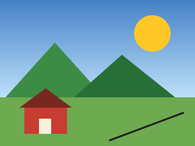
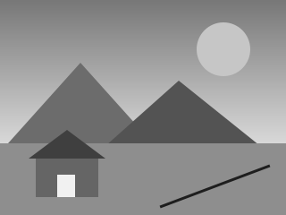
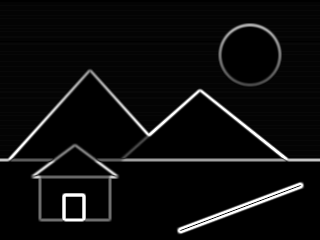
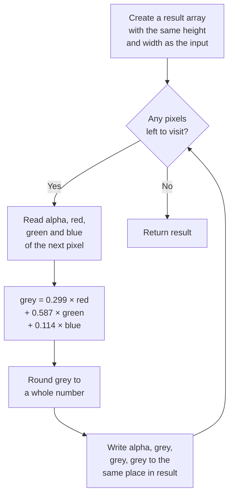
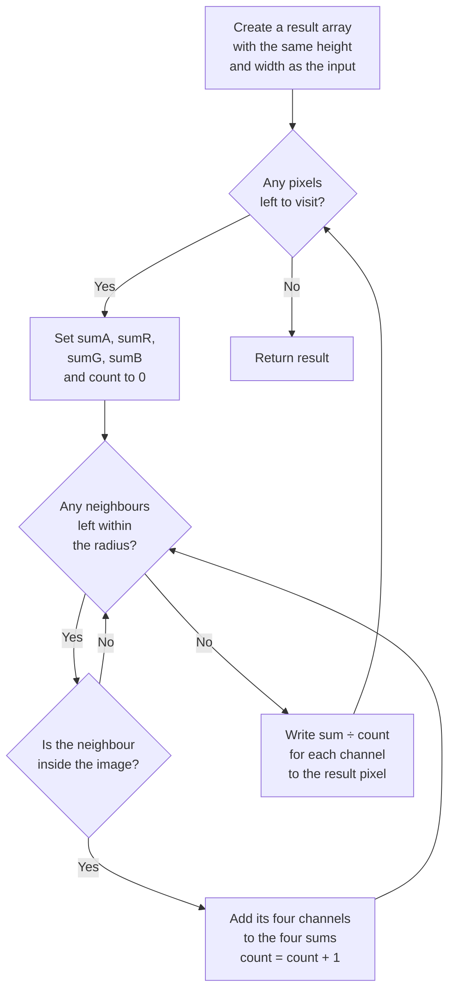
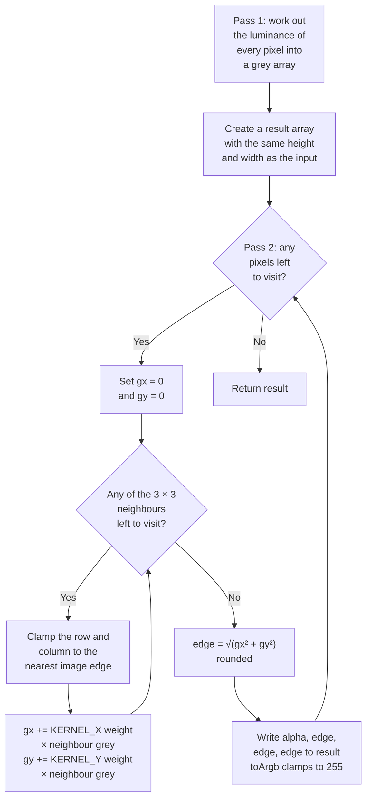
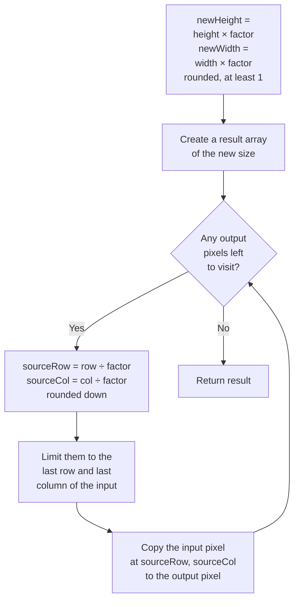

# Supplement — Image Filters Behind One Interface

> **Context:**
> This note extends [t09_interface_notes.md](t09_interface_notes.md). Read it after Core Ideas 3 to 7. It applies the same idea as the `TextFilter` pipeline in exercise 08, but to pictures: every filter has one method, `filter`, and a `List` of filters runs them in order.

---

## What you'll learn

| Skill Type | You will be able to... |
| :- | :- |
| Understand | Describe an image as a 2D `int` array of pixels, and read the red, green, blue and alpha channels of one pixel. |
| Apply | Write classes that implement `IImageFilter` and return a new filtered array. |
| Apply | Load a PNG into an array and save an array as a PNG with `ImageHelper`. |
| Apply | Put several filters in a `List<IImageFilter>` and apply them in order. |
| Analyse | Explain why `applyFilter` never changes when you add a new filter class. |

---

## Why this matters

A photo app offers dozens of filters. The code that runs them does not know about any one filter. It only knows that each filter takes an image and returns an image. That is exactly what an interface describes.

In this supplement you build four filters and one loop that runs them:

| Original | Greyscale | Box blur | Sobel edges |
| :-: | :-: | :-: | :-: |
|  |  |  |  |

Each picture is the output of the filter on the picture to its left. These pictures use the drawn test image [`input.png`](../../../code/data/t09_image_filters/input.png), which the exercises also use. The demo in Step 8 uses photographs instead.

---

## The code for this supplement

All the code is in [`code/src/t09_interface/demos/de01`](../../../code/src/t09_interface/demos/de01/):

| File | Role |
| :- | :- |
| [IImageFilter.java](../../../code/src/t09_interface/demos/de01/IImageFilter.java) | The interface: one abstract method and one default method |
| [ImageProcessor.java](../../../code/src/t09_interface/demos/de01/ImageProcessor.java) | Runs a list of filters over an image, in order |
| [ImageHelper.java](../../../code/src/t09_interface/demos/de01/ImageHelper.java) | Reads and writes PNG files, and reads and packs pixel channels |
| [GreyscaleFilter.java](../../../code/src/t09_interface/demos/de01/GreyscaleFilter.java) | Turns every pixel grey |
| [BoxBlurFilter.java](../../../code/src/t09_interface/demos/de01/BoxBlurFilter.java) | Averages each pixel with its neighbours |
| [SobelFilter.java](../../../code/src/t09_interface/demos/de01/SobelFilter.java) | Finds edges |
| [ScaleFilter.java](../../../code/src/t09_interface/demos/de01/ScaleFilter.java) | Makes the image bigger or smaller |
| [Demo.java](../../../code/src/t09_interface/demos/de01/Demo.java) | Loads a PNG by file name, runs three filters from a list, saves each step |

The tests are in [ImageFiltersTest.java](../../../code/test/t09_interface/demos/de01/ImageFiltersTest.java). The demo reads PNG files from [`code/data/t09_image_filters/images/`](../../../code/data/t09_image_filters/images/), and the exercises read [`code/data/t09_image_filters/input.png`](../../../code/data/t09_image_filters/input.png).

---

## Step 1 — An image is a 2D array of pixels

A PNG image is a grid of pixels. In this supplement the grid is an `int[][]`, indexed `pixels[row][col]`. Row 0 is the top of the image, and column 0 is the left edge. So `pixels.length` is the height and `pixels[0].length` is the width.

Each pixel is one `int` that holds four channels, each from 0 to 255:

| Channel | Meaning |
| :- | :- |
| alpha | How opaque the pixel is. 0 is fully transparent, 255 is fully opaque. |
| red | How much red light |
| green | How much green light |
| blue | How much blue light |

This layout is called **ARGB**. The four channels share the 32 bits of the `int`, 8 bits each. You do not need to work with the bits yourself. `ImageHelper` gives you one method to read each channel and one method to pack four channels back into a pixel:

```java
int pixel = pixels[row][col];
int red = ImageHelper.red(pixel);       // 0 to 255
int green = ImageHelper.green(pixel);
int blue = ImageHelper.blue(pixel);
int alpha = ImageHelper.alpha(pixel);

// Pack four channels into one pixel. Values below 0 become 0, values above 255 become 255.
int newPixel = ImageHelper.toArgb(alpha, red, green, blue);
```

### Snippet explanation

`toArgb` clamps each value into the 0 to 255 range. A filter can do arithmetic that goes past 255, such as the Sobel filter in Step 6, and still produce a valid pixel.

---

## Step 2 — The interface

```java
public interface IImageFilter {

    /** Returns a new filtered image. The input array is not changed. */
    int[][] filter(int[][] pixels);

    /** A short name for this filter, used in output file names. */
    default String name() {
        return getClass().getSimpleName();
    }
}
```

### Snippet explanation

The interface has two methods, of two kinds from the t09 notes:

- `filter` is abstract. Every filter class must write it. This is the contract: an image goes in, a new image comes out.
- `name` is a **default method** ([Core Idea 7](t09_interface_notes.md#core-idea-7--default-methods-behaviour-with-a-fallback)). Every filter gets it for free, and it returns the class name, for example `"GreyscaleFilter"`. A filter with a setting can override it, as `BoxBlurFilter` does to return `"BoxBlurFilter_r1"`.

The interface says only what one filter does. Running a whole list of filters is a separate job, so it lives in a separate class, `ImageProcessor`, in [Step 8](#step-8--the-demo-one-filter-per-image-then-two-in-series).

The `I` at the start of `IImageFilter` is a naming style that marks the type as an interface. The Java API does not use it (it has `List`, not `IList`), but many C# and game codebases do. Either style is fine if a project uses it everywhere.

> [!IMPORTANT]
> `filter` must return a **new** array and must not change the array it receives. Code that uses a filter may keep the original image and pass it to another filter later, as exercise 14 does. If a filter wrote into its input, the second filter would see a changed picture.

---

## Step 3 — `ImageHelper`: from PNG to array and back

`ImageHelper` is a utility class: it has only `static` methods and a `private` constructor, so nobody creates an `ImageHelper` object. It uses two classes from the JDK: `ImageIO` reads and writes image files, and `BufferedImage` holds an image in memory.

```java
public static int[][] readPng(String path) throws IOException {
    BufferedImage image = ImageIO.read(new File(path));
    if (image == null) {
        throw new IOException("Not a readable image: " + path);
    }

    int height = image.getHeight();
    int width = image.getWidth();
    int[][] pixels = new int[height][width];
    for (int row = 0; row < height; row++) {
        for (int col = 0; col < width; col++) {
            // getRGB takes x (column) first, then y (row)
            pixels[row][col] = image.getRGB(col, row);
        }
    }
    return pixels;
}
```

### Snippet explanation

`getRGB` returns one pixel as an ARGB `int`, which is the format Step 1 describes. Watch the argument order. `BufferedImage` uses `(x, y)`, which is `(col, row)`, but the array uses `[row][col]`. Swapping them is the most common bug in image code. On a square image you do not notice. On a wide image you get an `ArrayIndexOutOfBoundsException`.

`writePng` does the same loop the other way: it creates a `BufferedImage` of the array's size, copies each pixel in with `setRGB(col, row, pixel)`, makes any missing folders, and calls `ImageIO.write(image, "png", file)`. See [ImageHelper.java](../../../code/src/t09_interface/demos/de01/ImageHelper.java) for the full method.

Both methods declare `throws IOException`, because the file can be missing, locked or not an image. You do not need to know how exceptions work yet. For now, call these methods inside a `try` block, as the demo does in Step 8. [t10 Exception Handling](../t10_exception_handling/t10_exception_handling_notes.md) covers `try`, `catch` and `throws` properly.

---

## Step 4 — `GreyscaleFilter`

The simplest filter changes each pixel on its own and does not look at its neighbours.

The diagram shows the algorithm. The loop visits every pixel once, and each result pixel depends only on the same input pixel.



In Java:

```java
public class GreyscaleFilter implements IImageFilter {

    @Override
    public int[][] filter(int[][] pixels) {
        int height = pixels.length;
        int width = pixels[0].length;
        int[][] result = new int[height][width];

        for (int row = 0; row < height; row++) {
            for (int col = 0; col < width; col++) {
                int pixel = pixels[row][col];
                int grey = luminance(pixel);
                result[row][col] = ImageHelper.toArgb(ImageHelper.alpha(pixel), grey, grey, grey);
            }
        }
        return result;
    }

    /** Returns the brightness of one pixel, 0 to 255. */
    public static int luminance(int pixel) {
        double grey = 0.299 * ImageHelper.red(pixel)
                + 0.587 * ImageHelper.green(pixel)
                + 0.114 * ImageHelper.blue(pixel);
        return (int) Math.round(grey);
    }
}
```

### Snippet explanation

A pixel is grey when its red, green and blue values are equal. A plain average `(r + g + b) / 3` works, but it looks wrong, because the eye sees green as much brighter than blue. The weights 0.299, 0.587 and 0.114 come from the ITU-R BT.601 video standard and match how bright each colour looks. The filter keeps the original alpha, so transparent areas stay transparent.

Every filter in this supplement has the same shape: read the size, make a new array, fill it with two nested loops, return it. Only the work inside the loop changes.

---

## Step 5 — `BoxBlurFilter`

A blur replaces each pixel with the average of the pixels around it. The "box" is a square of side `2 * radius + 1`, so a radius of 1 averages a 3 x 3 square of 9 pixels.

The diagram shows the algorithm. For each pixel, an inner loop visits every neighbour in the box and skips any that fall outside the image.



In Java:

```java
private int averageAround(int[][] pixels, int row, int col) {
    int sumA = 0;
    int sumR = 0;
    int sumG = 0;
    int sumB = 0;
    int count = 0;

    for (int r = row - radius; r <= row + radius; r++) {
        for (int c = col - radius; c <= col + radius; c++) {
            if (r < 0 || r >= pixels.length || c < 0 || c >= pixels[0].length) {
                continue;
            }
            int pixel = pixels[r][c];
            sumA += ImageHelper.alpha(pixel);
            sumR += ImageHelper.red(pixel);
            sumG += ImageHelper.green(pixel);
            sumB += ImageHelper.blue(pixel);
            count++;
        }
    }
    return ImageHelper.toArgb(sumA / count, sumR / count, sumG / count, sumB / count);
}
```

### Snippet explanation

The bounds check is the t01 pattern. A pixel in the corner has only 4 neighbours inside the image (itself included), not 9, so the method counts only the pixels it adds and divides by `count`. Without the check, the first corner pixel throws `ArrayIndexOutOfBoundsException`.

Unlike `GreyscaleFilter`, this class has a setting. The radius goes in through the constructor and is stored in a `private final int radius` field, so `new BoxBlurFilter(1)` and `new BoxBlurFilter(3)` are two different filters of the same class. The constructor rejects a radius below 1 with `IllegalArgumentException`.

> [!WARNING]
> Read from `pixels`, write to `result`. If the blur wrote each average back into `pixels`, the next pixel would average values that are already blurred, and the blur would smear to the right and down.

---

## Step 6 — `SobelFilter`

Sobel edge detection finds places where brightness changes sharply. It works on brightness only, so it first works out one grey value per pixel with `GreyscaleFilter.luminance`.

The diagram shows the algorithm. It has two passes: one works out the brightness of every pixel, and the second measures how fast the brightness changes around each pixel.



For each pixel it then multiplies the 3 x 3 grey values around it by two small grids of weights, called **kernels**, and adds up the results:

```java
private static final int[][] KERNEL_X = {
    {-1, 0, 1},
    {-2, 0, 2},
    {-1, 0, 1}
};

private static final int[][] KERNEL_Y = {
    {-1, -2, -1},
    {0, 0, 0},
    {1, 2, 1}
};
```

`KERNEL_X` gives a large value `gx` when the right side is brighter or darker than the left side, which is a vertical edge. `KERNEL_Y` gives a large `gy` for a horizontal edge. The edge strength is the length of the vector `(gx, gy)`:

```java
int edge = (int) Math.round(Math.sqrt(gx * gx + gy * gy));
```

### Snippet explanation

In a flat area, the negative and positive weights cancel out and `edge` is 0 (black). On a sharp black-to-white edge, `edge` can reach about 1,000. `toArgb` clamps it to 255 (white). At the image border the filter uses the nearest edge pixel again, so it does not need a bounds check inside the kernel loop. See [SobelFilter.java](../../../code/src/t09_interface/demos/de01/SobelFilter.java) for the full method.

The blur in the demo runs before Sobel on purpose. Blurring first removes small noise, so Sobel marks the outlines of shapes rather than every speck.

---

## Step 7 — `ScaleFilter`

`ScaleFilter(0.5)` halves each side of the image, and `ScaleFilter(2.0)` doubles it. Each output pixel copies the nearest input pixel, which is called **nearest-neighbour** scaling.

The diagram shows the algorithm. Unlike the other filters, it loops over the **output** pixels, and works backwards to the input pixel each one copies.



In Java:

```java
for (int row = 0; row < newHeight; row++) {
    int sourceRow = Math.min(height - 1, (int) (row / factor));
    for (int col = 0; col < newWidth; col++) {
        int sourceCol = Math.min(width - 1, (int) (col / factor));
        result[row][col] = pixels[sourceRow][sourceCol];
    }
}
```

### Snippet explanation

This is the only filter that returns an array of a different size. That is allowed: the contract says "an image goes in, a new image comes out", and says nothing about the size. Any code that reads the size from `pixels.length` and `pixels[0].length`, as every filter here does, works on the result. Code that assumes the size never changes does not.


---

## Step 8 — The demo: one filter per image, then two in series

The demo reads PNG files from the image folder, `code/data/t09_image_filters/images/`. That folder holds six test images from the [USC-SIPI Image Database](https://sipi.usc.edu/database/): `airplane.png`, `airport.png`, `jelly_beans.png`, `peppers.png`, `sailboat.png` and `woman.png`. Their sources are in [SOURCES.md](../../../code/data/t09_image_filters/images/SOURCES.md). To process your own picture, save it as a PNG in the same folder.

The demo does two things. First it applies **one** filter to each of four images. Then it applies **two** filters, one after the other, to a fifth image.

### One filter per image

```java
// One filter per image. Four different classes go through the same parameter type.
applyFilter(new GreyscaleFilter(), "woman.png");
applyFilter(new BoxBlurFilter(3), "peppers.png");
applyFilter(new SobelFilter(), "airplane.png");
applyFilter(new ScaleFilter(0.25), "airport.png");
```

`applyFilter` loads one image, applies one filter and saves the result:

```java
public static void applyFilter(IImageFilter filter, String fileName) {
    String inputPath = IMAGE_FOLDER + fileName;
    String baseName = fileName.replaceFirst("(?i)\\.png$", "");
    String outputPath = OUTPUT_FOLDER + baseName + "_" + filter.name() + ".png";

    try {
        int[][] pixels = ImageHelper.readPng(inputPath);
        int[][] result = filter.filter(pixels);
        ImageHelper.writePng(result, outputPath);
        System.out.println(fileName + ": " + filter.name() + " -> " + outputPath
                + " (" + result[0].length + " x " + result.length + ")");
    } catch (IOException e) {
        System.out.println("Could not process " + inputPath + ": " + e.getMessage());
    }
}
```

### Snippet explanation

The parameter `filter` has the interface type `IImageFilter`, so `applyFilter` accepts an object of any class that implements the interface. The four calls pass four different classes. Inside `applyFilter`, the line `filter.filter(pixels)` calls the `filter` method of the real object: `GreyscaleFilter.filter` on the first call, `BoxBlurFilter.filter` on the second, and so on. That is polymorphism. `applyFilter` itself never names a filter class.

`filter.name()` builds the output file name, for example `peppers_BoxBlurFilter_r3.png`. Each output name starts with the image name, so results from different pictures do not overwrite each other. `applyFilter` is `public`, so you can call it with any filter and any PNG in the image folder, for example `Demo.applyFilter(new GreyscaleFilter(), "jelly_beans.png")`.

### Two filters in series

```java
// Two filters in series: the output of the first is the input of the second
IImageFilter blur = new BoxBlurFilter(2);
IImageFilter edges = new SobelFilter();

int[][] pixels = ImageHelper.readPng(IMAGE_FOLDER + "sailboat.png");
pixels = blur.filter(pixels);
pixels = edges.filter(pixels);

String outputPath = OUTPUT_FOLDER + "sailboat_blur_then_sobel.png";
ImageHelper.writePng(pixels, outputPath);
```

### Snippet explanation

Each `filter` call returns a new array, and the code stores it back in `pixels`. So `edges` works on the blurred image, not the original. The blur runs first on purpose: it removes small detail, so Sobel marks the outlines of shapes rather than every speck. Swap the two lines and the result changes. [Exercise 14](exercises/t09_interface_supplement_image_filters_exercises.md#exercise-14--filter-order) explores this.

Both variables have the type `IImageFilter`, not `BoxBlurFilter` and `SobelFilter`. The code only needs to know that each object can filter an image.

### Running the demo

Run the demo from `Main` (menu option 9, t09s) or by calling `t09_interface.demos.de01.Demo.run()`. IntelliJ runs a program from the project root, but a terminal may run it from the `code` folder. `ImageHelper.dataFolder()` checks both, so the paths work either way. The demo first prints the full path of the image folder and the output folder on your computer. Run from the project root, the output is:

```text
Put the PNG files you want to process in:
  ...\code\data\t09_image_filters\images
Results go in:
  ...\code\data\t09_image_filters\output

woman.png: GreyscaleFilter -> code/data/t09_image_filters/output/woman_GreyscaleFilter.png (256 x 256)
peppers.png: BoxBlurFilter_r3 -> code/data/t09_image_filters/output/peppers_BoxBlurFilter_r3.png (512 x 512)
airplane.png: SobelFilter -> code/data/t09_image_filters/output/airplane_SobelFilter.png (512 x 512)
airport.png: ScaleFilter_x0.25 -> code/data/t09_image_filters/output/airport_ScaleFilter_x0.25.png (256 x 256)
sailboat.png: BoxBlurFilter_r2 then SobelFilter -> code/data/t09_image_filters/output/sailboat_blur_then_sobel.png
```

Your output shows the full path where this example shows `...`. Run from the `code` folder, the paths start with `data/` instead of `code/data/`. Open the output folder to see the results.

### Running a whole list: `ImageProcessor`

The demo applies two filters in series with two lines of code. For a longer list of filters, a loop is neater, and `ImageProcessor` wraps that loop in one static method. `ImageProcessor.applyAll(List.of(blur, edges), pixels)` gives the same result as the two lines in the demo. Like `ImageHelper`, it has a `private` constructor and only `static` methods.

```java
public final class ImageProcessor {

    private ImageProcessor() {
    }

    /** Runs every filter in the list, in order. Each filter gets the previous result. */
    public static int[][] applyAll(List<IImageFilter> filters, int[][] pixels) {
        int[][] result = pixels;
        for (IImageFilter filter : filters) {
            result = filter.filter(result);
        }
        return result;
    }
}
```

### Snippet explanation

`applyAll` takes a `List<IImageFilter>`, so it works with every filter class, including ones written after `ImageProcessor`. An empty list returns the image unchanged. It is the same idea as `TextFilters.applyAll` in t09 exercise 08.

`applyAll` is not in `IImageFilter` on purpose. The interface describes what **one** filter does, and every filter class implements it. Running a list of filters is a different job, so it goes in a different class. A class that implements `IImageFilter` then has only `filter` and `name` to think about.

### The point of the design

To add a fifth filter, you write one new class and pass an object of it to `applyFilter`. You do not change `applyFilter`, `ImageHelper`, `ImageProcessor` or any other filter. The code that runs the filters depends only on the interface, not on any filter class. This is the **Strategy** pattern, which [t13 Design Patterns I](../t13_design_patterns_1/t13_design_patterns_1_notes.md) covers in full.

---

## Common mistakes

| Mistake | What happens | Fix |
| :- | :- | :- |
| Calling `image.getRGB(row, col)` | Wrong pixels, or `ArrayIndexOutOfBoundsException` on a wide image | `BufferedImage` takes `(x, y)`, which is `(col, row)` |
| Writing results back into the input array | Blur smears; the next filter in the list sees a changed image | Create a new `result` array and write only to it |
| Forgetting the bounds check in a neighbourhood loop | `ArrayIndexOutOfBoundsException` on the first edge pixel | Skip, or clamp, any row or column outside the array |
| Dividing by 9 at the edge of a 3 x 3 blur | Dark border around the blurred image | Count the pixels you add and divide by `count` |
| Packing a value above 255 without clamping | Wrong colours, because the extra bits spill into the next channel | Use `ImageHelper.toArgb`, which clamps each channel |
| Setting alpha to 0 by mistake | The PNG looks empty, because every pixel is transparent | Copy the source alpha, or use 255 for opaque |
| Naming a file that is not in the image folder, or a file that is not a PNG | `Could not process .../t09_image_filters/images/...: Can't read input file!` | Put the PNG in the folder the demo prints, and check the spelling of the file name |

---

## Practice tasks

Each task below is a full exercise, with steps, hints, a worked solution and tests, in the [image filters exercise sheet](exercises/t09_interface_supplement_image_filters_exercises.md) (exercises 10 to 19).

1. Write `InvertFilter`, which replaces each channel value `v` with `255 - v` and keeps alpha. Pass an `InvertFilter` to `Demo.applyFilter` and check that nothing else needs to change.
2. Write `ThresholdFilter(int level)`, which makes each pixel black if its luminance is below `level` and white otherwise. Put it after `SobelFilter` so that the output has only pure black and pure white.
3. Write `FlipHorizontalFilter`, which mirrors the image left to right. Which pixel of the input does `result[row][col]` copy?
4. Write `SepiaFilter`. For each pixel, `newRed = 0.393r + 0.769g + 0.189b`, `newGreen = 0.349r + 0.686g + 0.168b`, and `newBlue = 0.272r + 0.534g + 0.131b`. Why does this filter need clamping when greyscale does not?
5. Apply greyscale, blur and Sobel in that order, then in the reverse order. Explain why the results are different.
6. Write a JUnit test for your `InvertFilter`, following the style of [ImageFiltersTest.java](../../../code/test/t09_interface/demos/de01/ImageFiltersTest.java). Use a 1 x 1 image so that you can work out the expected pixel by hand.
7. Write `PixelateFilter(int blockSize)`, which fills each block of `blockSize` x `blockSize` pixels with the colour of its top-left pixel. Make sure the smaller blocks at the right and bottom edges are filled too.
8. Write `Rotate90Filter`, which turns the image a quarter turn clockwise. The result has the width and height swapped. Which input pixel does `result[row][col]` copy?
9. Write `BrightnessFilter(int amount)`, which adds `amount` to the red, green and blue channels. A negative amount darkens the image.
10. Write `PosterizeFilter(int levels)`, which rounds each channel to the nearest of `levels` evenly spaced values. How many different colours are left in the image?

---

## Reflective questions

1. `Demo` passes `GreyscaleFilter`, `BoxBlurFilter`, `SobelFilter` and `ScaleFilter` objects to `applyFilter`, whose parameter has the type `IImageFilter`. What would you have to change in `applyFilter` if the parameter type were `Object`?
2. Why is `name()` a default method rather than an abstract method? When does a filter class need to override it?
3. `applyAll` is a static method in `ImageProcessor`, not a method in `IImageFilter`. Why does running a list of filters not belong in the interface that describes one filter?
4. `ScaleFilter` returns a different-sized array. Which other filters would break if they assumed the size of their input? Which ones are safe, and why?
5. `ImageHelper` has a `private` constructor and only `static` methods. Why does it not implement `IImageFilter`?
