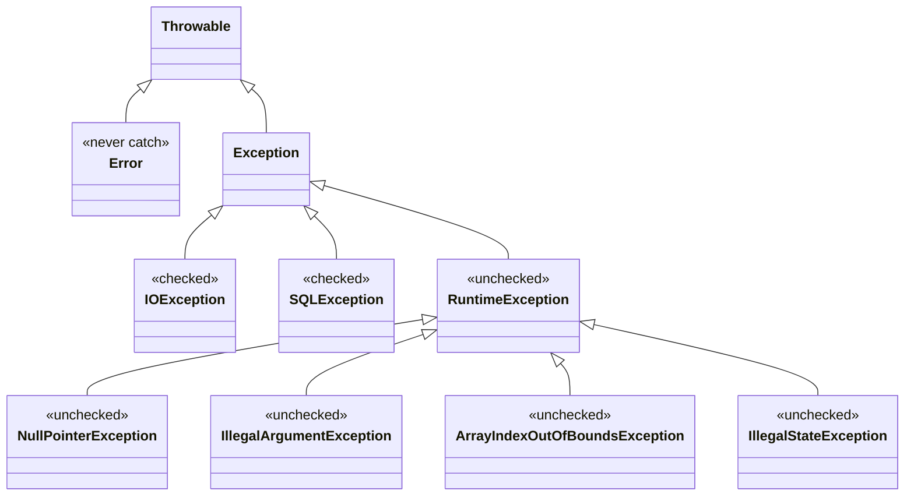

# Exception Handling

> **Prerequisites:**
> - Interfaces: you can read an interface contract
> - Inheritance: you understand `extends` and polymorphism
> - Collections: you can use `ArrayList`, `Map` and basic iteration
> - `Optional`: you can return and read an `Optional<T>` ([t07 Core Idea 6](../t07_collections_3_set_map/t07_collections_3_set_map_notes.md))

---

---

## In this topic

- [What you'll learn](#what-youll-learn)
- [Why this matters](#why-this-matters)
- [How this builds on previous content](#how-this-builds-on-previous-content)
- [Key terms](#key-terms)
- [Core Ideas / Concepts](#core-ideas--concepts)
- [Worked examples](#worked-examples)
- [Common mistakes](#common-mistakes)
- [Debugging and pitfalls](#debugging-and-pitfalls)
- [Practice tasks](#practice-tasks)
- [Reflective questions](#reflective-questions)
- [Further reading](#further-reading)

---

## What you'll learn

A quick summary of what **you** should be able to do after this lesson:

| Skill Type | You will be able to... |
| :-- | :-- |
| Understand | Describe the Java exception hierarchy: `Throwable`, `Error`, `Exception`, `RuntimeException`. |
| Understand | Distinguish checked exceptions (must handle) from unchecked (runtime) exceptions. |
| Use | Write `try`/`catch`/`finally` blocks to handle and recover from errors. |
| Use | Use multi-catch (`catch (A \| B e)`) to reduce repetition. |
| Use | Close resources safely with try-with-resources, including your own `AutoCloseable` classes. |
| Use | Define and throw custom checked and unchecked exception classes. |
| Use | Translate a low-level exception into your own type without losing the cause. |
| Analyse | Decide when to throw, when to catch, when to propagate, and when to return an `Optional` instead. |
| Debug | Read a stack trace, and identify exception anti-patterns: swallowing, over-broad catch, exception as control flow, and a lost cause. |

---

## Why this matters

Programs meet unexpected situations: a file is missing, a user enters invalid input, a network call fails. Without a disciplined approach, the program either crashes with a cryptic stack trace or silently produces wrong results.

Java's exception mechanism gives you:
- a standard vocabulary for describing what went wrong,
- a way to separate normal logic from error-handling logic,
- compile-time enforcement for errors that callers **must** acknowledge.

---

## How this builds on previous content

| Earlier topic | Concept carried forward |
| :- | :- |
| [t00 Guard clauses](../t00_oop_fundamentals/t00_oop_fundamentals_notes.md) | You have been throwing `IllegalArgumentException` since t00 — this topic explains *why* that one, and when a different choice is right |
| [t07 Collections III](../t07_collections_3_set_map/t07_collections_3_set_map_notes.md) | `Optional` already gives you a way to say "not found" without `null`; this topic shows when to use it instead of an exception |
| [t08 Inheritance](../t08_inheritance/t08_inheritance_notes.md) | Exceptions are an inheritance hierarchy, so catching a supertype catches every subtype — which is why catch order matters |
| [t09 Interfaces](../t09_interface/t09_interface_notes.md) | `AutoCloseable` is just an interface; implementing it is what makes a class usable in try-with-resources |

Where this goes next: from here on, almost every topic throws something. [t15 DAO](../t15_dao/t15_dao_notes.md) returns `Optional` for "not found" and wraps `SQLException` for real failures; [t18 Java I/O](../t18_io/t18_io_notes.md) is built on the checked `IOException` and on try-with-resources; and [t22 Networking](../t22_networking/t22_networking_notes.md) depends on an exception never escaping `ClientHandler.run()`.

---

## Key terms

- **Checked exception**: a subclass of `Exception` but not `RuntimeException`; the compiler forces callers to catch it or declare it with `throws`.
- **Unchecked exception**: a subclass of `RuntimeException`; no compiler enforcement.
- **Propagate**: let an exception pass up to the caller, by not catching it (and declaring it with `throws` if it is checked).
- **Cause**: the original exception stored inside a newer one, shown as `Caused by:` in a stack trace.
- **Exception translation**: catching a low-level exception and throwing a higher-level one, with the original as its cause.
- **Suppressed exception**: an exception thrown while closing a resource after another exception had already been thrown; it is attached to the first one rather than replacing it.
- **Stack trace**: the list of method calls that were active when an exception was thrown, most recent first.

---

## Core Ideas / Concepts

> Every exercise for this topic has a worked solution in [code/src/t10_exception_handling](../../../code/src/t10_exception_handling/) and JUnit tests in `code/test/t10_exception_handling/`.

### Core Idea 1 — The Java exception hierarchy

#### Explanation

Every exception in Java descends from `Throwable`, which splits into two branches: `Error` for JVM-level failures, and `Exception` for everything your code should care about. `RuntimeException` is a subclass of `Exception`, and that one relationship is what separates unchecked from checked.



**Diagram description**
`Throwable` is the root of the hierarchy and has two direct subclasses:

- `Error`, for JVM-level failures such as `OutOfMemoryError`. Never catch these.
- `Exception`, which has three subclasses shown here:
  - `IOException` and `SQLException`, which are **checked**: the compiler forces callers to handle or declare them.
  - `RuntimeException`, which is **unchecked**. Its subclasses `NullPointerException`, `IllegalArgumentException`, `ArrayIndexOutOfBoundsException` and `IllegalStateException` are unchecked too.

| Type | Category | What it means |
|:-|:-|:-|
| `Error` | Never catch | JVM-level failure such as `OutOfMemoryError` |
| `IOException` | Checked | File, network or stream failure |
| `SQLException` | Checked | Database failure |
| `RuntimeException` | Unchecked | Programming error, to be fixed rather than caught |
| `NullPointerException` | Unchecked | A method was called on `null` |
| `ArrayIndexOutOfBoundsException` | Unchecked | Index outside the valid range |
| `IllegalArgumentException` | Unchecked | A caller passed an unacceptable value |
| `IllegalStateException` | Unchecked | The object is not in a state where this call makes sense |

#### Snippet explanation

- **Checked exceptions** extend `Exception` but not `RuntimeException`. The compiler forces callers to either handle them or declare them with `throws`.
- **Unchecked exceptions** extend `RuntimeException`. There is no compiler enforcement; they usually indicate programming errors that should be fixed, not caught.
- **Errors** extend `Error`. They represent JVM-level failures. Never catch these.

Your own checked exceptions extend `Exception` directly; your own unchecked ones extend `RuntimeException`.

---

### Core Idea 2 — try / catch / finally

```java
try {
    // NumberFormatException is thrown here, so the println below never runs
    int result = Integer.parseInt("abc");
    System.out.println(result);
} catch (NumberFormatException e) {
    System.out.println("Not a valid number: " + e.getMessage());
} finally {
    // Always runs: use for cleanup that try-with-resources cannot do for you
    System.out.println("Done");
}
```

#### Snippet explanation

- `catch` receives the exception object — use `e.getMessage()` and `e.getClass().getSimpleName()` for useful output.
- `finally` runs whether or not an exception was thrown, and whether or not it was caught.
- `finally` runs even if `catch` rethrows, and even if `try` executes `return`.
- Never `return` from inside `finally`. It silently discards any exception that was on its way out, and overrides any value that `try` returned.

---

### Core Idea 3 — Multiple catch blocks and multi-catch

```java
public static int readInt(String[] args, int index) {
    try {
        return Integer.parseInt(args[index]);
    } catch (ArrayIndexOutOfBoundsException e) {
        System.err.println("No argument at index " + index);
        return 0;
    } catch (NumberFormatException e) {
        System.err.println("Argument is not a number: " + args[index]);
        return 0;
    }
}
```

#### Snippet explanation

- Catch blocks are checked **top to bottom** — put more specific types first.
- A supertype catch (e.g. `catch (Exception e)`) placed first will absorb everything — usually wrong. The compiler rejects a catch block that can never be reached because a supertype above it already catches everything it would.

#### Multi-catch (Java 7+)

```java
try {
    // ...
} catch (NumberFormatException | ArrayIndexOutOfBoundsException e) {
    System.err.println("Input error: " + e.getMessage());
}
```

Use multi-catch when the handling logic is identical and the exception types are unrelated. You cannot list a type together with its own subtype, because the subtype is already covered.

---

### Core Idea 4 — Checked exceptions and throws

#### Explanation

A method that calls code which throws a checked exception must either:
1. **Handle it** with `try`/`catch`, or
2. **Propagate it** by declaring `throws` in the signature.

```java
import java.io.BufferedReader;
import java.io.IOException;
import java.nio.file.Files;
import java.nio.file.Path;
import java.util.Optional;

// Option A: handle it here, and say "no line" in the return type
public static Optional<String> readFirstLine(Path path) {
    try (BufferedReader br = Files.newBufferedReader(path)) {
        return Optional.ofNullable(br.readLine());
    } catch (IOException e) {
        System.err.println("Could not read file: " + e.getMessage());
        return Optional.empty();
    }
}

// Option B: propagate, and let the caller decide
public static String readFirstLineRaw(Path path) throws IOException {
    try (BufferedReader br = Files.newBufferedReader(path)) {
        return br.readLine();
    }
}
```

#### Snippet explanation

Handle an exception where you can **do something useful** about it; otherwise propagate it. Option A suits a method whose caller only wants "a line or nothing". Option B suits a library method: it cannot know whether a missing file should mean "use defaults", "ask the user" or "stop the program", so it lets the caller choose.

---

### Core Idea 5 — try-with-resources and AutoCloseable

#### Explanation

Files, database connections and sockets must be **closed**, even when something goes wrong. Declare them in the brackets after `try`, and Java closes them automatically when the block ends — normally, by `return`, or by exception.

```java
try (BufferedReader in = Files.newBufferedReader(source);
     BufferedWriter out = Files.newBufferedWriter(target)) {
    out.write(in.readLine());
}
// out.close() runs first, then in.close(): reverse order of declaration
```

Any class that implements the `AutoCloseable` interface from t09 can be used this way:

```java
public class AuditLog implements AutoCloseable {
    private final List<String> sink;

    public AuditLog(List<String> sink) {
        this.sink = sink;
        sink.add("opened");
    }

    public void write(String event) {
        sink.add(event);
    }

    @Override
    public void close() {
        sink.add("closed");
    }
}

try (AuditLog log = new AuditLog(events)) {
    log.write("login");
    throw new IllegalStateException("session crashed");
}
// events is now [opened, login, closed]: close ran even though the block threw
```

#### Snippet explanation

Try-with-resources is better than `finally { r.close(); }` for two reasons. It cannot be forgotten. And if `close()` itself throws while another exception is already on its way out, the original exception is kept and the close failure is attached to it as a **suppressed** exception, readable with `e.getSuppressed()`. With a hand-written `finally`, the close failure replaces the original and the real cause is lost. Practice task 07 shows both.

---

### Core Idea 6 — Custom exceptions

#### Unchecked: for domain rules a caller should not break

```java
public class InvalidMoveException extends RuntimeException {

    private final int row;
    private final int col;

    public InvalidMoveException(int row, int col) {
        super("Invalid move at (" + row + ", " + col + ")");
        this.row = row;
        this.col = col;
    }

    public int getRow() { return row; }
    public int getCol() { return col; }
}
```

Throw it:

```java
public void makeMove(int row, int col) {
    if (row < 0 || row >= size || col < 0 || col >= size) {
        throw new InvalidMoveException(row, col);
    }
    // ...
}
```

#### Checked: for failures outside the program's control that the caller must handle

```java
// A settings file that exists but is malformed: the caller must choose a recovery
public class ConfigFormatException extends Exception {

    private final int lineNumber;

    public ConfigFormatException(String message, int lineNumber) {
        super(message + " (line " + lineNumber + ")");
        this.lineNumber = lineNumber;
    }

    public int getLineNumber() { return lineNumber; }
}
```

#### Snippet explanation

A custom exception is worth writing when a caller might want to catch **that** case on its own, or when it carries useful data, such as the row and column, or the line number, as fields. Do not use an exception for "the item you searched for is not there"; that is a normal outcome, and `Optional` (Core Idea 8) expresses it better.

---

### Core Idea 7 — Exception chaining and translation

#### Explanation

Low-level code throws low-level exceptions: `IOException`, `SQLException`, `NumberFormatException`. The layers above should not have to know about files or databases. So a class often **translates** a low-level exception into one of its own types. The rule is to pass the original exception on as the **cause**, so its stack trace is not lost.

```java
public static Map<String, String> load(Path file) throws ConfigException {
    try (BufferedReader reader = Files.newBufferedReader(file)) {
        // ... parse each line ...
        return settings;
    } catch (IOException e) {
        // Translate, and pass e as the cause
        throw new ConfigException("Cannot read settings file " + file, e);
    }
}

public class ConfigException extends Exception {
    public ConfigException(String message, Throwable cause) {
        super(message, cause);
    }
}
```

#### Snippet explanation

Callers of `load` deal with one type, `ConfigException`, whatever went wrong underneath. When the stack trace is printed, Java shows the `ConfigException` and then a `Caused by:` section with the original `IOException`, so the real reason is still visible. `throw new ConfigException("...")` without `e` compiles, but it throws that reason away. Practice task 06 builds the whole loader.

---

### Core Idea 8 — When to throw and when to return Optional

| Situation | Prefer |
| :-- | :-- |
| Caller **must** acknowledge the failure (file unreadable, database down) | Checked exception (`throws`) |
| Programming error — invalid argument, violated invariant | Unchecked (`IllegalArgumentException`, etc.) |
| "Not found" is a normal, expected outcome | `Optional<T>` |
| Error in infrastructure (DB, network) that upper layers handle | Checked exception, or wrap in a domain exception with the cause |
| Validating user input at the boundary | Return `false`/`Optional` or throw a domain `ValidationException` |

The key question is: **is this outcome a failure, or just one of the normal answers?** Looking up an ID that does not exist is a normal answer, so return `Optional.empty()`. Losing the database connection while looking it up is a failure, so throw. A method can need both, as in the software example below.

---

## Worked examples

### Step A — Basic guard with unchecked exceptions

```java
public class BoundedIntStack {

    private final int[] data;
    private int top = 0;

    public BoundedIntStack(int capacity) {
        if (capacity <= 0) {
            throw new IllegalArgumentException("Capacity must be positive, got: " + capacity);
        }
        data = new int[capacity];
    }

    public void push(int value) {
        if (top == data.length) {
            throw new IllegalStateException("Stack is full");
        }
        data[top++] = value;
    }

    public int pop() {
        if (top == 0) {
            throw new IllegalStateException("Stack is empty");
        }
        return data[--top];
    }
}
```

#### Snippet explanation

A bad constructor argument is the caller's mistake, so `IllegalArgumentException`. Popping an empty stack is a call made at the wrong time, so `IllegalStateException`. Both are unchecked: a correct program never triggers them, and the caller should fix the code rather than catch them. In t11 Generics you will see how to make a class like this work for any element type.

---

### Step B — Propagate and handle a checked exception

```java
public interface ConfigLoader {
    Map<String, String> load(Path path) throws IOException;
}

public class FileConfigLoader implements ConfigLoader {
    @Override
    public Map<String, String> load(Path path) throws IOException {
        Map<String, String> config = new LinkedHashMap<>();
        try (BufferedReader br = Files.newBufferedReader(path)) {
            String line;
            while ((line = br.readLine()) != null) {
                String[] parts = line.split("=", 2);
                if (parts.length == 2) {
                    config.put(parts[0].trim(), parts[1].trim());
                }
            }
        }
        return config;
    }
}

// In main or a service:
ConfigLoader loader = new FileConfigLoader();
try {
    Map<String, String> cfg = loader.load(Path.of("settings.properties"));
    System.out.println(cfg);
} catch (IOException e) {
    System.err.println("Config load failed: " + e.getMessage());
}
```

#### Snippet explanation

`FileConfigLoader` propagates; `main` handles. A checked exception declared on an interface method, here `throws IOException` on `ConfigLoader.load`, is part of the contract: every implementation may throw it, and every caller must deal with it.

---

### Step C — Custom exception hierarchy

```java
// Base domain exception
public class GameException extends RuntimeException {
    public GameException(String message) { super(message); }
    public GameException(String message, Throwable cause) { super(message, cause); }
}

// Specific subtypes carry the data a handler needs
public class InvalidMoveException extends GameException {
    private final int row;
    private final int col;

    public InvalidMoveException(int row, int col) {
        super("Invalid move at (" + row + ", " + col + ")");
        this.row = row;
        this.col = col;
    }

    public int getRow() { return row; }
    public int getCol() { return col; }
}

public class GameOverException extends GameException {
    private final String winner;

    public GameOverException(String winner) {
        super("Game over — winner: " + winner);
        this.winner = winner;
    }

    public String getWinner() { return winner; }
}
```

#### Snippet explanation

Callers can catch the base type `GameException` to handle any game error, or catch a specific subtype for targeted recovery. This is the Core Idea 6 `InvalidMoveException`, moved under a shared parent.

---

### Games example: move validation

```java
public class ChessBoard {

    private static final int SIZE = 8;
    private final char[][] board = new char[SIZE][SIZE];

    public void movePiece(int fromRow, int fromCol, int toRow, int toCol) {
        validateCoordinate(fromRow, fromCol, "from");
        validateCoordinate(toRow, toCol, "to");

        // No piece on the starting square
        if (board[fromRow][fromCol] == 0) {
            throw new InvalidMoveException(fromRow, fromCol);
        }

        board[toRow][toCol] = board[fromRow][fromCol];
        board[fromRow][fromCol] = 0;
    }

    private void validateCoordinate(int row, int col, String label) {
        if (row < 0 || row >= SIZE || col < 0 || col >= SIZE) {
            throw new IllegalArgumentException(
                "Coordinate " + label + " (" + row + "," + col + ") out of bounds"
            );
        }
    }
}
```

Usage:

```java
ChessBoard board = new ChessBoard();
try {
    // Row 8 is off the board
    board.movePiece(0, 0, 8, 0);
} catch (IllegalArgumentException e) {
    System.err.println("Bad coordinates: " + e.getMessage());
} catch (InvalidMoveException e) {
    System.err.println("No piece at: (" + e.getRow() + "," + e.getCol() + ")");
}
```

#### Snippet explanation

Two different problems, two different types. Off-board coordinates are a bug in the caller, so the standard `IllegalArgumentException`. An empty starting square is a game-rule violation, so the domain type `InvalidMoveException`, which the UI might catch to show "there is no piece there".

---

### Software example: DAO layer — Optional for "not found", exceptions for real failures

An earlier version of this example made `findById` throw a checked `TaskNotFoundException`, and the service then caught it only to return `Optional.empty()`. That is exception-as-control-flow: the service did the extra work to undo a design choice that should not have been made. "Not found" is a normal answer, so the DAO should say so in its return type. A real storage failure is a different matter.

```java
// Checked: the storage could not be reached; callers must decide what to do
public class DaoException extends Exception {
    public DaoException(String message, Throwable cause) {
        super(message, cause);
    }
}

public interface TaskDao {
    // Empty means "no such task"; an exception means "could not ask"
    Optional<Task> findById(int id) throws DaoException;

    void save(Task task) throws DaoException;
}

public class FileTaskDao implements TaskDao {

    private final Path file;

    public FileTaskDao(Path file) {
        this.file = file;
    }

    @Override
    public Optional<Task> findById(int id) throws DaoException {
        try {
            for (String line : Files.readAllLines(file)) {
                Task task = Task.parse(line);
                if (task.getId() == id) {
                    return Optional.of(task);
                }
            }
            return Optional.empty();
        } catch (IOException e) {
            throw new DaoException("Cannot read tasks from " + file, e);
        }
    }

    @Override
    public void save(Task task) throws DaoException {
        try {
            Files.writeString(file, task.toLine() + System.lineSeparator(),
                    StandardOpenOption.CREATE, StandardOpenOption.APPEND);
        } catch (IOException e) {
            throw new DaoException("Cannot save task " + task.getId(), e);
        }
    }
}

public class TaskService {

    private final TaskDao dao;

    public TaskService(TaskDao dao) { this.dao = dao; }

    public String describeTask(int id) throws DaoException {
        return dao.findById(id)
                .map(task -> "Task " + id + ": " + task.getTitle())
                .orElse("No task with id " + id);
    }
}
```

#### Snippet explanation

The interface separates the two outcomes cleanly. "No such task" comes back as an empty `Optional`, and the service handles it with `orElse` — no `try`/`catch` needed. "Could not read the file" becomes a `DaoException` with the `IOException` as its cause. The service does not know or care that the storage is a file; if `FileTaskDao` is later replaced by a `JdbcTaskDao`, the interface stays the same and the `SQLException` is wrapped in the same way. This is the pattern [t15 DB Connectivity](../t15_dao/t15_dao_notes.md) builds on.

---

## Common mistakes

| Anti-pattern | Problem | Better approach |
| :-- | :-- | :-- |
| `catch (Exception e) {}` — swallowing | Error silently disappears; root cause lost | Handle it properly, or log the exception **object** (so the stack trace survives) and rethrow |
| `catch (Exception e)` — too broad | Catches `NullPointerException`, `IllegalStateException`, every bug | Catch the specific type you can actually handle |
| Exception as control flow | `try { find() } catch (NotFoundException e) { return default; }` | Return `Optional` for expected absence; use `containsKey` for maps |
| Losing the cause | `throw new MyException("message")` inside a `catch` | `throw new MyException("message", e)` — preserves the stack trace chain |
| Closing resources by hand | `finally { r.close(); }` is easy to forget, and a close failure hides the real one | Use try-with-resources |
| `return` inside `finally` | Discards any exception in flight | Never return from `finally` |
| `e.printStackTrace()` as the only handling | The program carries on as if nothing happened | Decide on a recovery, or rethrow |

---

## Debugging and pitfalls

### Reading a stack trace

```text
Exception in thread "main" t10.ConfigException: Cannot read settings file app.cfg
    at t10.SettingsLoader.load(SettingsLoader.java:34)
    at t10.Main.start(Main.java:12)
    at t10.Main.main(Main.java:6)
Caused by: java.nio.file.NoSuchFileException: app.cfg
    at java.base/sun.nio.fs.WindowsException.translateToIOException(...)
    at java.base/java.nio.file.Files.newBufferedReader(Files.java:2922)
    at t10.SettingsLoader.load(SettingsLoader.java:27)
    ... 2 more
```

Read it in this order:

1. **The first line** gives the exception type and message: what went wrong.
2. **The first `at` line in your own code** gives the file and line number where it was thrown. Library lines, such as `java.base/...`, are rarely where the bug is.
3. **The lines below** show who called that method, all the way back to `main`.
4. **`Caused by:`** shows the original exception that was wrapped. The deepest `Caused by:` is usually the real reason. Here, the file `app.cfg` does not exist.

### Quick checks

- **"unreported exception X; must be caught or declared to be thrown"** — you called a method that throws a checked exception. Catch it, or add `throws X` to your method.
- **"exception X has already been caught"** — a catch block for a supertype comes before one for its subtype. Put the more specific type first.
- **A `NullPointerException` far from the real problem** — look for an empty `catch` or a method that returned `null` instead of `Optional` or an exception.

---

## Practice tasks

Work through the [t10 exercises](exercises/t10_exception_handling_exercises.md). Worked solutions are in `code/src/t10_exception_handling/exercises/` and the matching JUnit tests are in `code/test/t10_exception_handling/exercises/`.

---

## Reflective questions

- What is the difference between a checked and an unchecked exception? Give one example of each from the Java standard library.
- When is it appropriate to define your own exception class instead of using a built-in one?
- Why is `catch (Exception e) {}` considered dangerous?
- Should a `findById` method in a DAO throw a checked exception or return an `Optional`? What factors influence the decision?
- How does try-with-resources work, and what interface must a resource implement to use it?
- You catch an `IOException` and throw your own `ConfigException`. What must you pass to its constructor, and why?

<details style="background:#f5f7ff; border:1px solid rgba(0,0,0,0.15); border-radius:10px;
padding:0.9rem 1rem; margin:1rem 0;">
  <summary style="cursor:pointer; font-weight:800; margin:0;">
    Check your thinking
  </summary>

**Checked vs unchecked.**
A **checked** exception extends `Exception` but not `RuntimeException`, and the compiler forces every caller to catch it or declare `throws`. It models a failure that is outside the program's control and that a caller can reasonably be expected to handle — `IOException`, `SQLException`.

An **unchecked** exception extends `RuntimeException` and carries no compiler obligation. It models a **programming error** — something that should be fixed in code rather than handled at runtime: `IllegalArgumentException`, `NullPointerException`, `IndexOutOfBoundsException`.

The distinction is about *who is at fault*. A missing file is the world's fault, so the caller must decide what to do. A null argument is the caller's fault, so it should crash loudly during development.

**When to define your own exception class.**
When the failure is **specific to your domain** and a caller might want to catch *that* case distinctly. `InsufficientFundsException` can be caught on its own; `IllegalArgumentException` cannot be separated from every other bad argument in the call. Custom types also carry structured data — `InsufficientFundsException` can hold the requested amount and the balance as fields rather than burying them in a message string.

Do **not** invent one when a standard exception says the same thing. A null argument is `IllegalArgumentException` (or `NullPointerException`) and wrapping it in `MyNullException` gains nothing while making your API harder to learn. Default to unchecked for domain errors unless the caller genuinely has a recovery path.

**Why `catch (Exception e) {}` is dangerous.**
It is two separate mistakes at once. The **empty body** discards the error entirely: the program continues in an unknown state, and the eventual symptom — corrupt data, a wrong total, a `NullPointerException` three layers away — has no connection to the real cause. Debugging this is miserable because the stack trace pointing at the true failure was thrown away.

The **broad type** compounds it: `Exception` catches `NullPointerException`, `IllegalStateException` and every other bug you did not anticipate, so genuine programming errors are silently swallowed along with the one case you meant to handle. Catch the narrowest type you can actually do something about, and if you must catch broadly, at minimum log with the exception attached (`log(e)` — passing the object, not just `e.getMessage()`, so the stack trace survives) and then rethrow.

**Should DAO `findById` throw or return `Optional`?**
Return `Optional<Task>`. "Not found" is a **normal, expected outcome** of a lookup, not an error — a user typing an ID that does not exist is routine. Exceptions should signal the exceptional; using them for ordinary control flow is slow and makes callers write `try`/`catch` around something that is not a failure. `Optional` also puts the absence in the *type*, so the compiler pushes the caller to handle it, whereas returning `null` invites a `NullPointerException`.

The factors that would change the answer: is absence expected or genuinely exceptional (`findById` on an ID you just inserted *would* be exceptional); can the caller do something useful; and is there a real failure underneath — a dropped database connection is an `SQLException` and must not be flattened into an empty `Optional`. Distinguish "no such row" from "could not ask", exactly as the software example does.

**How try-with-resources works.**
Declare the resource in the parentheses of `try` and Java closes it automatically when the block exits — normally, via `return`, or by exception:

```java
// br.close() runs when the block ends, whatever happened inside it
try (BufferedReader br = Files.newBufferedReader(path)) {
    return br.readLine();
}
```

The resource must implement **`AutoCloseable`** (or `Closeable`, which extends it). Multiple resources are separated by semicolons and closed in **reverse** order of declaration.

It is strictly better than `finally { r.close(); }` for two reasons students usually miss. First, `close()` can itself throw, and in the manual version that second exception **replaces** the original — you lose the real cause. Try-with-resources keeps the original and attaches the close failure as a *suppressed* exception. Second, it cannot be forgotten or misplaced, which is the usual outcome of hand-written cleanup.

**Translating an exception.**
Pass the original exception as the **cause**: `throw new ConfigException("Cannot read " + file, e);`. Your exception class needs a constructor that takes a `Throwable cause` and passes it to `super(message, cause)`. Without it, the stack trace stops at your `throw` line, and the `Caused by:` section that names the missing file, the locked database or the bad number is gone.

</details>

---

## Further reading

- [Oracle Java Tutorials: Exceptions](https://docs.oracle.com/javase/tutorial/essential/exceptions/index.html)
- [Oracle Java Tutorials: The try-with-resources statement](https://docs.oracle.com/javase/tutorial/essential/exceptions/tryResourceClose.html)

---

## Lesson Context

```yaml
previous_lesson:
  topic_code: t09_interface
  domain_emphasis: Balanced

this_lesson:
  topic_code: t10_exception_handling
  primary_domain_emphasis: Balanced
  difficulty_tier: Foundation
mlos: [MLO1, MLO2]
```
