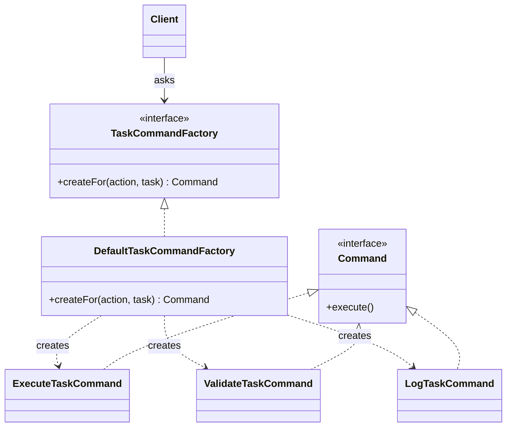

# Design Patterns II — Structure, Coordination & Extension

> **Prerequisites:**
> - You understand Strategy and Command patterns
> - You can reason about interfaces and composition
> - You can identify tight coupling and conditional logic smells
> - You are comfortable with basic collections and queues

---

---

## In this topic

- [What you'll learn](#what-youll-learn)
- [Why this matters](#why-this-matters)
- [How this builds on previous content](#how-this-builds-on-previous-content)
- [Key terms](#key-terms)
- [Pattern 1: Factory](#pattern-1-factory)
- [Pattern 2: Observer](#pattern-2-observer)
- [Pattern 3: Adapter](#pattern-3-adapter)
- [Games example](#games-example)
- [Software example](#software-example)
- [Pattern comparison (important)](#pattern-comparison-important)
- [Common mistakes](#common-mistakes)
- [Practice tasks](#practice-tasks)
- [Reflective questions](#reflective-questions)
- [Further reading](#further-reading)

---

## What you'll learn

| Skill Type | You will be able to... |
| :- | :- |
| Understand | Explain why object creation and coordination become design problems at scale. |
| Apply | Use Factory to give the choice of which class to create one home, instead of copying it into every client. |
| Apply | Use Observer to decouple state change from reaction, including removing listeners and handling a failing one. |
| Apply | Use Adapter to integrate incompatible interfaces safely. |
| Analyse | Identify when multiple patterns must collaborate to solve a single problem. |
| Debug | Diagnose over-coupling caused by misplaced responsibilities. |

---

## Why this matters

In Design Patterns I, we learned how to:
- encapsulate behaviour (Strategy),
- encapsulate work (Command).

As systems grow, new problems appear:
- object creation logic spreads,
- components need to react to events,
- external APIs do not fit our design.

This lesson focuses on **structural and coordination pressure**: how parts of a system are created, how they react to change, and how they evolve without collapsing into conditional logic.

---

## How this builds on previous content

From last week, we already have:
- Commands representing work,
- Queues executing commands,
- Strategies defining execution policy.

That design works — **until it doesn’t**. Today we fix the cracks.

---

## Key terms

### Factory

A **factory** is an object or method whose job is deciding which class to create, so callers never write `new` for those classes.

### Observer pattern

In the **Observer** pattern, one object announces events, and any number of listeners react without the announcer knowing who they are.

### Subject and listener

The **subject** keeps the list of listeners and notifies them. A **listener** (or observer) is called when something happens.

### Adapter pattern

An **adapter** wraps a class with the wrong methods, so the rest of the program can use it through the interface it expects.

---

## Pattern 1: Factory

### The pain: creation logic leakage

A task arrives with an action chosen by the user: `"run"`, `"validate"` or `"log"`. Each action needs a different `Command`, built with different collaborators. Without a factory, the choice is written out wherever a command is needed:

```java
// In the console menu
Command cmd;
if (action.equals("run")) {
    cmd = new ExecuteTaskCommand(task, new ImmediateExecution());
} else if (action.equals("validate")) {
    cmd = new ExecuteTaskCommand(task, new ValidatedExecution());
} else {
    cmd = new LogTaskCommand(task, auditLog);
}

// ...and the same if-chain again in the scheduler, and again in the replay code
```

Problems:
- every caller must know **which classes exist** and **how to build each one**,
- the same `if` chain is copied into every place that creates commands,
- adding a fourth action means finding and editing every copy.

Creation is becoming a **responsibility**, not a detail.

---

### Intent

Encapsulate object creation so clients depend on *what* they want, not *how* it is built.

A factory does not make the decision disappear. It gives the decision **one home**: the `if` or `switch` that picks a class is written once, inside the factory, and nowhere else.

### Pattern roles

- **Client**: asks for an object, naming what it wants
- **Factory**: decides which concrete class to create, and creates it
- **Product**: the interface the client receives (`Command`)
- **Concrete products**: the classes the factory chooses between



**Diagram description**
The `Client` depends only on the `TaskCommandFactory` interface, and receives a `Command`. `DefaultTaskCommandFactory` implements the factory interface. It creates one of three concrete commands — `ExecuteTaskCommand`, `ValidateTaskCommand` or `LogTaskCommand` — and each of those implements `Command`. The client never names any of the three concrete classes.

### Trade-offs

- Adds indirection and extra types
- Centralises responsibility (can become a bottleneck)
- Overkill when there is only one class to create and no prospect of a second

---

### Factory interface

```java
public interface TaskCommandFactory {
    // Throws IllegalArgumentException for an action it does not recognise
    Command createFor(String action, Task task);
}
```

---

### Concrete factory

```java
public final class DefaultTaskCommandFactory implements TaskCommandFactory {

    private final AuditLog auditLog;

    public DefaultTaskCommandFactory(AuditLog auditLog) {
        if (auditLog == null)
            throw new IllegalArgumentException("auditLog is required");
        this.auditLog = auditLog;
    }

    @Override
    public Command createFor(String action, Task task) {
        if (action == null)
            throw new IllegalArgumentException("action is required");

        // The only place in the program that maps an action name to a class
        return switch (action.trim().toLowerCase()) {
            case "run" -> new ExecuteTaskCommand(task, new ImmediateExecution());
            case "validate" -> new ExecuteTaskCommand(task, new ValidatedExecution());
            case "log" -> new LogTaskCommand(task, auditLog);
            default -> throw new IllegalArgumentException("Unknown action: " + action);
        };
    }
}
```

```java
// Every client now looks like this, and names no concrete command class
Command cmd = factory.createFor(action, task);
cmd.execute();
```

#### Snippet explanation

The factory owns two pieces of knowledge the clients used to share: **which** class matches each action, and **what** each class needs to be built — a strategy for the execute commands, the shared `AuditLog` for the log command. Adding a `"retry"` action changes one `case` line here, and no client. An unknown action fails fast with a clear message, in one place.

The arrow form `case "run" -> ...` is a **switch expression** (Java 14+): each case produces a value, there is no fall-through, and the compiler insists every path returns or throws.

Because clients depend on the `TaskCommandFactory` interface, a test can pass in a factory that returns a recording fake command, and check what the client asked for without running anything.

---

<details style="background:#fffdf0; border:1px solid rgba(161,98,7,0.22); border-radius:10px;
padding:0.9rem 1rem; margin:1rem 0;">
  <summary style="cursor:pointer; font-weight:800; margin:0;">
    Aside: Why Factory beats scattered <code>new</code>
  </summary>

Using `new` is not bad — **spreading creation logic everywhere is**.

Factory allows:
- configuration-based creation (the action name could come from a file or a network request),
- testing with substitutes,
- future extension without client changes.

A useful test: search the project for the name of a concrete class. If it appears in one factory and nowhere else, creation is under control.

</details>

---

## Pattern 2: Observer

### The pain: hidden coordination

Suppose that when a task completes we want to:
- log task completion,
- update a UI,
- trigger follow-up work.

Embedding this logic directly into execution reintroduces **tight coupling**: the queue would hold a logger, a UI and a scheduler, and call each by name. Adding a fourth reaction would mean editing the queue.

---

### Intent

Define a one-to-many dependency so that when one object changes state, all dependents are notified automatically.

### Pattern roles

- **Subject**: publishes events and keeps the list of listeners
- **Observer**: the interface every listener implements
- **ConcreteObserver**: performs one specific reaction

### Trade-offs

- Control flow becomes indirect
- Debugging event chains can be harder
- Poor naming leads to confusion
- Listeners that are added but never removed keep objects alive (a memory leak)

---

### Observer interface

```java
public interface TaskListener {
    void onCompleted(Task task);
}
```

---

### Subject (publisher)

```java
public final class ObservableTaskQueue {

    private final List<TaskListener> listeners = new ArrayList<>();
    private final Queue<Task> pending = new ArrayDeque<>();
    private final TaskCommandFactory factory;

    public ObservableTaskQueue(TaskCommandFactory factory) {
        this.factory = factory;
    }

    public void addListener(TaskListener listener) {
        if (listener == null)
            throw new IllegalArgumentException("listener is required");
        listeners.add(listener);
    }

    public void removeListener(TaskListener listener) {
        listeners.remove(listener);
    }

    public void submit(Task task) {
        pending.add(task);
    }

    public void processAll() {
        while (!pending.isEmpty()) {
            Task task = pending.poll();
            factory.createFor("run", task).execute();
            notifyListeners(task);
        }
    }

    private void notifyListeners(Task completedTask) {
        // Iterate over a copy, so a listener may remove itself without breaking the loop
        for (TaskListener l : List.copyOf(listeners))
            l.onCompleted(completedTask);
    }
}
```

```java
// Each reaction is attached from outside; the queue never names any of them
queue.addListener(task -> System.out.println("Done: " + task));
queue.addListener(new AuditListener(auditLog));
queue.addListener(new FollowUpScheduler(queue));
```

---

### Why this is non-trivial

This introduces **coordination without dependency**:
- the queue does not know who is listening,
- listeners evolve independently,
- reactions can be added without modification.

Three details matter in real code:

- **Removal.** A screen that closes must call `removeListener`, or the queue keeps it in memory and keeps notifying it.
- **Changing the list during notification.** If a listener adds or removes a listener while the loop runs, iterating the live list throws `ConcurrentModificationException` — the same rule you met in t05. Looping over `List.copyOf(...)` avoids it.
- **A failing listener.** An exception thrown by one listener stops the loop, so the listeners after it are never told. Decide deliberately whether that is acceptable, or catch and log per listener.

`TaskListener` has one abstract method, so a short reaction can be a lambda, as in the first `addListener` call above.

---

## Pattern 3: Adapter

### The pain: incompatible interfaces

Assume an external API:

```java
public interface ExternalJob {
    void runJob();
}
```

Your system expects `Command`.

---

### Intent

Convert the interface of a class into another interface clients expect.

### Pattern roles

- **Target**: expected interface (`Command`)
- **Adaptee**: existing incompatible class
- **Adapter**: bridges the two

### Trade-offs

- Adds an extra layer
- Can hide deeper design problems
- Should not patch poor internal design

---

### Adapter example

```java
public final class ExternalJobAdapter implements Command {

    private final ExternalJob job;

    public ExternalJobAdapter(ExternalJob job) {
        this.job = job;
    }

    @Override
    public void execute() {
        job.runJob();
    }
}
```

---

<details style="background:#fff5f5; border:1px solid rgba(220,38,38,0.25); border-radius:10px;
padding:0.9rem 1rem; margin:1rem 0;">
  <summary style="cursor:pointer; font-weight:800; margin:0;">
    Gotchas: Adapter vs rewrite
  </summary>

Adapter is appropriate when:
- you do not control the external API,
- rewriting would duplicate logic,
- isolation from change is required.

If you control the code, redesign may be better.

</details>

---

<details style="background:#f5f7ff; border:1px solid rgba(0,0,0,0.15); border-radius:10px;
padding:0.9rem 1rem; margin:1rem 0;">
  <summary style="cursor:pointer; font-weight:800; margin:0;">
    Real-world: Coordinated task processing
  </summary>

#### Context

We now have:
- Commands representing work,
- Factories controlling creation,
- Observers reacting to execution,
- Adapters integrating foreign jobs.

**Patterns in play**
- Factory: controls creation of Commands
- Command: encapsulates work units
- Observer: reacts to execution events
- Adapter: integrates external jobs

**Why this matters**
- Creation, execution, and reaction are separated.
- New features attach around the system.
- This is the minimum structure needed before concurrency.

In [t19 Concurrency](../t19_concurrency/t19_concurrency_notes.md), this design will **fail under parallel load** — and we will fix it with threads.

</details>

---

## Games example

The three patterns, applied to a small level-loading and combat system.

### Factory — spawning pickups from a level file

A level file marks pickups with one-letter codes: `H` for health, `A` for ammo, `S` for a shield. The level loader should not know how each pickup is built.

```java
public interface Pickup {
    void applyTo(Player player);
}

public final class PickupFactory {

    // Returns the pickup for a map code, or throws for a code the game does not know
    public Pickup fromCode(char code, int x, int y) {
        return switch (Character.toUpperCase(code)) {
            case 'H' -> new HealthPack(x, y, 25);
            case 'A' -> new AmmoCrate(x, y, 30);
            case 'S' -> new ShieldOrb(x, y, 5.0);
            default -> throw new IllegalArgumentException(
                "Unknown pickup code '" + code + "' at (" + x + "," + y + ")");
        };
    }
}
```

```java
// The level loader: reads codes, asks the factory, never names a pickup class
for (MapCell cell : level.pickupCells()) {
    pickups.add(factory.fromCode(cell.code(), cell.x(), cell.y()));
}
```

#### Snippet explanation

The amounts (25 health, 30 ammo, 5 seconds of shield) live in the factory with the class choice, so a designer tuning the game changes one file. An unknown code in a hand-edited level file fails at load time with its position, not later in the middle of play.

### Observer — reacting to the player's health

```java
public interface HealthListener {
    void onHealthChanged(int oldHealth, int newHealth);
}

public final class PlayerHealth {
    private final List<HealthListener> listeners = new ArrayList<>();
    private int health = 100;

    public void addListener(HealthListener l) { listeners.add(l); }
    public void removeListener(HealthListener l) { listeners.remove(l); }

    public void takeDamage(int amount) {
        int old = health;
        health = Math.max(0, health - amount);
        for (HealthListener l : List.copyOf(listeners))
            l.onHealthChanged(old, health);
    }
}
```

```java
health.addListener((oldHp, newHp) -> hud.setHealthBar(newHp));
health.addListener((oldHp, newHp) -> {
    if (newHp == 0)
        audio.play("death.wav");
});
health.addListener(new LowHealthAchievement());
```

#### Snippet explanation

`PlayerHealth` knows nothing about the HUD, the audio system or achievements; it only knows that something might be listening. Each system attaches its own reaction. Passing both the old and the new value lets a listener react to a *change* — "health just dropped below 20" — rather than only to the current value.

### Adapter — wrapping a third-party audio library

The game is written against its own small interface. The audio library you licensed has a different shape, and you cannot change it.

```java
// Ours: what the game code calls
public interface SoundPlayer {
    void play(String clipName);
}

// Theirs: a third-party class with its own API
public final class SonicEngine {
    public int loadClip(String filePath) { /* ... */ return 1; }
    public void playClip(int clipHandle, float volume) { /* ... */ }
}

// The adapter: makes SonicEngine look like a SoundPlayer
public final class SonicEngineAdapter implements SoundPlayer {

    private final SonicEngine engine;
    private final Map<String, Integer> handles = new HashMap<>();

    public SonicEngineAdapter(SonicEngine engine) {
        this.engine = engine;
    }

    @Override
    public void play(String clipName) {
        // Load each clip once, on first use, then reuse its handle
        int handle = handles.computeIfAbsent(clipName,
                name -> engine.loadClip("audio/" + name));
        engine.playClip(handle, 1.0f);
    }
}
```

#### Snippet explanation

Only `SonicEngineAdapter` knows that the library needs a file path, a numeric handle and a volume. If the studio switches to another library, you write a second adapter and change the one line that creates it; no game code changes. The adapter also adds a little behaviour the library lacks — caching handles — without leaking that detail.

---

## Software example

The same three patterns in a small online-shop back end.

### Factory — choosing a payment method

```java
public interface PaymentMethod {
    Receipt pay(Order order);
}

public final class PaymentMethodFactory {

    private final CardGateway cards;
    private final WalletService wallets;

    public PaymentMethodFactory(CardGateway cards, WalletService wallets) {
        this.cards = cards;
        this.wallets = wallets;
    }

    public PaymentMethod forType(PaymentType type) {
        return switch (type) {
            case CARD -> new CardPayment(cards);
            case WALLET -> new WalletPayment(wallets);
            case INVOICE -> new InvoicePayment();
        };
    }
}
```

#### Snippet explanation

`PaymentType` is an enum, so the `switch` needs no `default`: the compiler checks that every constant is handled, and adding `PaymentType.VOUCHER` makes this factory fail to compile until it is handled. The checkout code receives a `PaymentMethod` and never sees the gateways each method depends on.

### Observer — what happens after an order is placed

```java
public interface OrderListener {
    void onOrderPlaced(Order order);
}

// In OrderService, after the order is saved:
for (OrderListener l : List.copyOf(listeners)) {
    try {
        l.onOrderPlaced(order);
    } catch (RuntimeException e) {
        // One failing reaction must not stop the others, or undo the saved order
        log.error("Listener " + l.getClass().getSimpleName() + " failed", e);
    }
}
```

```java
orderService.addListener(new ConfirmationEmailSender(mailer));
orderService.addListener(new StockReserver(stockDao));
orderService.addListener(new AnalyticsRecorder(analytics));
```

#### Snippet explanation

Here the trade-off from "Why this is non-trivial" is decided explicitly: the order is already saved, so a failed analytics call must not stop the confirmation email. Each listener is called inside its own `try`/`catch`, and the failure is logged with the listener's name.

### Adapter — a legacy payment gateway

```java
// The interface the new checkout code expects
public interface CardGateway {
    Receipt charge(Money amount, CardDetails card);
}

// The legacy class: amounts in cents, a status code instead of an exception
public final class LegacyPayClient {
    public int submitCharge(long amountInCents, String cardNumber, String expiry) {
        /* ... */
        return 0;
    }
}

public final class LegacyPayAdapter implements CardGateway {

    private final LegacyPayClient client;

    public LegacyPayAdapter(LegacyPayClient client) {
        this.client = client;
    }

    @Override
    public Receipt charge(Money amount, CardDetails card) {
        int status = client.submitCharge(amount.inCents(), card.number(), card.expiry());
        if (status != 0)
            throw new PaymentFailedException("Legacy gateway returned status " + status);
        return new Receipt(amount, Instant.now());
    }
}
```

#### Snippet explanation

The adapter translates **three** mismatches, not just a method name: units (a `Money` object becomes cents), parameters (a `CardDetails` object becomes two strings), and error reporting (a numeric status becomes an exception, as t10 recommends). The rest of the shop is written as if the legacy system had a modern interface, and replacing it later touches one class.

---

## Pattern comparison (important)

- **Factory vs Strategy** — creation vs behaviour
- **Observer vs Command** — reaction to state vs representation of work
- **Adapter vs Refactoring** — protection vs redesign

---

<details style="background:#fff5f5; border:1px solid rgba(220,38,38,0.25); border-radius:10px;
padding:0.9rem 1rem; margin:1rem 0;">
  <summary style="cursor:pointer; font-weight:800; margin:0;">
    Anti-pattern: Pattern soup
  </summary>

Combining many patterns without real design pressure leads to unnecessary indirection, harder debugging, and unclear ownership.

Patterns should remove complexity — not introduce it.

</details>

---

### Design prompt (no coding)

You need to add:
- task retries,
- failure logging,
- delayed execution.

Which patterns would you introduce or extend? Justify your choices.

---

### Pattern smell checklist

- Is object creation scattered across the system?
- Do components know too much about each other?
- Does adding behaviour require modifying many classes?

If yes, a pattern may be missing — or misused.

---

## Common mistakes

| Mistake | What happens | Fix |
| :- | :- | :- |
| A factory that returns a concrete class | Callers depend on that class anyway, so the factory hides nothing | Return the interface type |
| Listeners that are never removed | They keep running, and keep objects alive that should have gone | Remove a listener when its owner is finished with it |
| A listener changing the list during notification | `ConcurrentModificationException` | Notify from a copy of the list |
| Business logic inside an adapter | The rule is hidden where nobody looks for it, and is lost if the adapter is replaced | An adapter only translates |
| Relying on the order listeners run in | Behaviour breaks when one is added or removed | Make each listener independent |

---

## Practice tasks

1. Write a `ShapeFactory` that creates shapes from text such as `"circle"`. What should it do for text it does not recognise?
2. Give a `Scoreboard` class listeners that are told about each new high score. Add a logging listener without editing `Scoreboard`.
3. Your program expects `Clock.nowMillis()`, but a library offers `Timer.currentSeconds()`. Write the adapter.

For step-by-step practice with worked solutions, see the [t14 exercises](exercises/t14_design_patterns_2_exercises.md).

---

## Reflective questions

1. Why does Factory reduce coupling compared to direct construction?
2. What problem does Observer solve that Strategy does not?
3. When is Adapter preferable to refactoring existing code?
4. Which pattern would you introduce first in a growing system — and why?
5. How do these patterns prepare the system for concurrency?

<details style="background:#f5f7ff; border:1px solid rgba(0,0,0,0.15); border-radius:10px;
padding:0.9rem 1rem; margin:1rem 0;">
  <summary style="cursor:pointer; font-weight:800; margin:0;">
    Check your thinking
  </summary>

**1. Why Factory reduces coupling.**
Calling `new JdbcTaskDao(url, user, pass)` binds the caller to a **concrete class** *and* to the knowledge of how to build it. Every such call site must be edited if the constructor gains a parameter or the implementation is swapped — and those call sites are usually scattered.

A factory moves that knowledge to one place. Callers depend only on the interface (`TaskDao`) and on the factory; the concrete type is named exactly once. Two things become possible that were not before: substituting an implementation for tests (an in-memory DAO), and choosing the implementation at runtime from configuration. The measure of success is that `grep` for the concrete class name returns one hit.

**2. What Observer solves that Strategy does not.**
Different axis entirely. Strategy answers *how do I perform this step?* — one plug-in, chosen by the context, usually returning a result to it. Observer answers *who needs to know this happened?* — **one-to-many notification**, where the publisher does not know or care who is listening, and gets nothing back.

Concretely: without Observer, a `TaskService` that must update the UI, write an audit log and send an email has to hold references to all three and call them in order — so it knows about every consumer, and adding a fourth edits the service. With Observer it publishes one `taskCreated` event; subscribers register themselves. Swapping Strategy in here does not help, because Strategy still has the context calling *one* known collaborator.

**3. When Adapter beats refactoring.**
When you **cannot or should not change** the code you need to fit: a third-party library, a legacy class other teams depend on, generated code, or something with no tests where a rewrite is genuinely risky. The adapter is a small, isolated translation layer, and if the external API later changes you fix one class.

Refactor instead when you own the code, have tests, and the mismatch is a design flaw worth fixing properly — otherwise adapters accumulate and you end up translating between translations. The pragmatic sequence is often: adapt now to unblock, refactor later behind the adapter's stable interface.

**4. Which pattern first in a growing system.**
A defensible answer names one and justifies it by the pain observed. The strongest general case is **Strategy/Factory first**, because the earliest and commonest symptom of growth is conditional logic on type — `if`/`switch` chains and scattered `new` — and those directly block extension.

What matters more than the choice is the reasoning: introduce a pattern **in response to actual duplication or an actual change that hurt**, never speculatively. A pattern added before the second use case is over-engineering; it adds indirection and files while solving nothing.

**5. How these patterns prepare for concurrency.**
Three ways, and they are what makes [t19](../t19_concurrency/t19_concurrency_notes.md) tractable:

- **Command bundles a unit of work into an object.** That is exactly what `ExecutorService.submit()` needs — a self-contained task with its state already captured, safe to hand to another thread and run later. Code with the work inline in a method has nothing to submit.
- **Factory centralises construction**, so per-thread or pooled resources (a `Connection`, a DAO) are created in one controlled place rather than wherever a `new` happened to appear. That is where you enforce "one connection per thread".
- **Interfaces and stateless strategies remove shared mutable state.** A stateless strategy is inherently thread-safe — nothing to corrupt. The residual risk is precisely what remains mutable and shared, which is where `synchronized` belongs.

The honest caveat: Observer is the one that gets *harder*. Notifying listeners from multiple threads means the subscriber list itself is shared mutable state, and a listener may be invoked concurrently — so you need a thread-safe collection and listeners that tolerate it.

</details>

---

## Further reading

- Refactoring Guru — Factory Method
  <https://refactoring.guru/design-patterns/factory-method>
- Refactoring Guru — Observer
  <https://refactoring.guru/design-patterns/observer>
- Refactoring Guru — Adapter
  <https://refactoring.guru/design-patterns/adapter>
- Martin Fowler — Patterns of Enterprise Application Architecture
  <https://martinfowler.com/books/eaa.html>

---

## Lesson Context

```yaml
previous_lesson:
  topic_code: t13_design_patterns_1
  domain_emphasis: Balanced

this_lesson:
  topic_code: t14_design_patterns_2
  primary_domain_emphasis: Balanced
  difficulty_tier: Intermediate
mlos: [MLO2]
```
