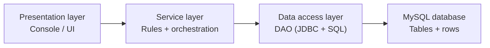

# DB Connectivity I — JDBC + DAO (Data Access Object)

> **Prerequisites:**
> - You can create Java classes with fields, constructors, and methods
> - You can use interfaces and understand polymorphism (interface references)
> - You can work comfortably with `ArrayList` and loops
> - You can write defensive checks (null/blank validation, fail fast)
> - You can wrap a low-level exception in your own type with a cause ([t10 Exception Handling](../t10_exception_handling/t10_exception_handling_notes.md))

---

---

## In this topic

- [What you'll learn](#what-youll-learn)
- [Why this matters](#why-this-matters)
- [How this builds on previous content](#how-this-builds-on-previous-content)
- [Key terms](#key-terms)
- [Overview: What is a DAO and why use it?](#overview-what-is-a-dao-and-why-use-it)
- [Local setup: MySQL + phpMyAdmin](#local-setup-mysql--phpmyadmin)
- [Step 1 — Create a database in phpMyAdmin](#step-1--create-a-database-in-phpmyadmin)
- [Step 2 — Create a user (recommended)](#step-2--create-a-user-recommended)
- [Step 3 — Create the table (schema)](#step-3--create-the-table-schema)
- [Step 4 — Add the MySQL JDBC driver to your project](#step-4--add-the-mysql-jdbc-driver-to-your-project)
- [Step 5 — Your MySQL connection string](#step-5--your-mysql-connection-string)
- [Step 6 — Keep credentials out of your code](#step-6--keep-credentials-out-of-your-code)
- [Step 7 — Connection smoke test](#step-7--connection-smoke-test)
- [Building the DAO](#building-the-dao)
- [Step 8 — Domain class: `Task`](#step-8--domain-class-task)
- [Step 9 — DAO exception and interface](#step-9--dao-exception-and-interface)
- [Step 10 — JDBC implementation: `JdbcTaskDao`](#step-10--jdbc-implementation-jdbctaskdao)
- [Step 11 — Service layer: `TaskService`](#step-11--service-layer-taskservice)
- [Step 12 — Presentation layer: console demo](#step-12--presentation-layer-console-demo)
- [Domain objects and DTOs](#domain-objects-and-dtos)
- [Patterns used in this topic (and why)](#patterns-used-in-this-topic-and-why)
- [Common mistakes](#common-mistakes)
- [Practice tasks](#practice-tasks)
- [Reflective questions](#reflective-questions)
- [Further reading](#further-reading)

---

## What you'll learn

| Skill Type | You will be able to... |
| :- | :- |
| Understand | Define key persistence terms: database, table, schema, SQL, JDBC, driver, mapping. |
| Understand | Explain what a DAO is and what problem it solves. |
| Apply | Connect to a local MySQL database (via phpMyAdmin) using JDBC. |
| Apply | Load database settings from a file that is never committed to Git. |
| Apply | Implement a DAO interface with a JDBC-backed class (`Jdbc...Dao`). |
| Apply | Use `PreparedStatement` placeholders safely (no SQL string concatenation). |
| Apply | Keep `SQLException` inside the DAO by translating it into a `DaoException`. |
| Analyse | Explain how DAO supports an N-tier structure (UI then Service then DAO then DB). |
| Analyse | Decide when a layer should pass a domain object and when it needs a DTO. |
| Debug | Identify and fix common connection and JDBC errors (driver, access denied, port, auth). |

---

## Why this matters

Once a program needs to **persist data** (keep it after the program ends), you need a storage layer outside your Java objects.

If you scatter SQL across your codebase (especially in `Main`), your program becomes difficult to change and difficult to test:
- the same SQL logic gets duplicated in multiple places,
- schema changes cause bugs everywhere,
- UI code, business rules, and persistence code become mixed together.

The DAO pattern gives you a clean boundary: **database access happens in one place**, and the rest of your program talks to simple Java methods.

---

## How this builds on previous content

In Design Patterns I and II you learned that **interfaces + composition** let you swap implementations and reduce coupling.

This topic uses those same ideas in a very practical way:

- You define a `TaskDao` **interface** (the contract).
- You implement it as `JdbcTaskDao` (one strategy/implementation).
- Your service layer depends on the interface, not the concrete class.

It also uses two ideas from earlier topics:

- **Exception translation** from [t10 Exception Handling](../t10_exception_handling/t10_exception_handling_notes.md): the DAO catches `SQLException` and throws its own `DaoException`, with the original as the cause.
- **`Optional`** from [t07 Collections III](../t07_collections_3_set_map/t07_collections_3_set_map_notes.md): `findById` returns an empty `Optional` when there is no such row.

This connects directly to:
- **Design Patterns I — Behaviour & Decoupling**
  Focus: programming to an interface, reducing conditionals, composition over inheritance.
- **Design Patterns II — Structure, Coordination & Extension**
  Focus: structuring larger systems, coordinating components, preparing for extension and deployment.

---

## Key terms

### Database

A **database** is a managed store of data. Here, your database system is **MySQL**.

### SQL

**SQL (Structured Query Language)** is the language you use to read and change data in a database:
- `SELECT` reads rows
- `INSERT` creates rows
- `UPDATE` changes rows
- `DELETE` removes rows

### Table, row, column

A **table** is like a spreadsheet:
- **columns** are fields (e.g., `title`, `status`)
- **rows** are records (e.g., one task)

### Schema

A **schema** is the structure of the database: what tables exist, what columns they contain, and what rules apply.

### JDBC

**JDBC (Java Database Connectivity)** is Java’s standard API for talking to SQL databases.

Key JDBC types you will use:
- `Connection` (a session with the database)
- `PreparedStatement` (a safe SQL command with placeholders)
- `ResultSet` (the returned rows from a query)

### Driver

A **driver** is the library that lets JDBC speak to a specific database (here: MySQL). Without the MySQL driver on your classpath, your program cannot connect.

### Placeholder

A **placeholder** is a `?` in an SQL statement used with a `PreparedStatement`. You fill placeholders using `setString(...)`, `setInt(...)`, etc.

### Mapping

**Mapping** is converting between:
- database rows to Java objects (when reading)
- Java object values to row values (when writing)

### DTO

A **DTO (Data Transfer Object)** is a simple object whose only job is to carry data between layers or across a network, in the shape the receiver needs. It has no behaviour or business rules. See [Domain objects and DTOs](#domain-objects-and-dtos).

---

## Overview: What is a DAO and why use it?

### What “DAO” means

**DAO** stands for **Data Access Object**.

A DAO is a class (often implementing an interface) whose job is to:
1. run SQL against the database,
2. map database rows into Java objects,
3. hide JDBC details from the rest of the program — including JDBC's exception type.

### What problem DAO solves

If SQL and JDBC code appears across your application:
- you duplicate queries,
- you increase the chance of bugs when requirements change,
- your UI and business rules become tangled up with database access.

A DAO solves this by creating a single, consistent place where persistence happens.

### Where DAO fits in an N-tier structure



**Diagram description**
Four layers in a straight line: the presentation layer calls the service layer, which calls the data access layer, which calls the MySQL database. Each layer talks only to the next one along — the UI never reaches past the service layer to the DAO or the database.

Rule of thumb:
- **UI** should never contain SQL.
- **Service** should not contain JDBC, and never sees a `Connection`, `ResultSet` or `SQLException`.
- **DAO** is the only layer that knows SQL exists.

---

## Local setup: MySQL + phpMyAdmin


---

## Step 1 — Create a database in phpMyAdmin

1. Open phpMyAdmin in your browser.
2. Go to the **Databases** tab.
3. Create a database named `taskhub`.
4. Choose collation `utf8mb4_general_ci`.

Collation controls how strings compare and sort. `utf8mb4` is a safe default for modern systems.

---

## Step 2 — Create a user (recommended)

Using `root` works locally, but a dedicated user is safer and more realistic.

Example user:
- Username: `taskhub_user`
- Host: `localhost`
- Password: set one
- Privileges: **ALL** on database `taskhub` (local dev only)

Privileges are permissions: what the user is allowed to do in the database.

---

## Step 3 — Create the table (schema)

Run this in phpMyAdmin’s **SQL** tab:

```sql
CREATE TABLE tasks (
  id INT NOT NULL AUTO_INCREMENT,
  title VARCHAR(120) NOT NULL,
  status ENUM('TODO','DOING','DONE') NOT NULL DEFAULT 'TODO',
  created_at TIMESTAMP NOT NULL DEFAULT CURRENT_TIMESTAMP,
  PRIMARY KEY (id)
);

CREATE INDEX idx_tasks_status ON tasks(status);
```

Key parts:
- `AUTO_INCREMENT` generates a new `id` automatically.
- `ENUM('TODO','DOING','DONE')` restricts allowed status values. The Java `TaskStatus` enum in Step 8 mirrors it, so an invalid status is rejected before it reaches the database.
- `INDEX` makes status lookups faster.

---

## Step 4 — Add the MySQL JDBC driver to your project

### Maven dependency

```xml
<dependency>
  <groupId>com.mysql</groupId>
  <artifactId>mysql-connector-j</artifactId>
  <version>8.4.0</version>
</dependency>
```

---

## Step 5 — Your MySQL connection string

Example:

```text
jdbc:mysql://localhost:3306/taskhub?useSSL=false&serverTimezone=UTC&allowPublicKeyRetrieval=true
```

Breakdown:
- `jdbc:mysql://` selects the MySQL JDBC driver
- `localhost:3306` is MySQL running locally on the default port
- `/taskhub` is the database name
- `useSSL=false` avoids SSL warnings in local dev
- `serverTimezone=UTC` avoids timezone parsing issues
- `allowPublicKeyRetrieval=true` avoids a common MySQL 8 authentication error

---

## Step 6 — Keep credentials out of your code

A password typed into a `.java` file ends up in Git, and from there on GitHub, in every clone and in your team-mates' history — permanently, even if you delete it later. It also means each team member must edit the code to match their own database.

Put the settings in a **properties file** instead, and keep that file out of Git.

**`config/db.properties`** (listed in `.gitignore`; never committed):

```text
db.url=jdbc:mysql://localhost:3306/taskhub?useSSL=false&serverTimezone=UTC&allowPublicKeyRetrieval=true
db.user=taskhub_user
db.password=your_password
```

**`config/db.properties.example`** (committed, so team-mates know which keys to provide):

```text
db.url=jdbc:mysql://localhost:3306/taskhub
db.user=CHANGE_ME
db.password=CHANGE_ME
```

**`.gitignore`**:

```text
config/db.properties
```

Load it with `java.util.Properties`:

```java
import java.io.IOException;
import java.io.Reader;
import java.nio.file.Files;
import java.nio.file.Path;
import java.util.Properties;

public record DbConfig(String url, String user, String password) {

    public static DbConfig load(Path file) throws IOException {
        Properties props = new Properties();
        try (Reader in = Files.newBufferedReader(file)) {
            props.load(in);
        }
        return new DbConfig(
            require(props, "db.url"),
            require(props, "db.user"),
            props.getProperty("db.password", ""));
    }

    private static String require(Properties props, String key) {
        String value = props.getProperty(key);
        if (value == null || value.isBlank())
            throw new IllegalStateException("Missing setting '" + key + "' in db.properties");
        return value.trim();
    }
}
```

### Snippet explanation

`Properties.load` reads `key=value` lines and ignores blank lines and `#` comments. A missing required key fails straight away with a message that names the key, instead of failing later with a confusing "Access denied". A missing file throws `IOException`, which the caller in `main` reports. [t18 Java I/O](../t18_io/t18_io_notes.md) covers reading files in more depth; this is all you need for now. Deployed systems often read the same values from environment variables instead, using `System.getenv("DB_PASSWORD")`.

---

## Step 7 — Connection smoke test

Before writing a DAO, confirm you can connect and run a trivial query.

```java
import java.nio.file.Path;
import java.sql.Connection;
import java.sql.DriverManager;
import java.sql.PreparedStatement;
import java.sql.ResultSet;

public class DbSmokeTest {

    // A throwaway test program, so letting exceptions escape main is acceptable here
    public static void main(String[] args) throws Exception {

        DbConfig cfg = DbConfig.load(Path.of("config/db.properties"));

        try (Connection c = DriverManager.getConnection(cfg.url(), cfg.user(), cfg.password());
             PreparedStatement ps = c.prepareStatement("SELECT 1");
             ResultSet rs = ps.executeQuery()) {

            rs.next();
            int value = rs.getInt(1);

            System.out.println("DB connection OK, SELECT 1 -> " + value);
        }
    }
}
```

---

## Building the DAO


---

## Step 8 — Domain class: `Task`

A domain class represents something meaningful in your system. Here: a task you want to store in MySQL. The allowed statuses are an `enum`, not a set of strings, so the compiler rejects any value outside the list.

```java
import java.util.Optional;

public enum TaskStatus {
    TODO, DOING, DONE;

    // Turns user input such as " doing " into a status; empty if it is not a valid one
    public static Optional<TaskStatus> parse(String text) {
        if (text == null)
            return Optional.empty();
        try {
            return Optional.of(valueOf(text.trim().toUpperCase()));
        } catch (IllegalArgumentException e) {
            return Optional.empty();
        }
    }
}
```

```java
// A record: final fields, accessors, equals, hashCode and toString are generated for you
public record Task(int id, String title, TaskStatus status) {

    // id is 0 for a task that has not been stored yet; the database assigns the real id
    public Task {
        if (id < 0)
            throw new IllegalArgumentException("id must be >= 0");

        if (title == null || title.isBlank())
            throw new IllegalArgumentException("title is required");

        if (status == null)
            throw new IllegalArgumentException("status is required");

        title = title.trim();
    }
}
```

### Snippet explanation

`Task` is a **record** (from t04): its fields are `final`, so a `Task` cannot change after it is built, and `id()`, `title()`, `status()`, `equals`, `hashCode` and `toString` are written for you. The block `public Task { ... }` is a **compact constructor**: it validates and tidies the values before they are stored. To change a status, the service asks the DAO to update the row, then reads the task back. Records also work directly with Jackson, so in t20 to t22 a `Task` can be sent as JSON with no extra code. `TaskStatus.parse` turns untrusted text into a status or an empty `Optional`; t10 explained why "this is not a valid status" is better as an empty result than as an exception the caller must catch.

---

<details style="background:#f5f7ff; border:1px solid rgba(0,0,0,0.15); border-radius:10px;
padding:0.9rem 1rem; margin:1rem 0;">
  <summary style="cursor:pointer; font-weight:800; margin:0;">
    Aside: Optional — a quick refresher
  </summary>

You first met `Optional<T>` in [t07 Core Idea 6](../t07_collections_3_set_map/t07_collections_3_set_map_notes.md). It is a small wrapper that is either **present** (holds one value) or **empty**. It makes "might be missing" visible in a method's signature, which `null` does not.

In this topic, `findById(9999)` returning `Optional.empty()` means "there is no such row" — a normal answer, not an error. A database failure is different, and is reported with a `DaoException` instead.

### Patterns you should know

#### Pattern A — `isPresent()` / `get()` (simple, but not the nicest)

```java
Optional<Task> result = dao.findById(10);

if (result.isPresent())
{
    // get() is safe here only because isPresent() was checked first
    Task t = result.get();
    System.out.println(t);
}
else
{
    System.out.println("No task found.");
}
```

#### Pattern B — `orElse(...)` (use a default value)

```java
String title = dao.findById(10)
                  .map(Task::title)
                  .orElse("(no such task)");
```

#### Pattern C — `orElseThrow(...)` (treat “missing” as an error)

Use this when your logic says “this must exist”.

```java
Task t = dao.findById(10)
            .orElseThrow(() -> new IllegalStateException("Task not found: 10"));
```

#### Pattern D — `ifPresentOrElse(...)` (clean and readable)

```java
dao.findById(10).ifPresentOrElse(
    t -> System.out.println("Found: " + t),
    () -> System.out.println("No task found.")
);
```

### When you should NOT use `Optional`

- Do not use `Optional` for fields or parameters.
- Do not wrap a collection in it: an empty `List` already means "nothing".
- Do use it for method return values where “no result” is normal.

</details>

---

## Step 9 — DAO exception and interface

The interface is the contract your service layer uses. It describes *what* data operations exist, without saying *how* they are implemented — and that includes how they fail.

If the interface said `throws SQLException`, every caller would have to know that a SQL database sits underneath, and an in-memory or file-based DAO would have to pretend to throw a SQL error. If it said `throws Exception`, callers could not tell a storage failure from a bug, and would be forced to write `catch (Exception e)`, which t10 warned against. So the DAO layer has **its own checked exception**:

```java
// Checked: the storage could not be reached or the operation failed.
// Callers must decide what to do, and never see the JDBC type underneath.
public class DaoException extends Exception {
    public DaoException(String message, Throwable cause) {
        super(message, cause);
    }
}
```

```java
import java.util.List;
import java.util.Optional;

public interface TaskDao {
    // Stores a new task (its id is ignored) and returns the generated id
    int insert(Task task) throws DaoException;

    // Empty means "no such task"; DaoException means "could not ask"
    Optional<Task> findById(int id) throws DaoException;

    List<Task> findAll() throws DaoException;

    boolean updateStatus(int id, TaskStatus newStatus) throws DaoException;

    boolean deleteById(int id) throws DaoException;
}
```

### Snippet explanation

`insert` takes a whole `Task`, not a loose `String title, String status`. The `Task` constructor has already validated the values, so the DAO receives an object that is known to be valid. A long list of same-typed parameters is also easy to call in the wrong order, and every new column would change the interface. `updateStatus` takes a `TaskStatus`, so a typo such as `"DNOE"` cannot even compile.

---

## Step 10 — JDBC implementation: `JdbcTaskDao`

This class contains:
- SQL statements,
- placeholder filling (`?`),
- mapping (row to `Task`),
- translation of `SQLException` into `DaoException`.

Important rules:
- Use `PreparedStatement` (no string concatenation).
- Close resources with try-with-resources.
- Keep SQL inside the DAO only.
- Catch `SQLException` in every public method and rethrow it as the **cause** of a `DaoException`.

```java
import java.sql.*;
import java.util.ArrayList;
import java.util.List;
import java.util.Optional;

public class JdbcTaskDao implements TaskDao {

    private final DbConfig config;

    public JdbcTaskDao(DbConfig config) {
        if (config == null)
            throw new IllegalArgumentException("config is required");
        this.config = config;
    }

    private Connection open() throws SQLException {
        return DriverManager.getConnection(config.url(), config.user(), config.password());
    }

    @Override
    public int insert(Task task) throws DaoException {
        if (task == null)
            throw new IllegalArgumentException("task is required");

        String sql = "INSERT INTO tasks(title, status) VALUES (?, ?)";

        try (Connection c = open();
             PreparedStatement ps = c.prepareStatement(sql, Statement.RETURN_GENERATED_KEYS)) {

            ps.setString(1, task.title());
            ps.setString(2, task.status().name());
            ps.executeUpdate();

            try (ResultSet keys = ps.getGeneratedKeys()) {
                if (!keys.next())
                    throw new DaoException("insert returned no generated key", null);
                return keys.getInt(1);
            }
        }
        catch (SQLException e) {
            throw new DaoException("Could not insert task '" + task.title() + "'", e);
        }
    }

    @Override
    public Optional<Task> findById(int id) throws DaoException {
        if (id <= 0)
            return Optional.empty();

        String sql = "SELECT id, title, status FROM tasks WHERE id = ?";

        try (Connection c = open();
             PreparedStatement ps = c.prepareStatement(sql)) {

            ps.setInt(1, id);

            try (ResultSet rs = ps.executeQuery()) {
                if (!rs.next())
                    return Optional.empty();

                return Optional.of(mapRow(rs));
            }
        }
        catch (SQLException e) {
            throw new DaoException("Could not find task id=" + id, e);
        }
    }

    @Override
    public List<Task> findAll() throws DaoException {
        String sql = "SELECT id, title, status FROM tasks ORDER BY id";

        try (Connection c = open();
             PreparedStatement ps = c.prepareStatement(sql);
             ResultSet rs = ps.executeQuery()) {

            List<Task> out = new ArrayList<>();
            while (rs.next())
                out.add(mapRow(rs));
            return out;
        }
        catch (SQLException e) {
            throw new DaoException("Could not list tasks", e);
        }
    }

    @Override
    public boolean updateStatus(int id, TaskStatus newStatus) throws DaoException {
        if (id <= 0)
            return false;

        if (newStatus == null)
            throw new IllegalArgumentException("newStatus is required");

        String sql = "UPDATE tasks SET status = ? WHERE id = ?";

        try (Connection c = open();
             PreparedStatement ps = c.prepareStatement(sql)) {

            ps.setString(1, newStatus.name());
            ps.setInt(2, id);
            return ps.executeUpdate() == 1;
        }
        catch (SQLException e) {
            throw new DaoException("Could not update task id=" + id, e);
        }
    }

    @Override
    public boolean deleteById(int id) throws DaoException {
        if (id <= 0)
            return false;

        String sql = "DELETE FROM tasks WHERE id = ?";

        try (Connection c = open();
             PreparedStatement ps = c.prepareStatement(sql)) {

            ps.setInt(1, id);
            return ps.executeUpdate() == 1;
        }
        catch (SQLException e) {
            throw new DaoException("Could not delete task id=" + id, e);
        }
    }

    // Called only inside the try blocks above, so its SQLException is translated there
    private static Task mapRow(ResultSet rs) throws SQLException {
        int id = rs.getInt("id");
        String title = rs.getString("title");
        TaskStatus status = TaskStatus.valueOf(rs.getString("status"));
        return new Task(id, title, status);
    }
}
```

### Snippet explanation

Every public method has the same shape: build the SQL, open resources in try-with-resources, bind the placeholders, map the result, and translate any `SQLException` with a message that says **what** the DAO was trying to do. The message is for people reading logs; the cause keeps the database's own explanation, such as "Access denied" or "Unknown column". The fields are `final`: a DAO's configuration never changes after construction.

---

## Step 11 — Service layer: `TaskService`

The service layer is where your business rules live:
- which statuses are allowed (now enforced by `TaskStatus`),
- what “create task” means,
- what you do when a task is missing.

```java
import java.util.List;
import java.util.Optional;

public class TaskService {

    private final TaskDao dao;

    public TaskService(TaskDao dao) {
        if (dao == null)
            throw new IllegalArgumentException("dao is null");
        this.dao = dao;
    }

    // Business rule: every new task starts as TODO
    public int createTask(String title) throws DaoException {
        return dao.insert(new Task(0, title, TaskStatus.TODO));
    }

    // Returns false for an unknown status text or an unknown id
    public boolean setStatus(int id, String statusText) throws DaoException {
        Optional<TaskStatus> status = TaskStatus.parse(statusText);
        if (status.isEmpty())
            return false;

        return dao.updateStatus(id, status.get());
    }

    public Optional<Task> get(int id) throws DaoException {
        return dao.findById(id);
    }

    public List<Task> list() throws DaoException {
        return dao.findAll();
    }
}
```

### Snippet explanation

The service does not catch `DaoException`; it declares it and lets it pass up. The service cannot do anything useful about a lost connection, so the decision belongs to the presentation layer, which can tell the user. The service never mentions SQL, `Connection` or `SQLException`, so it compiles and can be tested against an in-memory `TaskDao` with no database at all.

---

## Step 12 — Presentation layer: console demo

```java
import java.io.IOException;
import java.nio.file.Path;

public class Main {
    public static void main(String[] args) {

        DbConfig cfg;
        try {
            cfg = DbConfig.load(Path.of("config/db.properties"));
        } catch (IOException e) {
            System.out.println("Cannot read config/db.properties: " + e.getMessage());
            System.out.println("Copy config/db.properties.example and fill in your details.");
            return;
        }

        TaskService service = new TaskService(new JdbcTaskDao(cfg));

        try {
            int id = service.createTask("Write DAO notes");
            System.out.println("Created task id=" + id);

            service.setStatus(id, "doing");
            System.out.println("Updated status -> DOING");

            System.out.println("All tasks:");
            for (Task t : service.list())
                System.out.println(" - " + t);
        }
        catch (DaoException e) {
            // The one place that decides what a storage failure means to the user
            System.out.println("Database problem: " + e.getMessage());
            System.out.println("Cause: " + e.getCause());
        }
    }
}
```

### Snippet explanation

`main` handles two kinds of failure, each where it can be explained to the user: a missing settings file, and a database problem. Nothing below `main` prints anything or decides how to recover. This is the layering from the overview diagram, applied to errors as well as to data.

---

## Domain objects and DTOs

So far one class, `Task`, has crossed every layer. That works while every layer needs the same data in the same shape. It stops working when a layer needs a **different shape**:

- A task list on screen needs only the id and title, not every column.
- A network client in [t22 Networking](../t22_networking/t22_networking_notes.md) sends a "create task" request that has a title but no id yet.
- A report joins two tables, and the result is not any single domain object.

A **DTO (Data Transfer Object)** is a small, behaviour-free object built for one of these journeys. A Java `record` is the natural way to write one:

```java
// What the list screen needs: no status, no validation rules, no methods
public record TaskSummary(int id, String title) { }

// What a client sends to create a task: there is no id yet
public record CreateTaskRequest(String title) { }
```

The DAO can return the summary directly from a narrower query:

```java
List<TaskSummary> findSummaries() throws DaoException;
```

```java
// Inside JdbcTaskDao: select only the columns the DTO needs
String sql = "SELECT id, title FROM tasks ORDER BY id";
// ... map each row with: new TaskSummary(rs.getInt("id"), rs.getString("title"))
```

### Snippet explanation

The **domain object** (`Task`) holds the rules: it validates its title and status, and is the type the service reasons about. A **DTO** only carries values, in the shape a particular screen, request or report needs. Use the domain object until a layer needs a different shape; then add a DTO for that journey, rather than adding fields to `Task` that most callers do not want. When you send data as JSON in t20 to t22, the request and response classes are DTOs.

---

## Patterns used in this topic (and why)

### 1) Layered Architecture (N-tier)

**What it is:** Your program is split into layers, where each layer has a clear job.

- presentation layer (UI): input/output, and deciding what to tell the user when something fails
- service layer: business rules and workflows
- data access layer (DAO): SQL + mapping
- database: persistent storage

**Rationale:** This prevents “everything in `Main`”. When requirements change, you change one layer instead of rewriting the whole program.

### 2) DAO (Data Access Object)

**What it is:** A DAO is responsible for all database access for one part of your domain (tasks, scores, users).

**Rationale:** You isolate SQL and JDBC code in one place. This avoids duplication and keeps persistence changes local.

### 3) Strategy-like swapping (interface-driven design)

**What it is:** Your service depends on `TaskDao` (an interface), so you can swap implementations.

**Rationale:** This makes testing easier and supports future changes (in-memory DAO, cached DAO, different database).

### 4) Exception translation

**What it is:** The DAO catches `SQLException` and throws `DaoException`, passing the original as the cause.

**Rationale:** The boundary between layers is only real if nothing leaks through it — not even an exception type. The cause keeps the database's own explanation for debugging.

### 5) Factory Method (likely next step)

**What it is:** A small creator method/class that builds your DAO based on configuration.

**Rationale:** `DbConfig` already moved the settings out of the code. A factory that reads a setting such as `dao.type=jdbc` or `dao.type=memory` and returns the right `TaskDao` keeps that choice out of `Main` too.

---

## Common mistakes

| Problem | What it usually means | What to check |
| :- | :- | :- |
| `No suitable driver found` | MySQL driver not included | Maven dependency or build path |
| `Access denied for user` | Wrong credentials or privileges | `db.properties`, phpMyAdmin user and grants |
| `Communications link failure` | MySQL not running / wrong host/port | Is MySQL running? Port 3306? |
| `Public Key Retrieval is not allowed` | MySQL 8 auth config | `allowPublicKeyRetrieval=true` in the URL |
| Password visible on GitHub | Credentials were typed into a `.java` file | Move them to `config/db.properties`, add it to `.gitignore`, and change the password |
| `SQLException` appears in the service or UI | The DAO let a JDBC type escape | Catch it in the DAO and throw `DaoException` with it as the cause |
| DAO methods declare `throws Exception` | The interface gives callers no information | Declare `throws DaoException` |
| `IllegalArgumentException: No enum constant TaskStatus.X` | The database holds a status the enum does not list | Keep the SQL `ENUM` and the Java `enum` in step |

---

## Practice tasks

1. Add a DAO method: `List<Task> findByStatus(TaskStatus status) throws DaoException`.
2. Add a service method that lists tasks for a status typed by the user, using `TaskStatus.parse` and returning an empty list for an unknown status.
3. Add a demo in `Main` that prints only `TODO` tasks.
4. Add paging: `findPage(int offset, int limit)` using `LIMIT ? OFFSET ?`.
5. Write an `InMemoryTaskDao` backed by a `Map<Integer, Task>`, and use it to run `TaskService` with no database. Which methods need a `throws` clause, and why?
6. Add `findSummaries()` returning `List<TaskSummary>`, and change the list screen to use it.

The [t15 exercises](exercises/t15_dao_exercises.md) build the same layers for a car-rental system.

---

## Reflective questions

1. Why is SQL in `Main` a design smell?
2. What benefits do you get by making `TaskDao` an interface?
3. What logic belongs in the service layer rather than the DAO?
4. When does `Optional` make your code safer than returning `null`?
5. If you moved from MySQL to Postgres, what code should change (and what should not)?
6. Why does `TaskDao` declare `throws DaoException` rather than `throws SQLException` or `throws Exception`?

<details style="background:#f5f7ff; border:1px solid rgba(0,0,0,0.15); border-radius:10px;
padding:0.9rem 1rem; margin:1rem 0;">
  <summary style="cursor:pointer; font-weight:800; margin:0;">
    Check your thinking
  </summary>

**1. Why SQL in `Main` is a design smell.**
It collapses layers that exist for a reason. `Main` is presentation — it should deal with what the user asked for, not with table names, column order and `ResultSet` cursors. Once SQL is there:

- **the same query gets duplicated** wherever it is needed, so a schema change means hunting every copy;
- **nothing is testable** without a live database and a UI;
- **the database becomes unswappable**, because dialect-specific SQL is scattered through the program;
- connections and statements are opened in code whose job is printing, so they leak.

The DAO exists so that exactly one class knows the table exists.

**2. Benefits of `TaskDao` being an interface.**
It names the **contract** — what persistence operations exist — separately from **how** they are performed. That buys: a swappable implementation (JDBC now, in-memory for tests, a different database later) with no change to callers; testability, since a service can be unit-tested against a fake DAO with no database at all; and a compile-time-checked boundary, so the service layer literally cannot reach for a `Connection`. It is also what makes the factory in [t14](../t14_design_patterns_2/t14_design_patterns_2_notes.md) worth having — something must decide which implementation to hand out.

**3. What belongs in the service layer, not the DAO.**
The DAO does **one table, one operation, no decisions**: build the SQL, bind parameters, map rows, return. The service holds everything that reasons about the result:

- **business rules** — "a task cannot be completed twice", "a booking needs a free seat";
- **coordination across DAOs** — for example, creating an order *and* its line items;
- **validation beyond field-level guards**, and translating storage results into domain meaning.

The test: if the logic would still be true after moving from MySQL to a REST API, it is service logic.

**4. When `Optional` is safer than `null`.**
When absence is a **legitimate, expected outcome** and you want the compiler to make the caller face it. `null` carries no information — it is the same value for "not found", "not set" and "I forgot to initialise" — and nothing forces a check, so the mistake surfaces later as a `NullPointerException` with no clue about origin. `Optional<Task>` states in the *signature* that there may be nothing, and the caller must call `isPresent`, `orElse` or `map` to get at the value.

Use it for **return types** of lookups. Do not use it for fields, parameters, or collections — an empty `List` already means "nothing", and `Optional<List<T>>` gives you two ways to say the same thing and a bug waiting to happen.

**5. MySQL to Postgres: what changes, what does not.**

*Changes* — and it should be a short list confined to one layer:

- the **connection URL and driver** (`jdbc:postgresql://...` in `db.properties`, the Postgres driver in `pom.xml`);
- **dialect-specific SQL** inside the JDBC DAO — `LIMIT ? OFFSET ?` is fine in both, but auto-increment keys differ (`AUTO_INCREMENT` vs `SERIAL`/`IDENTITY`), as do some type names and quoting rules;
- occasionally **type mapping** details, such as how each driver returns dates or BLOBs.

*Does not change* — and this is the payoff:

- the `Task` **domain class**;
- the `TaskDao` **interface** and `DaoException`;
- the **service layer** and all business rules;
- the **presentation layer**;
- every test written against the interface rather than the implementation.

If moving database forces you to touch the service or the UI, the layering has leaked — most often because `SQLException` or a `ResultSet` was allowed to escape the DAO. That is why `JdbcTaskDao` catches every `SQLException` and rethrows it as a `DaoException`: the boundary is only real if the abstraction leaks nothing, including exception types.

**6. Why `throws DaoException`.**
`throws SQLException` would tie the **interface** to one technology: an `InMemoryTaskDao` or a file-based DAO has no SQL to fail, yet every caller would still be written as if a SQL database were underneath. `throws Exception` is worse: it tells callers nothing, so they cannot separate "the database is down" from a `NullPointerException` bug, and the only way to handle it is a `catch (Exception e)` that swallows both. `DaoException` says exactly one thing — "storage failed" — and still carries the real `SQLException` as its cause for whoever needs the detail.

</details>

---

## Further reading

- DAO Pattern in Java
  <https://www.baeldung.com/java-dao-pattern>
- Refactoring Guru — Strategy Pattern
  <https://refactoring.guru/design-patterns/strategy>
- MySQL Connector/J Developer Guide
  <https://dev.mysql.com/doc/connector-j/en/>
- [Java SE API documentation for java.util.Properties](https://docs.oracle.com/en/java/javase/25/docs/api/java.base/java/util/Properties.html)

---

## Lesson Context

```yaml
previous_lesson:
  topic_code: t14_design_patterns_2
  domain_emphasis: Balanced

this_lesson:
  topic_code: t15_dao
  primary_domain_emphasis: Balanced
  difficulty_tier: Intermediate
mlos: [MLO4]
```
