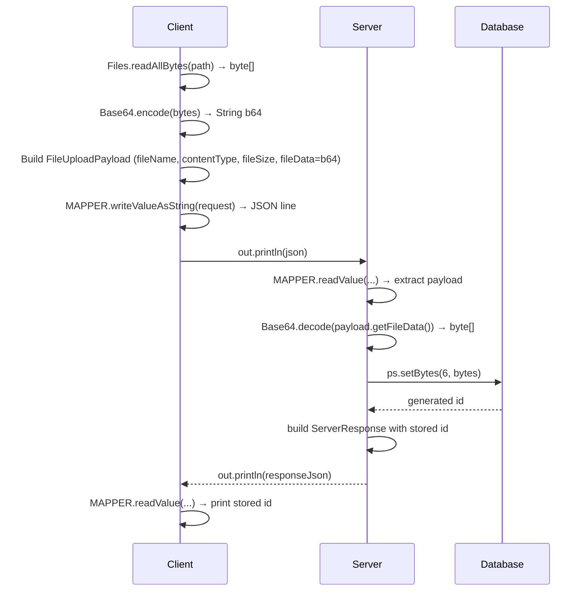
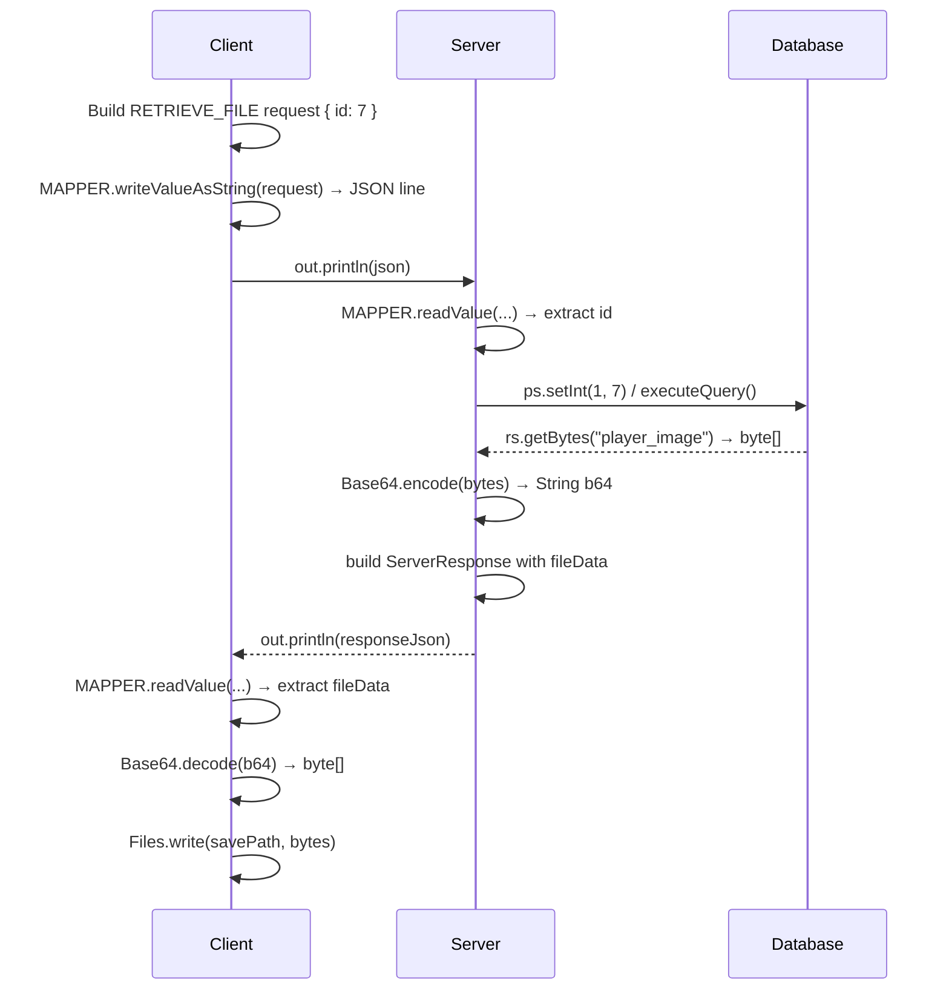

# JSON in Java II: Protocol Design & Advanced Jackson

> **Prerequisites:**
> - JSON in Java I: ObjectMapper, TypeReference, `ServerResponse<T>` wrapper
> - DB Connectivity: PreparedStatement, ResultSet, JDBC patterns
>
> **Continues from:** [JSON in Java I — Format & Jackson Basics](../t20_json_1_jackson_basics/t20_json_1_jackson_basics_notes.md)

---

---

## In this topic

- [What you'll learn](#what-youll-learn)
- [Why this matters](#why-this-matters)
- [How this builds on previous content](#how-this-builds-on-previous-content)
- [Key terms](#key-terms)
- [Section 1 — Designing a JSON request/response protocol](#section-1--designing-a-json-requestresponse-protocol)
- [Section 2 — Base64 encoding binary data within JSON](#section-2--base64-encoding-binary-data-within-json)
- [Section 3 — Storing and retrieving binary data with JDBC (BLOB)](#section-3--storing-and-retrieving-binary-data-with-jdbc-blob)
- [Section 4 — Testing JSON round-trips](#section-4--testing-json-round-trips)
- [Link to challenge exercise](#link-to-challenge-exercise)
- [Common mistakes](#common-mistakes)
- [Practice tasks](#practice-tasks)
- [Reflective questions](#reflective-questions)
- [Further reading](#further-reading)

---

## What you'll learn

| Skill Type | You will be able to... |
| :- | :- |
| Understand | Explain what a protocol is and why a request envelope needs a `requestType` and a `payload`. |
| Understand | Explain why binary data cannot go directly into a JSON string, and what Base64 costs. |
| Understand | Describe when Base64-in-JSON is the wrong choice for transferring a file. |
| Apply | Design a request/response protocol with a documented type for each operation. |
| Apply | Route requests through a handler map instead of an `if`/`else` chain. |
| Apply | Read values safely from a `JsonNode` payload, guarding against missing and wrong-typed keys. |
| Apply | Encode and decode binary data with `Base64` for transport in JSON. |
| Apply | Store and retrieve binary data as a MySQL BLOB using `setBytes` and `getBytes`. |
| Apply | Write metadata-only queries that avoid fetching a BLOB you do not need. |
| Apply | Write round-trip tests that prove an object survives serialisation unchanged. |
| Analyse | Identify the security risk in dispatching on a client-supplied string by reflection. |

---

## Why this matters

Serialising one object is a library call. Designing the **conversation** between a client and a server is a design problem, and it is the one GCA2 actually assesses.

This topic covers the decisions that make that conversation robust: an envelope every message shares, routing that cannot be tricked by a hostile client, validation of a payload you did not write, and the difference between how binary data travels (Base64 text) and how it is stored (raw bytes in a BLOB).

---

## How this builds on previous content

| Earlier topic | Concept carried forward |
| :- | :- |
| [t10 Exception Handling](../t10_exception_handling/t10_exception_handling_notes.md) | A malformed request must produce an error *response*, never an escaped exception |
| [t13 Design Patterns I](../t13_design_patterns_1/t13_design_patterns_1_notes.md) | The handler map is Strategy applied to routing — one handler per request type |
| [t15 DB Connectivity](../t15_dao/t15_dao_notes.md) | `PreparedStatement` and `ResultSet` now carry `byte[]` as well as text and numbers |
| [t20 JSON I](../t20_json_1_jackson_basics/t20_json_1_jackson_basics_notes.md) | `ObjectMapper`, `TypeReference` and the `ServerResponse<T>` wrapper are the foundation for the envelope |
| [t04 Equality & Hashing](../t04_equality_hashing/t04_equality_hashing_notes.md) | Round-trip tests compare with `equals`, so the entity must implement it correctly |

---

## Key terms

### Protocol

A **protocol** is the agreement between two programs about the format and meaning of the messages they exchange.

### Envelope

An **envelope** is the fixed outer shape of a message. Here, every request has a `requestType` and a `payload`.

### JsonNode

**`JsonNode`** is Jackson's tree view of any JSON value, used when the shape is not known in advance.

### Base64

**Base64** encodes bytes as plain text so they can sit inside JSON. The result is about a third larger.

### BLOB

A **BLOB** (binary large object) is a database column that stores raw bytes.

### Round-trip test

A **round-trip test** converts an object to JSON and back, then checks that nothing changed.

---

## Section 1 — Designing a JSON request/response protocol

### What a protocol is

A **protocol** is an agreement between two parties about the format and meaning of the messages they exchange. Without an agreed protocol, the server receiving a JSON string from a client cannot determine what operation is being requested or how to interpret the payload.

A minimal, practical protocol for a Java client-server application needs two things:

1. **A request envelope** — a standard structure the client always sends, identifying the operation.
2. **A response envelope** — a standard structure the server always returns (this is `ServerResponse<T>` from t20).

### The request envelope

Every client message should carry at minimum:
- `requestType` — a string constant identifying the requested operation (e.g. `"GET_ALL"`, `"INSERT"`, `"DELETE"`)
- `payload` — a JSON object (or `null`) containing the parameters for that operation

```json
{
  "requestType": "GET_BY_ID",
  "payload": { "id": 7 }
}
```

```json
{
  "requestType": "GET_ALL",
  "payload": null
}
```

```json
{
  "requestType": "INSERT",
  "payload": {
    "name": "Charlie",
    "rating": 8.1
  }
}
```

Using `null` for payload (rather than omitting the field entirely) keeps the envelope structure consistent and avoids null-check branches when parsing.

### Implementing the request class

The payload structure varies per request type, so using `JsonNode` — Jackson's tree-model representation of any JSON value — allows the envelope to be parsed without knowing the specific payload shape in advance.

```java
import com.fasterxml.jackson.databind.JsonNode;

/**
 * A typed request envelope sent from client to server.
 * The 'requestType' field identifies the operation; 'payload' carries its parameters.
 *
 * @author OOP Teaching Team
 */
public class ClientRequest {

    // === Fields ===
    private String requestType;
    private JsonNode payload;

    // === Constructors ===
    // Creates: empty request — required by Jackson
    public ClientRequest() {
        requestType = "";
        payload = null;
    }

    // Creates: request with a type and a JsonNode payload
    public ClientRequest(String requestType, JsonNode payload) {
        this.requestType = requestType;
        this.payload = payload;
    }

    // === Public API ===
    // Gets: the operation type constant
    public String getRequestType() { return requestType; }

    // Sets: the operation type constant
    public void setRequestType(String requestType) { this.requestType = requestType; }

    // Gets: the raw JSON payload node (may be null for no-parameter requests)
    public JsonNode getPayload() { return payload; }

    // Sets: the raw JSON payload node
    public void setPayload(JsonNode payload) { this.payload = payload; }
}
```

### Reading values from a `JsonNode` payload

Once you have the `ClientRequest`, each handler reads the fields it needs from `getPayload()`. Two null-pointer risks must be handled defensively:

1. `getPayload()` returns `null` when the request was constructed with a `null` payload.
2. `payload.get("fieldName")` returns `null` when the named field is absent from the JSON — it does not throw an exception.

Calling `.asInt()` or `.asText()` on a `null` node will throw a `NullPointerException`. Always validate before reading:

```java
// Safely gets: an integer field from the payload with upfront validation
private ServerResponse<?> handleGetById(ClientRequest request) {
    JsonNode payload = request.getPayload();

    if (payload == null || !payload.has("id"))
        return ServerResponse.error("Missing required field: id");

    int id = payload.get("id").asInt();
    // proceed with id ...
}
```

The same pattern applies to string and double fields:

```java
if (payload == null || !payload.has("name"))
    return ServerResponse.error("Missing required field: name");

String name = payload.get("name").asText();
```

```java
if (payload == null || !payload.has("rating"))
    return ServerResponse.error("Missing required field: rating");

double rating = payload.get("rating").asDouble();
```

`payload.has("fieldName")` returns `true` if the key is present in the JSON object, even if its value is `null`. Use `payload.hasNonNull("fieldName")` if you also want to reject explicitly-null values.

### Building a `ClientRequest` on the client side

When the client needs to send a request with a payload, use `MAPPER.valueToTree(object)` to convert a payload object into a `JsonNode`:

```java
// Converts: a plain Java object to a JsonNode for use as a request payload
JsonNode node = MAPPER.valueToTree(new Player(0, "Charlie", 8.1));
ClientRequest request = new ClientRequest("INSERT", node);
String json = MAPPER.writeValueAsString(request);
```

For a no-payload request:

```java
ClientRequest request = new ClientRequest("GET_ALL", null);
String json = MAPPER.writeValueAsString(request);
```

### Routing requests — avoiding an `if-else` chain

A naive server reads `requestType` and dispatches with conditional logic:

```java
// Poor design — grows without bound as new operations are added
if (requestType.equals("GET_ALL")) {
    handleGetAll(request, out);
}
else if (requestType.equals("GET_BY_ID")) {
    handleGetById(request, out);
}
else if (requestType.equals("INSERT")) {
    handleInsert(request, out);
}
// ... every new operation means editing this method
```

This violates the Open/Closed Principle: adding an operation requires modifying existing code. A better design registers handlers in a `Map<String, RequestHandler>`, where `RequestHandler` is a functional interface:

```java
@FunctionalInterface
public interface RequestHandler {
    // Handles: one client request and returns a ServerResponse to be sent back
    ServerResponse<?> handle(ClientRequest request) throws DaoException;
}
```

```java
/**
 * Routes incoming requests to the appropriate handler by type.
 *
 * @author OOP Teaching Team
 */
public class RequestDispatcher {

    // === Fields ===
    private final Map<String, RequestHandler> handlers = new HashMap<>();

    // === Constructors ===
    // Creates: a dispatcher with all handlers registered against their type constants
    public RequestDispatcher(PlayerDao dao) {
        handlers.put("GET_ALL", req -> handleGetAll(dao));
        handlers.put("GET_BY_ID", req -> handleGetById(req, dao));
        handlers.put("INSERT", req -> handleInsert(req, dao));
        handlers.put("DELETE", req -> handleDelete(req, dao));
        handlers.put("UPDATE", req -> handleUpdate(req, dao));
        handlers.put("DISCONNECT", req -> handleDisconnect());
    }

    // === Public API ===
    // Handles: passing a request to its registered handler; unknown types get an error response
    public ServerResponse<?> dispatch(ClientRequest request) {
        RequestHandler handler = handlers.get(request.getRequestType());

        if (handler == null)
            return ServerResponse.error("Unknown request type: " + request.getRequestType());

        try {
            return handler.handle(request);
        }
        catch (DaoException e) {
            return ServerResponse.error("Server error: " + e.getMessage());
        }
    }

    // === Helpers ===
    // Gets: all entities from the DAO and wraps them in a success response
    private ServerResponse<List<Player>> handleGetAll(PlayerDao dao) throws DaoException {
        List<Player> players = dao.getAll();
        return ServerResponse.ok("Retrieved " + players.size() + " players", players);
    }

    // Gets: a single entity by id or returns a failure response if not found
    private ServerResponse<Player> handleGetById(ClientRequest request, PlayerDao dao)
            throws DaoException {
        JsonNode payload = request.getPayload();
        if (payload == null || !payload.has("id"))
            return ServerResponse.error("Missing required field: id");

        int id = payload.get("id").asInt();
        return dao.getById(id)
                  .map(p -> ServerResponse.ok("Player found", p))
                  .orElseGet(() -> ServerResponse.error("No player found for id=" + id));
        // Note: orElseGet(supplier) is preferred over orElse(value) here because
        // orElse(value) always evaluates its argument, even when the Optional is present.
        // For a simple string this makes no difference in practice, but orElseGet is the
        // correct idiom for any fallback that involves object construction or side effects.
    }

    // ... additional handlers follow the same pattern
}
```

Registering a new operation means adding one line to the constructor. No existing code changes. Each handler method is focused, testable, and independently readable.

---

## Section 2 — Base64 encoding binary data within JSON

> **Runnable code for Sections 7 and 8:** the [t21 binary pipeline demos](../../../code/src/t21_json_2_jackson_advanced/demos/) build the pipeline step by step: `de01` reads and writes file bytes, `de02` runs a metadata-only query, and `de03` stores a `GameAsset` in a BLOB. `de02` and `de03` need a running MySQL database. Sending these files over a socket is in [t22 Part 6](../t22_networking/t22_networking_notes.md#part-6-sending-files-through-the-protocol).

### Why binary data cannot go directly into JSON

JSON is a **text format** — it carries strings, numbers, booleans, and structured objects, but not raw binary bytes. Binary files (images, audio, PDFs, documents) are sequences of bytes that include values with special meaning in JSON: `{` (123), `}` (125), `"` (34), `\` (92), and control characters. Embedding raw bytes in a JSON string would corrupt the JSON structure.

The solution is **Base64 encoding**: convert the `byte[]` into a plain ASCII string before placing it in the JSON field, then decode it back to bytes after reading the field out.

Base64 represents every group of three bytes as four printable ASCII characters drawn from the set `A–Z`, `a–z`, `0–9`, `+`, `/`, and `=` (padding). The result is always valid text and can be placed safely in any JSON string field.

The trade-off is size: Base64 encoding increases data size by approximately 33%. A 100 KB image becomes approximately 133 KB as a Base64 string inside a JSON field.

### Encoding/decoding bytes to/from a Base64 string

Java's `java.util.Base64` has been in the standard library since Java 8. No additional dependency is needed.

```java
import java.io.IOException;
import java.util.Base64;
import java.nio.file.Files;
import java.nio.file.Path;

public class Main {

    public static void main(String[] args)
    {
        //helper to tell you what directory to put your data file in
        System.out.println("Put your data file in: " + System.getProperty("user.dir"));

        try {

            //ENCODE

            // Ensure you create/source the file so that you have something to open!
            byte[] fileBytes = Files.readAllBytes(Path.of("profile.png"));

            // Converts: raw byte array to a Base64-encoded ASCII string
            String encoded = Base64.getEncoder().encodeToString(fileBytes);

            // Show the data
            System.out.println(encoded);

            //DECODE

            // Converts: Base64 string back to the original byte array
            byte[] receivedFileBytes = Base64.getDecoder().decode(encoded);

            // Write the reconstructed file to disk
            Files.write(Path.of("retrieved_profile.png"), receivedFileBytes);
        }
        catch(IOException e)
        {
            System.out.println("A bad thing happened with the file!");
        }
    }
}
```

### Embedding binary data in a JSON upload payload

```json
{
  "requestType": "UPLOAD_FILE",
  "payload": {
    "entityId": 7,
    "fileName": "profile.png",
    "contentType": "image/png",
    "fileSize": 48302,
    "fileData": "iVBORw0KGgoAAAANSUhEUgAA..."
  }
}
```

All fields except `fileData` are plain metadata — they can be stored and queried independently without reading the binary content. `fileData` carries the entire file as a Base64 string.

### A DTO for file upload payloads

```java
/**
 * DTO carrying a file upload payload, including Base64-encoded binary content
 * and associated metadata fields.
 *
 * @author OOP Teaching Team
 */
public class FileUploadPayload {

    // === Fields ===
    private int entityId;
    private String fileName;
    private String contentType;
    private int fileSize;
    private String fileData;     // Base64-encoded binary content

    // === Constructors ===
    // Creates: empty payload — required by Jackson
    public FileUploadPayload() {
        entityId = 0;
        fileName = "";
        contentType = "";
        fileSize = 0;
        fileData = "";
    }

    // Creates: fully populated upload payload
    public FileUploadPayload(int entityId, String fileName,
                             String contentType, int fileSize,
                             String fileData) {
        this.entityId = entityId;
        this.fileName = fileName;
        this.contentType = contentType;
        this.fileSize = fileSize;
        this.fileData = fileData;
    }

    // === Public API ===
    // Gets: the entity id this file is associated with
    public int getEntityId() { return entityId; }

    // Sets: the entity id
    public void setEntityId(int entityId) { this.entityId = entityId; }

    // Gets: the original filename including extension
    public String getFileName() { return fileName; }

    // Sets: the original filename
    public void setFileName(String f) { fileName = f; }

    // Gets: the MIME content type (e.g. "image/png")
    public String getContentType() { return contentType; }

    // Sets: the MIME content type
    public void setContentType(String ct) { contentType = ct; }

    // Gets: the file size in bytes (pre-encoding)
    public int getFileSize() { return fileSize; }

    // Sets: the file size in bytes
    public void setFileSize(int fileSize) { this.fileSize = fileSize; }

    // Gets: the Base64-encoded file content
    public String getFileData() { return fileData; }

    // Sets: the Base64-encoded file content
    public void setFileData(String fileData) { this.fileData = fileData; }
}
```

### Client upload sequence

```java
// Converts: a file on disk into a Base64 upload payload
public FileUploadPayload buildUploadPayload(Path filePath, int entityId) throws IOException {
    byte[] bytes = Files.readAllBytes(filePath);
    String b64 = Base64.getEncoder().encodeToString(bytes);
    String name = filePath.getFileName().toString();

    // Files.probeContentType returns null when the type cannot be determined
    // (common for .bin, .dat, or any extension the OS doesn't recognise)
    String detectedMime = Files.probeContentType(filePath);
    String mime = (detectedMime != null) ? detectedMime : "application/octet-stream";

    return new FileUploadPayload(entityId, name, mime, bytes.length, b64);
}
```

```java
// Builds: the JSON for a file upload request; t22 sends this line over a socket
FileUploadPayload payload = buildUploadPayload(Path.of("profile.png"), 7);
JsonNode node = MAPPER.valueToTree(payload);
ClientRequest request = new ClientRequest("UPLOAD_FILE", node);
String json = MAPPER.writeValueAsString(request);
```

### Server decode sequence

```java
// Gets: the Base64 file content from the request payload and decodes it to a byte array
FileUploadPayload payload = MAPPER.treeToValue(request.getPayload(), FileUploadPayload.class);
byte[] fileBytes = Base64.getDecoder().decode(payload.getFileData());

// fileBytes can now be stored using PreparedStatement.setBytes()
// or passed to any other persistence mechanism
```

---

## Section 3 — Storing and retrieving binary data with JDBC (BLOB)

Section 2 showed how to encode a `byte[]` as a Base64 string for safe inclusion in a JSON message. This section covers the other half of the pipeline: persisting those bytes in a MySQL database using a `BLOB` column, and reading them back out.

The steps are independent. A `byte[]` arriving at the server from a JSON upload request is stored with `PreparedStatement.setBytes()`. A `byte[]` retrieved from the database is Base64-encoded and returned in a `ServerResponse<T>`. Neither side cares how the other works — the contract is just `byte[]` in and `byte[]` out.

---

### BLOB column types in MySQL

MySQL offers four BLOB types that differ only in the maximum number of bytes they can store:

| Type | Maximum size | Typical use |
| :- | :- | :- |
| `TINYBLOB` | 255 bytes | Very small payloads (rarely used) |
| `BLOB` | 65 535 bytes (~64 KB) | Small images, icons |
| `MEDIUMBLOB` | 16 777 215 bytes (~16 MB) | Most game assets, audio clips, documents |
| `LONGBLOB` | 4 294 967 295 bytes (~4 GB) | Large video files |

For most GCA2 use cases a `MEDIUMBLOB` is the right choice. It covers any realistic file a student might upload during a demo without the overhead of `LONGBLOB`.

---

### Schema design — extending a table with a BLOB column

Binary data should never live alone in a table. Metadata (the file name, content type, and size) must be stored alongside it in separate `VARCHAR`/`INT` columns so it can be queried cheaply without fetching the payload.

The three metadata columns required by the brief are:

| Column | SQL type | Purpose |
| :- | :- | :- |
| `file_name` | `VARCHAR(255) NOT NULL` | Original filename including extension |
| `content_type` | `VARCHAR(100) NOT NULL` | MIME type (`image/png`, `audio/ogg`, `application/pdf`) |
| `file_size` | `INT NOT NULL` | File size in bytes **before** Base64 encoding |

Add these columns (and the BLOB column) to an existing entity table using `ALTER TABLE`:

```sql
ALTER TABLE player
    ADD COLUMN file_name     VARCHAR(255)  NOT NULL DEFAULT '',
    ADD COLUMN content_type  VARCHAR(100)  NOT NULL DEFAULT '',
    ADD COLUMN file_size     INT           NOT NULL DEFAULT 0,
    ADD COLUMN player_image  MEDIUMBLOB;
```

Alternatively, define them directly in the `CREATE TABLE` statement in `mysqlSetup.sql`:

```sql
CREATE TABLE player (
    player_id     INT           NOT NULL AUTO_INCREMENT,
    player_name   VARCHAR(255)  NOT NULL,
    rating        DOUBLE        NOT NULL,
    file_name     VARCHAR(255)  NOT NULL DEFAULT '',
    content_type  VARCHAR(100)  NOT NULL DEFAULT '',
    file_size     INT           NOT NULL DEFAULT 0,
    player_image  MEDIUMBLOB,
    PRIMARY KEY (player_id)
);
```

`MEDIUMBLOB` columns are **nullable by default**. This is intentional — rows inserted before a file is uploaded should not be forced to provide binary data.

> [!IMPORTANT]
> **Update `mysqlSetup.sql`:** After altering the schema, update `mysqlSetup.sql` so that running it from scratch recreates the schema with the BLOB column in place. The seed `INSERT` rows may omit the BLOB columns (the `DEFAULT ''` and `DEFAULT 0` values handle metadata; the nullable BLOB stays `NULL`).

---

### Extending the DTO to hold binary data

Add the four columns as fields to your entity DTO. Jackson ignores `byte[]` fields by default when serialising (a raw `byte[]` in JSON would be Base64-encoded automatically by Jackson), but in your architecture the conversion is handled explicitly — the DTO carries a `byte[]` internally and the server/client code does the Base64 conversion before sending and after receiving. This keeps the DTO free of Jackson-specific concerns.

```java
public class Player {

    // === Fields ===
    private int playerId;
    private String playerName;
    private double rating;
    private String fileName;      // original filename, e.g. "avatar.png"
    private String contentType;   // MIME type, e.g. "image/png"
    private int fileSize;      // bytes, pre-encoding
    private byte[] playerImage;   // raw bytes; null when no file has been uploaded

    // === Constructors ===
    // Creates: a Player with no binary data attached
    public Player(int playerId, String playerName, double rating) {
        this.playerId = playerId;
        this.playerName = (playerName == null || playerName.isBlank())
                           ? "Unknown" : playerName.trim();
        this.rating = (rating < 0.0 || rating > 10.0) ? 0.0 : rating;
        fileName = "";
        contentType = "";
        fileSize = 0;
        playerImage = null;
    }

    // Creates: a Player with all fields including binary data
    public Player(int playerId, String playerName, double rating,
                  String fileName, String contentType,
                  int fileSize, byte[] playerImage) {
        this(playerId, playerName, rating);
        this.fileName = (fileName == null) ? "" : fileName.trim();
        this.contentType = (contentType == null) ? "" : contentType.trim();
        this.fileSize = Math.max(0, fileSize);
        this.playerImage = playerImage;
    }

    // === Public API ===
    // Gets: the player ID
    public int getPlayerId() { return playerId; }

    // Gets: the player name
    public String getPlayerName() { return playerName; }

    // Gets: the player rating
    public double getRating() { return rating; }

    // Gets: the filename of the stored image
    public String getFileName() { return fileName; }

    // Sets: the filename
    public void setFileName(String f) { fileName = (f == null) ? "" : f.trim(); }

    // Gets: the MIME content type
    public String getContentType() { return contentType; }

    // Sets: the MIME content type
    public void setContentType(String ct) { contentType = (ct == null) ? "" : ct.trim(); }

    // Gets: the file size in bytes (pre-encoding)
    public int getFileSize() { return fileSize; }

    // Sets: the file size in bytes
    public void setFileSize(int size) { fileSize = Math.max(0, size); }

    // Gets: the raw image bytes; may be null if no file has been stored
    public byte[] getPlayerImage() { return playerImage; }

    // Sets: the raw image bytes
    public void setPlayerImage(byte[] data) { playerImage = data; }
}
```

The key point is that `playerImage` is `null` — not an empty array — when no file has been uploaded. Your DAO insert and retrieval code must handle `null` without crashing.

---

### Inserting a BLOB with `setBytes()`

`PreparedStatement.setBytes(paramIndex, bytes)` fills a `?` placeholder with a `byte[]`. The JDBC driver handles the conversion to the database's internal BLOB representation.

```java
// Inserts: a player row including binary image data; returns the auto-generated player_id
public int insertPlayerWithImage(Player player) throws DaoException {
    String sql = """
            INSERT INTO player
                (player_name, rating, file_name, content_type, file_size, player_image)
            VALUES (?, ?, ?, ?, ?, ?)
            """;

    try (Connection c = DriverManager.getConnection(url, user, pass);
         PreparedStatement ps = c.prepareStatement(sql, Statement.RETURN_GENERATED_KEYS)) {

        ps.setString(1, player.getPlayerName());
        ps.setDouble(2, player.getRating());
        ps.setString(3, player.getFileName());
        ps.setString(4, player.getContentType());
        ps.setInt(5, player.getFileSize());
        ps.setBytes(6, player.getPlayerImage());   // null is valid — stored as NULL in the DB

        ps.executeUpdate();

        try (ResultSet keys = ps.getGeneratedKeys()) {
            if (keys.next())
                return keys.getInt(1);
        }
        throw new SQLException("no generated key returned");
    }
    catch (SQLException e) {
        throw new DaoException("Could not insert player", e);
    }
}
```

`ps.setBytes(6, null)` is valid JDBC — the driver stores a SQL `NULL` in the BLOB column. This means you do not need to branch on whether the player has an image before calling `setBytes`.

---

### Retrieving a BLOB with `getBytes()`

`ResultSet.getBytes("column_name")` returns a `byte[]`. It returns `null` if the column contains SQL `NULL`. Check for `null` before using the array.

```java
// Gets: a Player by ID, including any stored binary image data
public Optional<Player> getPlayerById(int id) throws DaoException {
    String sql = """
            SELECT player_id, player_name, rating,
                   file_name, content_type, file_size, player_image
            FROM player
            WHERE player_id = ?
            """;

    try (Connection c = DriverManager.getConnection(url, user, pass);
         PreparedStatement ps = c.prepareStatement(sql)) {

        ps.setInt(1, id);

        try (ResultSet rs = ps.executeQuery()) {
            if (rs.next()) {
                Player p = new Player(
                    rs.getInt("player_id"),
                    rs.getString("player_name"),
                    rs.getDouble("rating"),
                    rs.getString("file_name"),
                    rs.getString("content_type"),
                    rs.getInt("file_size"),
                    rs.getBytes("player_image")    // returns null if the column is NULL
                );
                return Optional.of(p);
            }
        }
    }
    catch (SQLException e) {
        throw new DaoException("Could not read player " + id, e);
    }
    return Optional.empty();
}
```

`rs.getBytes("player_image")` loads the entire BLOB into a `byte[]` in memory. For large files this can be significant. Only call this method when the caller actually needs the binary content — never in a list-all or metadata-only query.

---

### Metadata-only queries — never fetch the BLOB you don't need

A listing screen, a file browser, or a search result needs the filename, content type, and size — not the binary payload. Fetching a 5 MB image just to display its name wastes memory, slows the query, and increases network traffic between the database and the server.

Write a separate query that lists columns explicitly and **omits the BLOB column**:

```java
// Gets: metadata for all players that have a stored image, without loading the binary data
public List<Player> getAllPlayerMetadata() throws DaoException {
    String sql = """
            SELECT player_id, player_name, rating,
                   file_name, content_type, file_size
            FROM player
            WHERE player_image IS NOT NULL
            ORDER BY player_id
            """;

    List<Player> results = new ArrayList<>();

    try (Connection c = DriverManager.getConnection(url, user, pass);
         PreparedStatement ps = c.prepareStatement(sql);
         ResultSet rs = ps.executeQuery()) {

        while (rs.next()) {
            results.add(new Player(
                rs.getInt("player_id"),
                rs.getString("player_name"),
                rs.getDouble("rating"),
                rs.getString("file_name"),
                rs.getString("content_type"),
                rs.getInt("file_size"),
                null    // deliberately not fetched
            ));
        }
    }
    catch (SQLException e) {
        throw new DaoException("Could not list player metadata", e);
    }
    return results;
}
```

The critical rule is: **name every column you want, and leave `player_image` out of the list**. Never use `SELECT *` — it would pull the BLOB even if your `ResultSet` code ignores it.

---

### Putting it all together — the full binary upload/download pipeline

The following diagram shows how the four stages of a binary upload connect:



**Diagram description**
Six steps. 1. The client reads the file into a byte array. 2. It Base64-encodes those bytes into a string. 3. It builds an upload request carrying the encoded data plus the file name and MIME type, and sends it as one JSON line. 4. The server decodes the Base64 back into bytes. 5. It stores those raw bytes in the database as a BLOB alongside the metadata.
6. It returns the new record id to the client.

And the retrieval direction:



**Diagram description**
Five steps. 1. The client builds a `RETRIEVE_FILE` request carrying the record id and sends it. 2. The server queries the database for that row. 3. The database returns the raw BLOB bytes. 4. The server Base64-encodes them and sends them back inside a JSON response.
5. The client decodes the Base64 and writes the bytes out to a file.

Each arrow is one `println` or `readLine` call. The complexity is in knowing which API to call at each step — the structure itself is straightforward.

---

### What `getBinaryStream()` and `setBinaryStream()` are for

The brief permits both `setBytes()`/`getBytes()` and `setBinaryStream()`/`getBinaryStream()`. The stream-based variants exist for files too large to fit in a single `byte[]` in memory (hundreds of megabytes). They let JDBC transfer binary data incrementally without loading the whole payload at once.

For GCA2, `setBytes()` and `getBytes()` are simpler and sufficient. Use the stream variants only if you choose to handle very large files and want to avoid loading the full payload into memory.

```java
// Alternative insert using a stream (not required for GCA2 but shown for completeness)
InputStream stream = new ByteArrayInputStream(player.getPlayerImage());
ps.setBinaryStream(6, stream, player.getPlayerImage().length);

// Alternative retrieval using a stream
InputStream stream = rs.getBinaryStream("player_image");
byte[] bytes = stream.readAllBytes();
```

---

## Section 4 — Testing JSON round-trips

### Why round-trip tests matter

A **round-trip test** checks that an object survives the full serialise–deserialise cycle:

```text
original object  →  writeValueAsString  →  JSON string  →  readValue  →  reconstructed object
```

and that `original.equals(reconstructed)` holds. This kind of test catches:
- a missing no-arg constructor (Jackson cannot construct the object)
- a missing setter (Jackson cannot populate the field)
- a field name mismatch (field is present in JSON but not mapped to the right Java field)
- precision loss in a `double` field
- data silently dropped because a getter is private or misnamed

None of these errors produce a compiler warning. They all produce either a runtime exception or, worse, silent data corruption that only shows up when the data is read back from the database or displayed to a user.

### Test structure

```java
import org.junit.jupiter.api.*;
import com.fasterxml.jackson.core.type.TypeReference;
import com.fasterxml.jackson.databind.ObjectMapper;
import java.util.List;

import static org.junit.jupiter.api.Assertions.*;

class PlayerJsonTest {

    private static final ObjectMapper MAPPER = new ObjectMapper();
    private Player player;

    // Sets: up a known Player before each test; tests do not share mutable state
    @BeforeEach
    void setUp() {
        player = new Player(1, "Alice", 9.2);
    }

    // Checks: a single Player survives a serialise?deserialise round-trip intact
    @Test
    void playerToJson_andBack_returnsEqualPlayer() throws Exception {
        String json = MAPPER.writeValueAsString(player);
        Player reconstructed = MAPPER.readValue(json, Player.class);

        assertEquals(player, reconstructed);
    }

    // Checks: a List<Player> round-trip preserves size, order, and all field values
    @Test
    void playerListToJson_andBack_preservesAllPlayers() throws Exception {
        List<Player> original = List.of(player, new Player(2, "Bob", 7.5));
        String json = MAPPER.writeValueAsString(original);

        List<Player> reconstructed = MAPPER.readValue(
            json, new TypeReference<List<Player>>() {}
        );

        assertEquals(2, reconstructed.size());
        assertEquals(original.get(0), reconstructed.get(0));
        assertEquals(original.get(1), reconstructed.get(1));
    }

    // Checks: a ServerResponse<Player> round-trip preserves the generic data payload correctly
    @Test
    void response_withPlayer_roundTripPreservesData() throws Exception {
        ServerResponse<Player> original = ServerResponse.ok("Player found", player);
        String json = MAPPER.writeValueAsString(original);
        ServerResponse<Player> reconstructed = MAPPER.readValue(
            json, new TypeReference<ServerResponse<Player>>() {}
        );

        assertEquals("OK", reconstructed.getStatus());
        assertEquals(player, reconstructed.getData());
    }

    // Checks: a failure ServerResponse round-trip preserves null data and the error message
    @Test
    void response_failure_roundTripPreservesNullDataAndMessage() throws Exception {
        ServerResponse<Player> original = ServerResponse.error("Player not found");
        String json = MAPPER.writeValueAsString(original);
        ServerResponse<Player> reconstructed = MAPPER.readValue(
            json, new TypeReference<ServerResponse<Player>>() {}
        );

        assertEquals("ERROR", reconstructed.getStatus());
        assertNull( reconstructed.getData());
        assertEquals("Player not found", reconstructed.getMessage());
    }

    // Checks: Base64 encoding and decoding preserves all bytes exactly
    @Test
    void base64_roundTrip_preservesAllBytes() {
        byte[] original = {72, 101, 108, 108, 111};   // ASCII for "Hello"
        String encoded = java.util.Base64.getEncoder().encodeToString(original);
        byte[] reconstructed = java.util.Base64.getDecoder().decode(encoded);

        assertArrayEquals(original, reconstructed);
    }
}
```

### Test method naming

A good test name reads as a sentence describing exactly what is being verified. The conventional pattern is:

```text
methodOrFeatureUnderTest_stateOrCondition_expectedOutcome
```

Examples:
- `playerToJson_andBack_returnsEqualPlayer`
- `response_withNullData_serialisesWithoutException`
- `base64_roundTrip_preservesAllBytes`

Avoid names like `test1`, `testJson`, or `roundTripWorks`. A well-named test is self-documenting — someone reading the test report can understand what failed without opening the code.

### `@BeforeEach` and test independence

Each test should set up its own known state. Using `@BeforeEach` ensures that:
- no test depends on another test running first,
- no test can corrupt shared state that affects another test,
- the test suite can run in any order and produce consistent results.

Placing a `new Player(...)` call inside `@BeforeEach` (rather than as a `static final` field) ensures each test gets a fresh, independent object.

---

## Link to challenge exercise

The **ce13** challenge exercise (Alien vs. Predicate) uses JSON as an **input data source**: incident reports are loaded from a `.json` file on disk and processed using predicates, comparators, and strategy patterns. A `JSONSerialiser<T>` helper class provided with the exercise handles the file-to-list conversion.

Working through ce13 is a useful way to practise the Jackson API in a structured context before applying it to a client-server system. When you do, notice the difference between what ce13 covers and what this topic adds:

| ce13 | This topic |
| :- | :- |
| Reading JSON from a file | Reading JSON from a `String` |
| Writing JSON to a file | Writing JSON to a `String` |
| File-based overloads (`readValue(File, ...)`) | String-based overloads (`readValue(String, ...)`) |
| Single direction: file then `List<T>` then process | Both directions: object then string then object |
| No response envelope | `ServerResponse<T>` wrapper with status, message, data |
| No protocol design | `ClientRequest` envelope with `requestType` and `payload` fields |

---

## Common mistakes

| Mistake | Symptom | Fix |
| :- | :- | :- |
| Missing no-arg constructor | `InvalidDefinitionException: No suitable constructor found` at runtime | Add `public MyClass() {}` with all fields initialised to safe defaults |
| Using `ServerResponse.class` instead of `TypeReference` | `ClassCastException` when calling `getData()` | Use `new TypeReference<ServerResponse<Player>>() {}` |
| Field silently null after deserialisation | No exception, but `getName()` returns `null` | Check getter/setter naming — `getPlayerName()` maps to key `"playerName"`, not `"name"`; use `@JsonProperty("name")` on both getter and setter to override |
| Calling `.asInt()` / `.asText()` without checking `payload.has("field")` | `NullPointerException` at runtime when the field is absent | Call `payload.has("field")` first and return `ServerResponse.error(...)` if missing |
| Not annotating DTOs with `@JsonIgnoreProperties(ignoreUnknown = true)` | `UnrecognizedPropertyException` when the JSON contains a new field the class doesn't know about | Add `@JsonIgnoreProperties(ignoreUnknown = true)` to `ClientRequest`, `ServerResponse<T>`, and any DTO that may evolve |
| Constructing `ObjectMapper` per request | Significant performance degradation; thread-safety issues possible | Declare `private static final ObjectMapper MAPPER = new ObjectMapper()` once |
| Sending raw binary bytes in a JSON string | `JsonParseException` on the receiving end | Base64-encode before embedding; Base64-decode after extracting |
| Using `SELECT *` in a metadata query | The BLOB is loaded even though the column is never read — unnecessary memory and I/O cost | List every column explicitly and omit the BLOB column |
| Calling `rs.getString("player_image")` instead of `rs.getBytes(...)` | Corrupted or truncated binary data; `getBytes` is the only safe way to read a BLOB column | Always use `rs.getBytes("column")` for BLOB columns |
| Not checking for `null` after `rs.getBytes(...)` | `NullPointerException` when a row has no stored image | Check `if (bytes != null)` before using the array |
| Using `BLOB` instead of `MEDIUMBLOB` for typical files | `MysqlDataTruncation` for files over ~64 KB | Use `MEDIUMBLOB` (up to 16 MB) for any asset that could be a real image, audio clip, or document |
| Forgetting `Statement.RETURN_GENERATED_KEYS` on the insert `PreparedStatement` | `getGeneratedKeys()` returns an empty `ResultSet` — the stored ID is lost | Always pass `Statement.RETURN_GENERATED_KEYS` as the second argument to `prepareStatement` |
| `Files.probeContentType` returning `null` | `NullPointerException` when passing to constructor | Fall back to `"application/octet-stream"` if the return value is `null` |
| Building JSON strings manually by concatenation | Fragile, escaping errors, injection risk | Always use `MAPPER.writeValueAsString(object)` |
| Not asserting field values after round-trip | Test passes even when fields are silently dropped | Assert each field individually, or implement `equals()` and assert `assertEquals(original, reconstructed)` |

---

## Practice tasks

1. Design a request envelope for a library system with `BORROW` and `RETURN`. Write one example of each request and its reply.
2. Add a third handler to a `RequestDispatcher` map. How many existing lines did you change?
3. Base64-encode a small file and compare the two sizes. Does it match the "about a third larger" rule?

For step-by-step practice with worked solutions, see the [t21 exercises](exercises/t21_json_2_jackson_advanced_exercises.md).

---

## Reflective questions

1. Why does the `requestType` field in a request envelope need to be a string that maps to a handler, rather than calling a method directly by name?
2. What is the risk of using `payload.get("id").asInt()` without first checking `payload.has("id")`?
3. Base64 increases encoded size by approximately 33%. When would you still choose to Base64-encode a binary blob rather than sending raw bytes?
4. Why does a metadata-only SELECT query that avoids the BLOB column need to explicitly list column names instead of using `SELECT *`?
5. What is the purpose of a round-trip test in the context of JSON serialisation? What specifically does it verify?

<details style="background:#f5f7ff; border:1px solid rgba(0,0,0,0.15); border-radius:10px;
padding:0.9rem 1rem; margin:1rem 0;">
  <summary style="cursor:pointer; font-weight:800; margin:0;">
    Check your thinking
  </summary>

**1. Why `requestType` maps to a handler rather than naming a method directly.**
Because the client is **untrusted input from the network**. Taking a string off the wire and using reflection to invoke the method of that name lets a caller reach *any* method on your class — a remote code execution hole. A lookup table is a whitelist: unknown types fall through to a clean `error("unknown request type")` and nothing else is reachable.

It also decouples the protocol from your code. `"GET_TRACK_BY_ID"` is a stable public contract; the method implementing it can be renamed or refactored freely. Bind them together and every rename is a breaking protocol change for every deployed client. The `Map<String, Handler>` form additionally removes the `if`/`else` chain, so adding a request type registers an entry rather than editing the dispatcher — Strategy applied to routing.

**2. Risk of `payload.get("id").asInt()` without checking.**
If `"id"` is absent, `get` returns **`null`** and you get a `NullPointerException` — thrown inside `ClientHandler`, on a server thread, triggered by whatever a client chose to send. A malformed request should produce a polite error response; instead it kills the handler, and if the exception escapes `run()` it can drop that client's connection.

There is a second, subtler trap: Jackson's `asInt()` is lenient and **returns `0` rather than throwing** when the node is present but not an integer — so `{"id": "abc"}` silently becomes `id = 0` and you go on to query row 0. Wrong data is worse than a crash, because nothing reports it.

Guard with `has()` and a type check, or use the safe accessor pattern this topic builds (`getInt("id")` returning a sentinel or `Optional`), and validate before use:

```java
if (!payload.has("id") || !payload.get("id").isInt()) {
    return ServerResponse.error("missing or invalid 'id'");
}
```

**3. When Base64 is worth the 33% overhead.**
When the **transport is textual and cannot carry raw bytes**. JSON strings are Unicode text: arbitrary bytes are not valid UTF-8, and byte `0x00` or a stray `0x22` (`"`) would terminate or corrupt the string. Base64 maps any byte sequence onto 64 safe ASCII characters, so binary survives a text channel intact.

You accept the overhead when you want **one message, one round trip** — the file and its metadata travelling together in a single self-describing envelope, easy to log, easy to test, no second connection to coordinate. That is the right trade for the modest images in this module.

You would *not* choose it for large files: a 100 MB upload becomes 133 MB and must be fully in memory as a `String` on both sides. There, send raw bytes over a separate binary channel, or use `multipart/form-data`, and keep JSON for the metadata plus a reference.

**4. Why metadata-only queries must list columns instead of `SELECT *`.** Because `SELECT *` includes the BLOB, and the driver will pull those bytes across the network into memory even if your code never calls `getBytes()`. Listing a track browser with 200 rows would transfer 200 images to display 200 titles — slow, and a plausible `OutOfMemoryError`.

Naming columns keeps the query proportional to what you actually need. Two secondary benefits: the result set becomes **stable** (adding a column later cannot shift positional indexes or silently change what your mapper reads), and the intent is documented in the SQL itself. The general rule this teaches is *fetch what you need* — the same reason `findAllMetadata()` and `findByIdWithData()` should be separate DAO methods rather than one method that always returns everything.

**5. Purpose of a JSON round-trip test.**
It serialises an object, deserialises the result, and asserts the reconstructed object equals the original — verifying that **your object survives the wire unchanged**:

```java
@Test
void track_roundTrip_equalsOriginal() throws Exception {
    Track original = new Track(1, "Believe", 213);
    String json = MAPPER.writeValueAsString(original);
    Track restored = MAPPER.readValue(json, Track.class);
    assertEquals(original, restored);
}
```

Specifically it catches the failure modes that unit-testing the class alone cannot: a field with **no getter** (silently omitted from the JSON), a **missing no-arg constructor or setter** (deserialisation throws), a **name mismatch** between getter and JSON key so the field comes back `null`, **type drift** such as an `int` arriving as a `String`, and precision or encoding loss in dates and binary fields.

It is a strong test because it exercises both directions against the real `ObjectMapper` — a bug in either half fails the assertion. Its one prerequisite is a correct `equals` on the entity: with the default reference equality the test compares two distinct objects and always fails, which is exactly why [t04](../t04_equality_hashing/t04_equality_hashing_notes.md) is a prerequisite for [t23](../t23_unit_testing/t23_unit_testing_notes.md).

</details>

---

## Further reading

- **Baeldung — Jackson ObjectMapper**
  <https://www.baeldung.com/jackson-object-mapper-tutorial>

- **Baeldung — Java Base64 Encoding and Decoding**
  <https://www.baeldung.com/java-base64-encode-and-decode>

- **Baeldung — Storing and Reading BLOBs with JDBC**
  <https://www.baeldung.com/java-sql-store-load-file-blob>

---

## Lesson Context

```yaml
previous_lesson:
  topic_code: t20_json_1_jackson_basics
  domain_emphasis: Balanced

this_lesson:
  topic_code: t21_json_2_jackson_advanced
  primary_domain_emphasis: Balanced
  difficulty_tier: Advanced
mlos: [MLO4]
```
