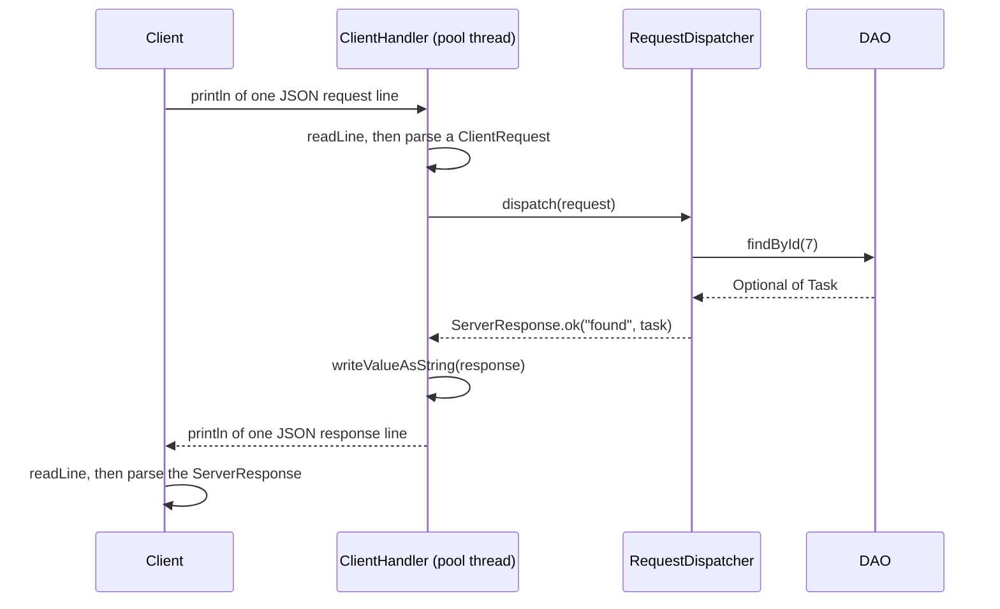

# Networking I — TCP Sockets and the Client-Server Protocol

> **Prerequisites:**
> - You understand interfaces, generics, and lambda expressions
> - You have a working DAO layer (see [DAO](../t15_dao/t15_dao_notes.md))
> - You understand `ExecutorService` and thread pools (see [Concurrency](../t19_concurrency/t19_concurrency_notes.md))
> - You can serialise and deserialise Java objects to/from JSON

---

---

## In this topic

- [What you'll learn](#what-youll-learn)
- [Why this matters](#why-this-matters)
- [How this builds on previous content](#how-this-builds-on-previous-content)
- [Key terms](#key-terms)
- [Part 1: A minimal echo server](#part-1-a-minimal-echo-server)
- [Part 2: Multi-client server with ExecutorService](#part-2-multi-client-server-with-executorservice)
- [Part 3: Designing a JSON protocol](#part-3-designing-a-json-protocol)
- [Part 4: A full JSON protocol server](#part-4-a-full-json-protocol-server)
- [Part 5: Protocol documentation](#part-5-protocol-documentation)
- [Part 6: Sending files through the protocol](#part-6-sending-files-through-the-protocol)
- [Common mistakes](#common-mistakes)
- [Practice tasks](#practice-tasks)
- [Reflective questions](#reflective-questions)
- [Further reading](#further-reading)

---

## What you'll learn

| Skill Type | You will be able to... |
| :- | :- |
| Understand | Explain what TCP is and why sockets are a reliable transport for a client-server protocol. |
| Understand | Describe the roles of `ServerSocket` and `Socket` in a Java server-client pair. |
| Apply | Write a single-threaded echo server and matching client as a baseline. |
| Apply | Extend to a multi-client server using `ExecutorService` and a `ClientHandler` `Runnable`. |
| Apply | Design and implement a JSON-based request/response protocol. |
| Apply | Implement a generic `ServerResponse<T>` wrapper for all server replies. |
| Apply | Add structured error handling so exceptions never reach the client as raw stack traces. |
| Analyse | Document a protocol: request types, payload fields, and response shape. |

---

## Why this matters

In GCA2 Stage 2, your DAO layer moves to a server. Clients connect over a network, send JSON requests (insert task, get by ID, filter, etc.), and receive JSON responses. The server handles multiple clients simultaneously using the `ExecutorService` you learned in [Concurrency](../t19_concurrency/t19_concurrency_notes.md).

This is a realistic multi-tier architecture: clients know nothing about SQL, and the server knows nothing about the client's UI. They communicate only via a documented protocol.

---

## How this builds on previous content

| Previous concept | How it reappears here |
| :- | :- |
| Interface + implementation | `ServerSocket` / `Socket` give you streams; you wrap them in familiar `BufferedReader` / `PrintWriter` |
| `ExecutorService` | The server submits each accepted connection as a `Runnable` task to the pool |
| DAO layer | `ClientHandler` calls your DAO — the persistence layer is unchanged |
| Generics (`ServerResponse<T>`) | The generic response wrapper uses the same generic syntax as your DAO return types |
| JSON serialisation | Every request and response travels as a JSON string over the socket |

---

## Key terms

### TCP

**TCP (Transmission Control Protocol)** is a connection-oriented protocol that guarantees delivery of data in the correct order. Once a connection is established, reading and writing feel like reading and writing a stream.

### Socket

A **socket** is one endpoint of a two-way connection. A server socket listens for incoming connections; client sockets make connections. Once connected, both ends have a socket they can read from and write to.

### `ServerSocket`

Java's `ServerSocket` binds to a port and calls `accept()` to block until a client connects. `accept()` returns a `Socket` representing that specific client connection.

### `Socket`

Java's `Socket` represents an established connection. You get an `InputStream` (read from the client) and an `OutputStream` (write to the client) from it.

### Protocol

A **protocol** is an agreed set of rules: what messages look like, what they mean, and what the expected response is. Your GCA2 protocol uses JSON strings sent as single lines, one message per `println`.

### `ServerResponse<T>`

A generic wrapper that standardises every response from the server. It carries a status (`"OK"` or `"ERROR"`), a human-readable message, and an optional data payload of type `T`.

---

## Part 1: A minimal echo server

Before adding your DAO or JSON protocol, get familiar with the socket primitives.

### The server

```java
import java.io.*;
import java.net.*;
import java.nio.charset.StandardCharsets;

public class EchoServer {

    // === Fields ===
    private int port;

    // === Constructors ===
    // Creates: an echo server that will listen on the given port
    public EchoServer(int port) {
        if (port < 1_024 || port > 65_535)
            throw new IllegalArgumentException("port must be 1024–65535");
        this.port = port;
    }

    // === Public API ===
    // Starts: the server — blocks waiting for one client, echoes each line, then exits
    public void start() throws IOException {
        try (ServerSocket serverSocket = new ServerSocket(port)) {
            System.out.println("Echo server listening on port " + port);

            // Blocks until a client connects
            Socket clientSocket = serverSocket.accept();
            System.out.println("Client connected: " + clientSocket.getInetAddress());

            try (BufferedReader in = new BufferedReader(
                     new InputStreamReader(clientSocket.getInputStream(), StandardCharsets.UTF_8));
                 PrintWriter out = new PrintWriter(
                     new OutputStreamWriter(clientSocket.getOutputStream(), StandardCharsets.UTF_8),
                     true)) {

                String line;
                while ((line = in.readLine()) != null) {
                    System.out.println("Received: " + line);
                    out.println("ECHO: " + line);
                }
            }
        }
    }

    public static void main(String[] args) throws IOException {
        new EchoServer(9_000).start();
    }
}
```

### The client

```java
import java.io.*;
import java.net.*;
import java.nio.charset.StandardCharsets;

public class EchoClient {

    // === Fields ===
    private String host;
    private int port;

    // === Constructors ===
    // Creates: a client that will connect to the given host and port
    public EchoClient(String host, int port) {
        if (host == null || host.isBlank())
            throw new IllegalArgumentException("host is required");
        this.host = host;
        this.port = port;
    }

    // === Public API ===
    // Connects: sends a test message and prints the reply
    public void run() throws IOException {
        try (Socket socket = new Socket(host, port);
             BufferedReader in = new BufferedReader(
                 new InputStreamReader(socket.getInputStream(), StandardCharsets.UTF_8));
             PrintWriter out = new PrintWriter(
                 new OutputStreamWriter(socket.getOutputStream(), StandardCharsets.UTF_8), true)) {

            out.println("hello server");

            // Blocks until a line arrives
            String reply = in.readLine();
            System.out.println("Reply: " + reply);
        }
    }

    public static void main(String[] args) throws IOException {
        new EchoClient("localhost", 9_000).run();
    }
}
```

Key points:
- `new PrintWriter(..., true)` — the `true` is **auto-flush**: the buffer is flushed after every `println`. Without this, data can sit in the buffer and never reach the other end.
- `readLine()` returns `null` when the connection is closed.
- Both readers and writers name `StandardCharsets.UTF_8`. A socket carries bytes, and the two ends must agree how characters become bytes. Since Java 18 the default is UTF-8 everywhere, but a protocol should not depend on what each end's JDK happens to default to — see [t18 Java I/O](../t18_io/t18_io_notes.md).
- Both sides use `try-with-resources` to close the socket cleanly.

---

## Part 2: Multi-client server with ExecutorService

The echo server above handles one client, then exits. A real server loops on `accept()` and delegates each connection to a thread pool.

```java
import java.io.*;
import java.net.*;
import java.nio.charset.StandardCharsets;
import java.util.concurrent.*;

public class MultiClientServer {

    // === Fields ===
    private int port;
    private ExecutorService pool;

    // === Constructors ===
    // Creates: a multi-client server using a cached thread pool
    public MultiClientServer(int port) {
        if (port < 1_024 || port > 65_535)
            throw new IllegalArgumentException("port must be 1024–65535");
        this.port = port;
        pool = Executors.newCachedThreadPool();
    }

    // === Public API ===
    // Starts: the server accept loop — runs until the process is stopped
    public void start() throws IOException {
        System.out.println("Server starting on port " + port);

        try (ServerSocket serverSocket = new ServerSocket(port)) {
            while (true) {
                // Block until a client arrives, then hand the connection to the pool
                Socket clientSocket = serverSocket.accept();
                System.out.println("Accepted: " + clientSocket.getInetAddress());
                pool.submit(new ClientHandler(clientSocket));
            }
        }
    }

    // === Helpers ===
    // Handles: one connected client — runs on a pool thread
    private static class ClientHandler implements Runnable {

        private Socket socket;

        // Creates: a handler for the given socket
        public ClientHandler(Socket socket) {
            this.socket = socket;
        }

        // Runs: the client session — reads lines and echoes them
        @Override
        public void run() {
            System.out.println("Handling client on " + Thread.currentThread().getName());

            try (BufferedReader in = new BufferedReader(
                     new InputStreamReader(socket.getInputStream(), StandardCharsets.UTF_8));
                 PrintWriter out = new PrintWriter(
                     new OutputStreamWriter(socket.getOutputStream(), StandardCharsets.UTF_8),
                     true)) {

                String line;
                while ((line = in.readLine()) != null) {
                    out.println("ECHO: " + line);
                }
            }
            catch (IOException e) {
                System.out.println("Client disconnected: " + e.getMessage());
            }
            finally {
                try {
                    socket.close();
                }
                catch (IOException e) {
                    // nothing useful to do here
                }
            }
        }
    }

    public static void main(String[] args) throws IOException {
        new MultiClientServer(9_000).start();
    }
}
```

Notice:
- The `while (true)` accept loop never blocks waiting for the current client to finish, because each client is submitted to the pool.
- The `finally` block closes the socket even if the handler throws an exception.
- Exceptions in the handler are caught and logged — they do not crash the server or the pool thread.

---

## Part 3: Designing a JSON protocol

### Why JSON over raw strings?

Raw strings are fragile: you need to parse tokens manually and the format is hard to extend. JSON gives you a self-describing structure that maps directly to your Java DTOs.

### Protocol rule: one JSON object per line

Each request and each response is **one JSON string** sent as a single line (terminated by `\n`). `PrintWriter.println()` adds the newline; `BufferedReader.readLine()` removes it.

Never send multi-line JSON over a socket unless you define explicit length framing — that is significantly more complex.

---

### Request structure

```json
{
  "requestType": "GET_ALL",
  "payload": {}
}
```

```json
{
  "requestType": "GET_BY_ID",
  "payload": { "id": 42 }
}
```

```json
{
  "requestType": "INSERT",
  "payload": { "title": "Buy milk", "status": "TODO" }
}
```

```json
{
  "requestType": "DISCONNECT",
  "payload": {}
}
```

On the wire `requestType` is a string, but in Java it is an **enum**, so a misspelt type cannot compile and the server can route on it with an `EnumMap` (Part 4):

```java
public enum RequestType {
    GET_ALL,
    GET_BY_ID,
    INSERT,
    UPDATE,
    DELETE,
    FILTER,
    DISCONNECT
}
```

---

### `ServerResponse<T>` — the response wrapper

Every server reply uses the same envelope:

```java
import com.fasterxml.jackson.annotation.JsonIgnore;

public class ServerResponse<T> {

    // === Fields ===
    // "OK" or "ERROR"
    private String status;
    private String message;
    private T data;

    // === Constructors ===
    // Creates: a response with all fields set explicitly
    public ServerResponse(String status, String message, T data) {
        if (status == null || status.isBlank())
            throw new IllegalArgumentException("status is required");
        this.status = status;
        this.message = message;
        this.data = data;
    }

    // === Public API ===
    // Gets: the status string — "OK" or "ERROR"
    public String getStatus() {
        return status;
    }

    // Gets: the human-readable message
    public String getMessage() {
        return message;
    }

    // Gets: the data payload, which may be null for error responses
    public T getData() {
        return data;
    }

    // Creates: a successful response carrying data
    public static <T> ServerResponse<T> ok(String message, T data) {
        return new ServerResponse<>("OK", message, data);
    }

    // Creates: an error response with no data
    public static <T> ServerResponse<T> error(String message) {
        return new ServerResponse<>("ERROR", message, null);
    }

    // Checks: whether this response represents a successful operation.
    // @JsonIgnore stops Jackson sending it as an extra "ok" field: it is derived from status
    @JsonIgnore
    public boolean isOk() {
        return "OK".equals(status);
    }
}
```

Usage examples:

```java
ServerResponse<List<Task>> ok = ServerResponse.ok("retrieved 3 tasks", tasks);
ServerResponse<Task> ok2 = ServerResponse.ok("task inserted", newTask);
ServerResponse<Void> error = ServerResponse.error("task not found");
```

On the wire as JSON (using Jackson):

```json
{ "status": "OK", "message": "retrieved 3 tasks", "data": [ ... ] }
{ "status": "ERROR", "message": "task not found", "data": null }
```

---

## Part 4: A full JSON protocol server

### Project structure

| Package | File | Responsibility |
| :- | :- | :- |
| `server` | `Server.java` | Accept loop and thread pool |
| `server` | `ClientHandler.java` | One client session: socket I/O and JSON parsing only |
| `server` | `RequestDispatcher.java` | Routes each request type to a handler; no socket code |
| `server` | `RequestHandler.java` | The interface every handler implements |
| `shared` | `RequestType.java` | Enum of request types |
| `shared` | `ClientRequest.java` | DTO for incoming requests |
| `shared` | `ServerResponse.java` | Generic response wrapper |
| `dao` | `TaskDao.java`, `JdbcTaskDao.java`, `DaoException.java` | The DAO layer from t15, unchanged |
| `domain` | `Task.java`, `TaskStatus.java` | The domain types from t15, unchanged |

The important split is between `ClientHandler` and `RequestDispatcher`. `ClientHandler` knows about sockets and JSON text but nothing about tasks. `RequestDispatcher` knows about tasks and the DAO but nothing about sockets. That means the dispatcher — where nearly all of the logic lives — can be tested with plain JUnit calls and an in-memory DAO, with no network at all.

---

### `ClientRequest`

```java
import java.util.Map;

public class ClientRequest {

    // === Fields ===
    private RequestType requestType;
    private Map<String, Object> payload;

    // === Constructors ===
    // Creates: an empty ClientRequest — needed by Jackson deserialisation
    public ClientRequest() {
        payload = Map.of();
    }

    // Creates: a request ready to send, used by the client
    public ClientRequest(RequestType requestType, Map<String, Object> payload) {
        this.requestType = requestType;
        this.payload = payload == null ? Map.of() : payload;
    }

    // === Public API ===
    // Gets: the request type, or null if the JSON did not include one
    public RequestType getRequestType() {
        return requestType;
    }

    // Sets: the request type (Jackson turns the JSON string "GET_ALL" into RequestType.GET_ALL)
    public void setRequestType(RequestType requestType) {
        this.requestType = requestType;
    }

    // Gets: the payload map
    public Map<String, Object> getPayload() {
        return payload;
    }

    // Sets: the payload map
    public void setPayload(Map<String, Object> payload) {
        this.payload = payload == null ? Map.of() : payload;
    }

    // Gets: a string value from the payload by key, or null if absent
    public String getString(String key) {
        Object v = payload.get(key);
        return v == null ? null : v.toString();
    }

    // Gets: an integer value from the payload by key, or -1 if absent/unparseable
    public int getInt(String key) {
        Object v = payload.get(key);
        if (v == null)
            return -1;
        try {
            return Integer.parseInt(v.toString());
        }
        catch (NumberFormatException e) {
            return -1;
        }
    }
}
```

#### Snippet explanation

`requestType` is the `RequestType` enum from Part 3, not a `String`. Jackson converts the JSON string `"GET_ALL"` into `RequestType.GET_ALL` automatically, and rejects an unknown value such as `"GET_EVERYTHING"` while parsing. A typo in a request type is therefore caught in one place, before any handler runs, and code that compares request types gets compiler checking instead of string comparisons.

---

### `RequestHandler` and `RequestDispatcher`

In t21 you replaced an `if-else` chain with a **routing table**: a map from request type to a handler object. Here the key is the `RequestType` enum, so the map is an `EnumMap`.

```java
// One handler per request type; may report a storage failure
@FunctionalInterface
public interface RequestHandler {
    ServerResponse<?> handle(ClientRequest request) throws DaoException;
}
```

```java
import java.util.EnumMap;
import java.util.List;
import java.util.Map;
import java.util.Optional;

public class RequestDispatcher {

    // === Fields ===
    private final TaskDao dao;
    private final Map<RequestType, RequestHandler> handlers = new EnumMap<>(RequestType.class);

    // === Constructors ===
    // Creates: a dispatcher with one handler registered for each supported request type
    public RequestDispatcher(TaskDao dao) {
        if (dao == null)
            throw new IllegalArgumentException("dao is required");
        this.dao = dao;

        handlers.put(RequestType.GET_ALL, this::getAll);
        handlers.put(RequestType.GET_BY_ID, this::getById);
        handlers.put(RequestType.INSERT, this::insert);
        handlers.put(RequestType.DELETE, this::delete);
        handlers.put(RequestType.DISCONNECT, req -> ServerResponse.ok("goodbye", null));
    }

    // === Public API ===
    // Dispatches: one parsed request; never throws, always returns a response to send
    public ServerResponse<?> dispatch(ClientRequest request) {
        if (request == null || request.getRequestType() == null)
            return ServerResponse.error("request has no requestType");

        RequestHandler handler = handlers.get(request.getRequestType());
        if (handler == null)
            return ServerResponse.error("unsupported request type: " + request.getRequestType());

        try {
            return handler.handle(request);
        }
        catch (IllegalArgumentException e) {
            // Bad input from the client, e.g. a blank title: safe to explain
            return ServerResponse.error("invalid request: " + e.getMessage());
        }
        catch (DaoException e) {
            // A server-side failure: log the details here, tell the client only what happened
            System.err.println("Database error handling " + request.getRequestType());
            e.printStackTrace();
            return ServerResponse.error("server could not complete the request; try again later");
        }
    }

    // === Handlers ===
    // Handles: GET_ALL
    private ServerResponse<?> getAll(ClientRequest req) throws DaoException {
        List<Task> tasks = dao.findAll();
        return ServerResponse.ok("retrieved " + tasks.size() + " tasks", tasks);
    }

    // Handles: GET_BY_ID
    private ServerResponse<?> getById(ClientRequest req) throws DaoException {
        int id = req.getInt("id");
        Optional<Task> task = dao.findById(id);
        if (task.isEmpty())
            return ServerResponse.error("no task with id=" + id);
        return ServerResponse.ok("task found", task.get());
    }

    // Handles: INSERT — status is optional and defaults to TODO
    private ServerResponse<?> insert(ClientRequest req) throws DaoException {
        String statusText = req.getString("status");
        TaskStatus status = statusText == null
            ? TaskStatus.TODO
            : TaskStatus.parse(statusText).orElseThrow(
                () -> new IllegalArgumentException("unknown status '" + statusText + "'"));

        // The Task constructor rejects a missing or blank title with IllegalArgumentException
        int newId = dao.insert(new Task(0, req.getString("title"), status));

        return dao.findById(newId)
            .<ServerResponse<?>>map(t -> ServerResponse.ok("task created", t))
            .orElse(ServerResponse.error("insert succeeded but task not found"));
    }

    // Handles: DELETE
    private ServerResponse<?> delete(ClientRequest req) throws DaoException {
        int id = req.getInt("id");
        if (!dao.deleteById(id))
            return ServerResponse.error("no task with id=" + id);
        return ServerResponse.ok("task deleted", null);
    }
}
```

#### Snippet explanation

Adding a request type is now two steps: write one private handler method, and register it with one `handlers.put(...)` line. `dispatch` itself never changes. `this::getAll` is a method reference to a handler method; it fits `RequestHandler` because `RequestHandler` has exactly one abstract method.

`dispatch` is the one place that turns failures into responses, and it keeps two kinds apart:

| What went wrong | Example | What the client is told |
| :- | :- | :- |
| The client sent something invalid | blank title, unknown status | `invalid request: ...` with the reason |
| The server failed | database down (`DaoException`) | a general message; the details go to the server log |

The client needs enough to fix its own mistakes, but should never see SQL errors, table names or stack traces from the server. Those help an attacker and mean nothing to a user.

---

### `ClientHandler` — socket session only

```java
import com.fasterxml.jackson.core.JsonProcessingException;
import com.fasterxml.jackson.databind.ObjectMapper;
import java.io.*;
import java.net.Socket;
import java.nio.charset.StandardCharsets;

public class ClientHandler implements Runnable {

    // A fixed, hand-checked reply used only if building a normal response fails
    private static final String FALLBACK_ERROR =
        "{\"status\":\"ERROR\",\"message\":\"internal server error\",\"data\":null}";

    // === Fields ===
    private final Socket socket;
    private final RequestDispatcher dispatcher;
    private final ObjectMapper mapper = new ObjectMapper();

    // === Constructors ===
    // Creates: a handler for the given socket, using the shared dispatcher
    public ClientHandler(Socket socket, RequestDispatcher dispatcher) {
        if (socket == null)
            throw new IllegalArgumentException("socket is required");
        if (dispatcher == null)
            throw new IllegalArgumentException("dispatcher is required");

        this.socket = socket;
        this.dispatcher = dispatcher;
    }

    // === Public API ===
    // Runs: the client session — reads JSON requests and writes JSON responses
    @Override
    public void run() {
        try (Socket socket = this.socket;
             BufferedReader in = new BufferedReader(
                 new InputStreamReader(socket.getInputStream(), StandardCharsets.UTF_8));
             PrintWriter out = new PrintWriter(
                 new OutputStreamWriter(socket.getOutputStream(), StandardCharsets.UTF_8), true)) {

            String line;
            while ((line = in.readLine()) != null) {
                ClientRequest request = parse(line);
                ServerResponse<?> response = request == null
                    ? ServerResponse.error("malformed request: not valid JSON for this protocol")
                    : dispatcher.dispatch(request);

                out.println(toJson(response));

                if (request != null && request.getRequestType() == RequestType.DISCONNECT)
                    break;
            }
        }
        catch (IOException e) {
            System.out.println("Client disconnected: " + e.getMessage());
        }
        catch (RuntimeException e) {
            // A bug, not a client problem: log it, and let this session end cleanly
            System.err.println("Unexpected error in client session");
            e.printStackTrace();
        }
    }

    // === Helpers ===
    // Parses: one line of JSON, or returns null if it is not a valid request
    private ClientRequest parse(String line) {
        try {
            return mapper.readValue(line, ClientRequest.class);
        }
        catch (JsonProcessingException e) {
            return null;
        }
    }

    // Serialises: a response to one line of JSON
    private String toJson(ServerResponse<?> response) {
        try {
            return mapper.writeValueAsString(response);
        }
        catch (JsonProcessingException e) {
            e.printStackTrace();
            return FALLBACK_ERROR;
        }
    }
}
```

#### Snippet explanation

Only a JSON problem is reported as "malformed request" now. In an earlier version a single `catch (Exception e)` wrapped parsing **and** the DAO call, so a database outage reached the client as "malformed request" — telling the client it had made a mistake it had not made.

Both the reader and the writer name `StandardCharsets.UTF_8`, so the bytes on the wire match the protocol document ("one JSON object per line, UTF-8") whichever machine and JDK each end runs on. Listing `Socket socket = socket` first in the try-with-resources closes the socket last, after the reader and writer, with no hand-written `finally`.

The session ends when the client closes the connection (`readLine()` returns `null`) **or** sends `DISCONNECT`, after its "goodbye" response has been sent. Error responses are built as `ServerResponse` objects and serialised by Jackson, never by gluing strings together: a message containing a `"` character would otherwise produce invalid JSON.

---

### `Server` — accept loop

```java
import java.io.IOException;
import java.net.ServerSocket;
import java.net.Socket;
import java.nio.file.Path;
import java.util.concurrent.ExecutorService;
import java.util.concurrent.Executors;

public class Server {

    // === Fields ===
    private final int port;
    private final RequestDispatcher dispatcher;
    private final ExecutorService pool = Executors.newCachedThreadPool();

    // === Constructors ===
    // Creates: a server on the given port that answers requests with the given dispatcher
    public Server(int port, RequestDispatcher dispatcher) {
        if (port < 1_024 || port > 65_535)
            throw new IllegalArgumentException("port must be 1024–65535");
        if (dispatcher == null)
            throw new IllegalArgumentException("dispatcher is required");

        this.port = port;
        this.dispatcher = dispatcher;
    }

    // === Public API ===
    // Starts: the accept loop — runs indefinitely until interrupted
    public void start() throws IOException {
        System.out.println("Server listening on port " + port);

        try (ServerSocket serverSocket = new ServerSocket(port)) {
            while (!Thread.currentThread().isInterrupted()) {
                Socket client = serverSocket.accept();
                System.out.println("Client connected: " + client.getInetAddress());
                pool.submit(new ClientHandler(client, dispatcher));
            }
        }
        finally {
            pool.shutdown();
        }
    }

    public static void main(String[] args) throws IOException {
        // Database settings come from a file outside Git, as in t15 Step 6
        DbConfig cfg = DbConfig.load(Path.of("config/db.properties"));

        TaskDao dao = new JdbcTaskDao(cfg);
        new Server(9_000, new RequestDispatcher(dao)).start();
    }
}
```

#### Snippet explanation

The server builds **one** `RequestDispatcher` and shares it between every `ClientHandler`. That is safe because the dispatcher's only state, the DAO and the handler map, is set in its constructor and never changed, and `JdbcTaskDao` opens a new connection for each call. If you add a field that changes while requests are being handled, such as a request counter, it becomes shared mutable state and needs the protection described in [t19 Concurrency](../t19_concurrency/t19_concurrency_notes.md).

---

### Client — sending JSON requests

```java
import com.fasterxml.jackson.databind.ObjectMapper;
import java.io.*;
import java.net.Socket;
import java.nio.charset.StandardCharsets;
import java.util.Map;

public class TaskClient {

    // === Fields ===
    private final String host;
    private final int port;
    private final ObjectMapper mapper = new ObjectMapper();

    // === Constructors ===
    // Creates: a client that connects to the given host and port
    public TaskClient(String host, int port) {
        if (host == null || host.isBlank())
            throw new IllegalArgumentException("host is required");
        this.host = host;
        this.port = port;
    }

    // === Public API ===
    // Runs: a demo session — inserts a task, lists all tasks, then disconnects
    public void run() throws IOException {
        try (Socket socket = new Socket(host, port);
             BufferedReader in = new BufferedReader(
                 new InputStreamReader(socket.getInputStream(), StandardCharsets.UTF_8));
             PrintWriter out = new PrintWriter(
                 new OutputStreamWriter(socket.getOutputStream(), StandardCharsets.UTF_8), true)) {

            send(out, new ClientRequest(RequestType.INSERT, Map.of("title", "Buy milk")));
            System.out.println("INSERT response: " + in.readLine());

            send(out, new ClientRequest(RequestType.GET_ALL, Map.of()));
            System.out.println("GET_ALL response: " + in.readLine());

            send(out, new ClientRequest(RequestType.DISCONNECT, Map.of()));
            System.out.println("DISCONNECT response: " + in.readLine());
        }
    }

    // === Helpers ===
    // Sends: one request as one line of JSON
    private void send(PrintWriter out, ClientRequest request) throws IOException {
        out.println(mapper.writeValueAsString(request));
    }

    public static void main(String[] args) throws IOException {
        new TaskClient("localhost", 9_000).run();
    }
}
```

#### Snippet explanation

The client builds the same `ClientRequest` DTO the server parses, with a `RequestType` constant, so a misspelt request type does not compile. Jackson writes the enum as its name, for example `"requestType":"INSERT"`, which is exactly what the protocol document specifies.

---

### The full message flow



**Diagram description**
The client writes one JSON request line to the socket. A pool thread running `ClientHandler` reads that line and parses it into a `ClientRequest`, then hands it to the `RequestDispatcher`. The dispatcher looks up the handler for the request type and calls the matching DAO method. The DAO result travels back to the dispatcher, which wraps it in a `ServerResponse`. The handler serialises that to JSON and writes it back down the socket. The client reads the line and parses the response.

Every step that touches the network is a single `println` or `readLine`. The real work is in the mapping (t20) and the dispatching (t21 and this topic). One `RequestDispatcher` and one `ObjectMapper` are shared by every pool thread. That is safe: the handler map is only written during construction, and a configured `ObjectMapper` is thread-safe.

---

## Part 5: Protocol documentation

GCA2 requires a protocol document committed to your README. Here is a template:

---

### Protocol Reference

**Transport:** TCP socket
**Format:** One JSON object per line (UTF-8). Each message is terminated by `\n`.
**Port:** 9000 (default)

#### Request envelope

```json
{ "requestType": "<TYPE>", "payload": { ... } }
```

#### Response envelope

```json
{ "status": "OK|ERROR", "message": "<description>", "data": <payload or null> }
```

#### Supported request types

| requestType | Payload fields | Success response data |
| :- | :- | :- |
| `GET_ALL` | _(none)_ | Array of task objects |
| `GET_BY_ID` | `id: int` | Single task object |
| `INSERT` | `title: string`, optional `status: string` (`TODO`, `DOING` or `DONE`; default `TODO`) | Inserted task object with generated ID |
| `UPDATE` | `id: int`, `title: string`, `status: string` | Updated task object |
| `DELETE` | `id: int` | `null` |
| `FILTER` | `status: string` | Array of matching task objects |
| `DISCONNECT` | _(none)_ | `null` |

#### Error responses

Any request that fails returns the error envelope. The message says which kind of failure it was:

| Message starts with | Meaning | Client should |
| :- | :- | :- |
| `malformed request` | The line was not valid JSON, or had an unknown `requestType` | Fix the request it sends |
| `invalid request` | A payload field was missing or invalid | Fix the field named in the message |
| `no task with id` | The id does not exist | Treat as "not found" |
| `server could not complete the request` | A server-side failure, such as the database being down | Try again later; nothing was wrong with the request |

The envelope is:

```json
{ "status": "ERROR", "message": "<reason>", "data": null }
```

Clients must always check the `status` field before using `data`.

---

## Part 6: Sending files through the protocol

[t21](../t21_json_2_jackson_advanced/t21_json_2_jackson_advanced_notes.md) showed how a file becomes Base64 text inside a JSON payload, and how the bytes are stored in a BLOB. Nothing about the socket changes when a file is involved. The Base64 text is one field in one line of JSON:

```java
// Builds: the upload request, using the payload class from t21
FileUploadPayload payload = buildUploadPayload(Path.of("profile.png"), 7);
Map<String, Object> fields = MAPPER.convertValue(payload, new TypeReference<>() { });
ClientRequest request = new ClientRequest(RequestType.UPLOAD_FILE, fields);

// Sends: one line, exactly like any other request
out.println(MAPPER.writeValueAsString(request));
```

`UPLOAD_FILE` is one more `RequestType` constant, with its own handler in the dispatcher.

Three demos in `code/src/t22_networking/demos/` build this up. Each has a server and a client, and each needs the MySQL database from the t21 BLOB section:

| Demo | Run | What it shows |
| :- | :- | :- |
| `de01` | `UploadServer`, then `UploadClient` | The client sends a file as Base64; the server decodes it and stores a BLOB |
| `de02` | `RetrieveServer`, then `RetrieveClient` | The server returns the stored file as Base64; the client writes it to disk |
| `de03` | `MetadataServer`, then `MetadataClient` | The server returns the file's details without the bytes |

Line-delimited JSON has one cost here. A 5 MB file becomes about 6.7 MB of text on a single line, all of it held in memory at both ends. That is fine for an assessment project. A production system would send large files in a separate stream, or in chunks.

---

## Common mistakes

| Mistake | What happens | Fix |
| :- | :- | :- |
| `new PrintWriter(out)` without `true` | Data sits in the buffer and is never sent | Always use `new PrintWriter(out, true)` (auto-flush) |
| Sending multi-line JSON | `readLine()` only reads one line — partial JSON is received | Serialise to a single-line string before sending |
| Not closing the socket in `finally` | File descriptor leaks; server eventually runs out of sockets | Always close in `finally` or use try-with-resources |
| Propagating exceptions as stack traces to the client | Client receives unparseable text | Catch all exceptions in the handler; return a `ServerResponse.error(...)` |
| Creating `ObjectMapper` inside `readLine()` loop | New mapper instance on every message — expensive | Create one mapper per handler in the constructor |
| Forgetting `DISCONNECT` handling | Socket stays open after client exits | Reply, then end the session loop |
| Routing with an `if` chain on strings | Every new request type edits the same method, and a typo silently becomes "unknown type" | Use a `RequestType` enum and an `EnumMap` of handlers |
| One `catch (Exception e)` around parsing and the DAO call | A database failure is reported to the client as "malformed request" | Catch JSON errors, invalid input and `DaoException` separately |
| Building JSON by joining strings | A `"` in a message produces invalid JSON | Serialise a `ServerResponse` with Jackson |
| No charset on `InputStreamReader` | The two ends may decode bytes differently | Pass `StandardCharsets.UTF_8` to every reader and writer |

---

## Practice tasks

1. Extend the server to handle `UPDATE` and `FILTER` requests: write a handler method for each and register it in the `RequestDispatcher` constructor. `ClientHandler` should not change.
2. `getInt` returns `-1` for a missing `id`. Make `GET_BY_ID` and `DELETE` return `invalid request: id is required` instead of "no task with id=-1".
3. Write JUnit tests for `RequestDispatcher` using an in-memory `TaskDao` (t15 practice task 5): no sockets, no database. Include one test with a DAO that always throws `DaoException`.
4. Write a `TaskClient` menu that lets a user choose an operation (GET_ALL, INSERT, DELETE) from the console.
5. Test with two client processes open simultaneously. Verify both get correct independent responses.
6. Add a request log to the server: print `[THREAD] requestType` for every request received.

---

## Reflective questions

1. Why does `PrintWriter` need `auto-flush = true` when writing to a socket?
2. What is the difference between the server's accept loop and the work done in `ClientHandler`?
3. Why should exceptions in `ClientHandler.run()` never propagate out of the `try/catch`?
4. If you added a second entity (e.g. `User`), how would you extend the protocol without breaking existing clients?
5. What is the purpose of `DISCONNECT` when TCP would close the connection anyway when the process exits?

<details style="background:#f5f7ff; border:1px solid rgba(0,0,0,0.15); border-radius:10px;
padding:0.9rem 1rem; margin:1rem 0;">
  <summary style="cursor:pointer; font-weight:800; margin:0;">
    Check your thinking
  </summary>

**1. Why `PrintWriter` needs auto-flush on a socket.**
`PrintWriter` buffers output for efficiency and only pushes it to the socket when the buffer fills, is flushed, or is closed. On a request/response protocol that produces **deadlock**: the server writes its reply into the buffer and blocks on `readLine()` waiting for the next request, while the client blocks on `readLine()` waiting for a reply that is still sitting in the server's buffer. Neither side can proceed, and it looks like a hang with no exception.

`new PrintWriter(socket.getOutputStream(), true)` flushes on every `println`, which is exactly the granularity a line-delimited protocol needs. The equivalent is calling `out.flush()` after each write — auto-flush just means you cannot forget. Note the `true` only auto-flushes on `println`/`printf`, not on `print`, so terminate messages with `println`.

**2. Accept loop vs `ClientHandler`.**
Different jobs on different threads. The **accept loop** is the receptionist: `serverSocket.accept()` blocks until a client connects, returns a `Socket` for that one client, hands it to the pool, and loops immediately to wait for the next. It does no protocol work at all.

**`ClientHandler`** is the conversation: it owns one socket for that client's whole session, reading requests, dispatching to the DAO and writing responses until the client leaves.

The separation is what makes the server multi-client. Do the handling inside the accept loop and the server serves exactly one client at a time — everyone else waits at `accept()` until the first disconnects. The loop must stay short and non-blocking so it can get back to accepting.

**3. Why exceptions must not escape `ClientHandler.run()`.**
Because there is nowhere useful for them to go. `run()` is the top of its thread: an exception that escapes kills that thread, and with `submit()` it is captured silently in a `Future` nobody reads, so the client's connection dies with **no error message on either side** — the client just hangs or sees an abrupt close, and the server log shows nothing.

It also leaks the socket, since cleanup after the throw point never runs. One misbehaving client (a malformed request, a missing JSON field) should degrade to _one error response_, never to a dead thread or a destabilised server. Catch inside `run()`, log with the exception object, attempt to send `ServerResponse.error(...)`, and close the socket in a `finally` or via try-with-resources.

**4. Adding a `User` entity without breaking existing clients.**
Add, never change. Introduce new request types (`GET_USER_BY_ID`, `INSERT_USER`) and register new handlers; every existing type keeps its name, payload shape and response shape, so deployed clients are unaffected and simply never send the new ones. The `DaoRegistry` from the supplement is what makes this a one-line change rather than a new `ClientHandler` constructor parameter.

The rules that keep this safe are worth stating: **adding** a field to a response is backward-compatible (old clients ignore unknown keys, provided Jackson is not configured to fail on them); **renaming, removing or retyping** a field is not; and an unknown request type must return a structured error rather than crashing. If a breaking change becomes unavoidable, version the protocol — a `version` field in the envelope, or `GET_USER_V2` — rather than mutating an existing type in place.

**5. Purpose of `DISCONNECT` when TCP closes anyway.**
It is the difference between hanging up and the line going dead. `DISCONNECT` is a **graceful, in-band** goodbye: the server learns the session is over at a known point, can finish any in-flight work, flush and commit, log a clean end, remove the client from any registry, close the socket and return its pool thread promptly.

Relying on the process exiting instead means the server discovers the loss only when a read returns `-1`/`null` or throws — and that can take a long time if the client's machine crashed or the network dropped, because the OS has no packet telling it so. Until then the handler thread sits blocked and its resources are pinned; a server that leaks a thread per abandoned client eventually exhausts its pool. A deliberate `DISCONNECT` also lets you distinguish "client left normally" from "connection failed", which matters both for logs and for deciding whether to roll back partial work.

</details>

---

## Further reading

- Oracle Docs — All About Sockets
  <https://docs.oracle.com/javase/tutorial/networking/sockets/>
- Baeldung — Java `ServerSocket`
  <https://www.baeldung.com/a-guide-to-java-sockets>
- Jackson `ObjectMapper` usage
  <https://www.baeldung.com/jackson-object-mapper-tutorial>

---

## Lesson Context

```yaml
previous_lesson:
  topic_code: t21_json_2_jackson_advanced
  domain_emphasis: Balanced

this_lesson:
  topic_code: t22_networking
  primary_domain_emphasis: Balanced
  difficulty_tier: Intermediate
mlos: [MLO4]
```
