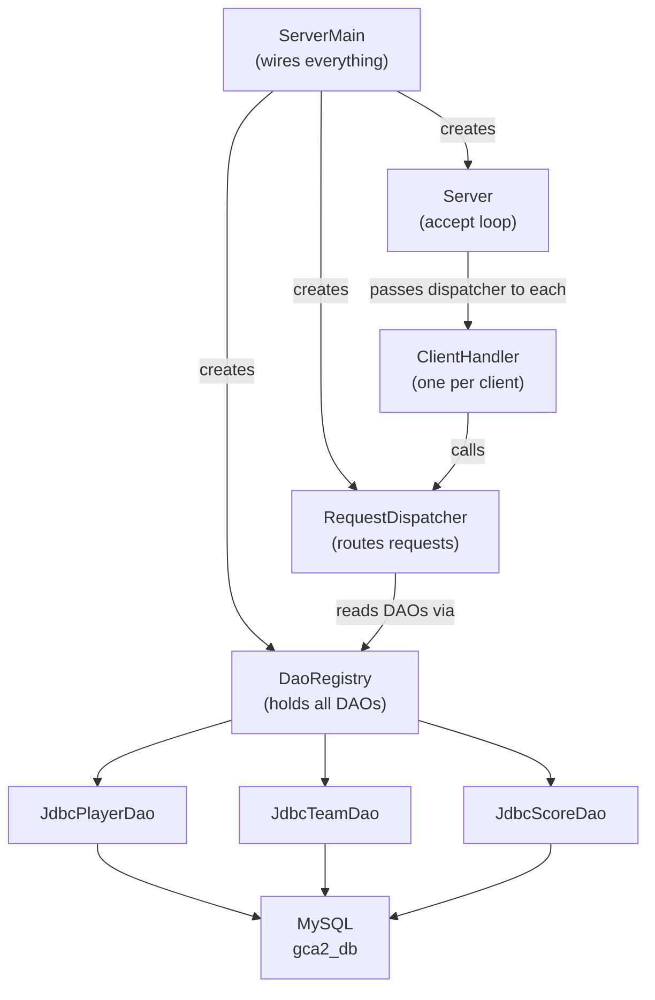

# Supplement — Managing Multiple DAOs in a Server

> **Context:**
> This note extends [t22_networking_notes.md](t22_networking_notes.md). Read it after you have a working single-table server. It targets GCA2 projects with **more than one database table**, where `RequestDispatcher` would otherwise receive a separate DAO parameter per table.

---

## What you'll learn

| Skill Type | You will be able to... |
| :- | :- |
| Understand | Explain why passing multiple DAO objects directly to `RequestDispatcher` becomes a problem as the schema grows. |
| Apply | Create a `DaoRegistry` class that bundles all DAOs into one object. |
| Apply | Refactor `RequestDispatcher` to depend on a single `DaoRegistry`. |
| Apply | Register handlers that route requests across multiple entity types. |
| Analyse | Explain the trade-off between `DaoRegistry` and a full service layer. |

---

## Why this matters

In the single-table example from [Networking I](t22_networking_notes.md), `RequestDispatcher` received one DAO, and `Server` and `ClientHandler` received only the dispatcher:

```java
RequestDispatcher dispatcher = new RequestDispatcher(taskDao);
new Server(9_000, dispatcher).start();
```

That split already keeps DAOs out of the networking classes. GCA2 requires **multiple related tables** (e.g. Players, Teams, Scores). The obvious first attempt is to add a parameter to the dispatcher for each new DAO:

```java
new RequestDispatcher(playerDao, teamDao, scoreDao);
```

This works, but it creates two problems that grow as your schema grows:
1. Every new table means another constructor parameter, another field and another null check in `RequestDispatcher`.
2. Every test that builds a dispatcher must pass every DAO, even the ones it does not use.

The fix is to **bundle all DAOs into one object** (`DaoRegistry`) and pass only that object to the dispatcher. `Server` and `ClientHandler` do not change at all.

---

## How this builds on previous content

| Previous concept | How it appears here |
| :- | :- |
| DAO interface + JDBC implementation | Each DAO is still defined by an interface; `DaoRegistry` holds interface references |
| Composition over inheritance | `DaoRegistry` holds DAO objects rather than extending them |
| Defensive coding (null/fail-fast) | `DaoRegistry` validates every DAO in its constructor |
| `RequestDispatcher` from [t22](t22_networking_notes.md) | Constructor shrinks from N DAO params to one `DaoRegistry` param |
| `Server` and `ClientHandler` from [t22](t22_networking_notes.md) | Unchanged: they only ever see the dispatcher |

---

## The problem in full

The example domain below has three tables: `players`, `teams`, and `scores`. Three interfaces exist: `PlayerDao`, `TeamDao`, and `ScoreDao`. Each follows the t15 pattern: its methods declare `throws DaoException`.

### Before: three parameters, and growing

```java
public class RequestDispatcher {

    // === Fields ===
    private final PlayerDao playerDao;
    private final TeamDao teamDao;
    private final ScoreDao scoreDao;

    // === Constructors ===
    // Creates: a dispatcher using three DAOs
    public RequestDispatcher(PlayerDao playerDao, TeamDao teamDao, ScoreDao scoreDao) {
        if (playerDao == null) throw new IllegalArgumentException("playerDao is required");
        if (teamDao == null) throw new IllegalArgumentException("teamDao is required");
        if (scoreDao == null) throw new IllegalArgumentException("scoreDao is required");

        this.playerDao = playerDao;
        this.teamDao = teamDao;
        this.scoreDao = scoreDao;
        // ... register handlers ...
    }
}
```

Add a fourth table and the constructor changes, and so does every place that builds a dispatcher, including every test. Add a fifth and they change again.

---

## The fix: `DaoRegistry`

`DaoRegistry` is a plain holder class. Its only job is to carry all the DAOs under one roof so that `RequestDispatcher` takes **one object** instead of N.

```java
public final class DaoRegistry {

    // === Fields ===
    private final PlayerDao playerDao;
    private final TeamDao teamDao;
    private final ScoreDao scoreDao;

    // === Constructors ===
    // Creates: a registry holding all three DAO objects — none may be null
    public DaoRegistry(PlayerDao playerDao, TeamDao teamDao, ScoreDao scoreDao) {
        if (playerDao == null) throw new IllegalArgumentException("playerDao is required");
        if (teamDao == null) throw new IllegalArgumentException("teamDao is required");
        if (scoreDao == null) throw new IllegalArgumentException("scoreDao is required");

        this.playerDao = playerDao;
        this.teamDao = teamDao;
        this.scoreDao = scoreDao;
    }

    // === Public API ===
    // Gets: the DAO responsible for player persistence
    public PlayerDao players() { return playerDao; }

    // Gets: the DAO responsible for team persistence
    public TeamDao teams() { return teamDao; }

    // Gets: the DAO responsible for score persistence
    public ScoreDao scores() { return scoreDao; }
}
```

Key points:
- Fields are interfaces (`PlayerDao`), not concrete classes — swapping implementations later requires no change here.
- Fields are `final`, so once built the registry never changes. That is what makes one registry safe to share between all the server's threads.
- The class contains **no logic** — that belongs in the service or DAO layers.
- Adding a fourth table means adding one field, one constructor parameter, and one getter.

---

## After: refactored `RequestDispatcher`

`RequestDispatcher` now has one DAO-related field. Its constructor takes one `DaoRegistry`, and registers a handler for each request type exactly as in t22. The `RequestType` enum lists the new types: `GET_ALL_PLAYERS`, `GET_PLAYER_BY_ID`, `INSERT_PLAYER`, `GET_ALL_TEAMS`, `GET_TEAM_BY_ID`, `GET_ALL_SCORES` and `DISCONNECT`.

```java
import java.util.EnumMap;
import java.util.List;
import java.util.Map;
import java.util.Optional;

public class RequestDispatcher {

    // === Fields ===
    private final DaoRegistry registry;
    private final Map<RequestType, RequestHandler> handlers = new EnumMap<>(RequestType.class);

    // === Constructors ===
    // Creates: a dispatcher that reads its DAOs from the shared registry
    public RequestDispatcher(DaoRegistry registry) {
        if (registry == null)
            throw new IllegalArgumentException("registry is required");
        this.registry = registry;

        // --- Player requests ---
        handlers.put(RequestType.GET_ALL_PLAYERS, this::getAllPlayers);
        handlers.put(RequestType.GET_PLAYER_BY_ID, this::getPlayerById);
        handlers.put(RequestType.INSERT_PLAYER, this::insertPlayer);

        // --- Team requests ---
        handlers.put(RequestType.GET_ALL_TEAMS, this::getAllTeams);
        handlers.put(RequestType.GET_TEAM_BY_ID, this::getTeamById);

        // --- Score requests ---
        handlers.put(RequestType.GET_ALL_SCORES, this::getAllScores);

        // --- Lifecycle ---
        handlers.put(RequestType.DISCONNECT, req -> ServerResponse.ok("goodbye", null));
    }

    // dispatch(ClientRequest) is exactly as in t22: look up the handler, run it, and turn
    // IllegalArgumentException and DaoException into the two kinds of error response.

    // === Handlers ===
    private ServerResponse<?> getAllPlayers(ClientRequest req) throws DaoException {
        List<Player> players = registry.players().findAll();
        return ServerResponse.ok("retrieved " + players.size() + " players", players);
    }

    private ServerResponse<?> getPlayerById(ClientRequest req) throws DaoException {
        int id = req.getInt("id");
        Optional<Player> player = registry.players().findById(id);
        return player.isPresent()
            ? ServerResponse.ok("player found", player.get())
            : ServerResponse.error("no player with id=" + id);
    }

    private ServerResponse<?> insertPlayer(ClientRequest req) throws DaoException {
        // The Player constructor rejects a blank name or position
        Player newPlayer = new Player(0, req.getString("name"), req.getString("position"));
        int newId = registry.players().insert(newPlayer);
        return registry.players().findById(newId)
            .<ServerResponse<?>>map(p -> ServerResponse.ok("player created", p))
            .orElse(ServerResponse.error("insert succeeded but player not found"));
    }

    private ServerResponse<?> getAllTeams(ClientRequest req) throws DaoException {
        List<Team> teams = registry.teams().findAll();
        return ServerResponse.ok("retrieved " + teams.size() + " teams", teams);
    }

    private ServerResponse<?> getTeamById(ClientRequest req) throws DaoException {
        int id = req.getInt("id");
        Optional<Team> team = registry.teams().findById(id);
        return team.isPresent()
            ? ServerResponse.ok("team found", team.get())
            : ServerResponse.error("no team with id=" + id);
    }

    private ServerResponse<?> getAllScores(ClientRequest req) throws DaoException {
        List<Score> scores = registry.scores().findAll();
        return ServerResponse.ok("retrieved " + scores.size() + " scores", scores);
    }
}
```

Notice:
- Adding a new request type (`INSERT_TEAM`, `DELETE_SCORE`, etc.) only requires a new enum constant, one handler method and one `handlers.put(...)` line.
- `registry.players()`, `registry.teams()`, and `registry.scores()` are short, readable calls.
- The null checks in `DaoRegistry`'s constructor guarantee these accessors never return `null`.
- The handlers are grouped by entity. If the dispatcher grows past a screenful, split it: one small class per entity (`PlayerHandlers`, `TeamHandlers`), each registering its own handlers.

---

## `Server` and `ClientHandler`: unchanged

Because `Server` and `ClientHandler` only know about `RequestDispatcher`, neither class changes when tables are added. Use them exactly as written in [t22 Part 4](t22_networking_notes.md#part-4-a-full-json-protocol-server).

---

## Wiring it all together: `ServerMain`

`ServerMain` is the only place that knows which concrete DAO implementations to use. Everything else depends on interfaces.

```java
import java.io.IOException;
import java.nio.file.Path;

public class ServerMain {

    public static void main(String[] args) throws IOException {

        // Database settings come from a file outside Git (t15 Step 6)
        DbConfig cfg = DbConfig.load(Path.of("config/db.properties"));

        // --- Build DAO implementations ---
        PlayerDao playerDao = new JdbcPlayerDao(cfg);
        TeamDao teamDao = new JdbcTeamDao(cfg);
        ScoreDao scoreDao = new JdbcScoreDao(cfg);

        // --- Bundle into registry, then build the one shared dispatcher ---
        DaoRegistry registry = new DaoRegistry(playerDao, teamDao, scoreDao);
        RequestDispatcher dispatcher = new RequestDispatcher(registry);

        // --- Start server ---
        new Server(5_000, dispatcher).start();
    }
}
```

`ServerMain` is the only class you change when:
- adding a new DAO (create it, pass it to `DaoRegistry`),
- swapping an implementation (change `new JdbcPlayerDao(...)` to something else).

---

## Architecture diagram



**Diagram description**
`ServerMain` wires everything together. It creates the `DaoRegistry`, which holds `JdbcPlayerDao`, `JdbcTeamDao` and `JdbcScoreDao`; it creates one `RequestDispatcher`, which reads its DAOs from the registry; and it creates the `Server`. The server runs the accept loop and passes the same dispatcher to every `ClientHandler` it creates, one per client. Each handler parses requests and calls the dispatcher, and all three DAOs talk to the MySQL database.

---

## Common mistakes

| Mistake | What happens | Fix |
| :- | :- | :- |
| Storing `DaoRegistry` as `static` | Hides the dependency; makes testing harder | Pass it as a constructor parameter every time |
| Skipping null checks in `DaoRegistry` | `NullPointerException` deep inside a handler thread, hard to trace | Always validate every DAO in the registry constructor |
| Creating a new `DaoRegistry` or dispatcher per accepted connection | Unnecessary object creation on every connection | Create one of each in `ServerMain`, share them across all handlers |
| Adding business logic to `DaoRegistry` | Mixes data access and rules; hard to test | `DaoRegistry` holds DAOs only; rules go in a service layer |
| Passing the registry to `ClientHandler` | Socket code gains a dependency on every DAO | Only `RequestDispatcher` sees the registry |
| Adding request-routing logic to `Server` | `Server` should only accept connections and submit tasks | All request routing stays in `RequestDispatcher` |

---

## Practice tasks

1. Add a fourth table to your schema (e.g. `matches`). Add `MatchDao` to `DaoRegistry` without changing `ClientHandler` or `Server`.
2. Add `GET_ALL_MATCHES` and `INSERT_MATCH`: two enum constants, two handler methods and two `handlers.put(...)` lines in `RequestDispatcher`.
3. Verify the registry's null checks by writing a JUnit test that passes `null` for one DAO and confirms `IllegalArgumentException` is thrown.
4. Write a JUnit test for `getPlayerById` that builds a `DaoRegistry` from three in-memory DAOs, with no database and no socket.

---

## Reflective questions

1. `DaoRegistry` is a plain holder with no logic. What design principle does that reflect?
2. Why is the same `DaoRegistry` instance passed to the one shared `RequestDispatcher` safe in a multithreaded server?
3. What would break if `DaoRegistry` stored concrete types (`JdbcPlayerDao`) instead of interface types (`PlayerDao`)?
4. If you needed to support two different databases (e.g. MySQL for players, a mock for tests), which class would you change?
