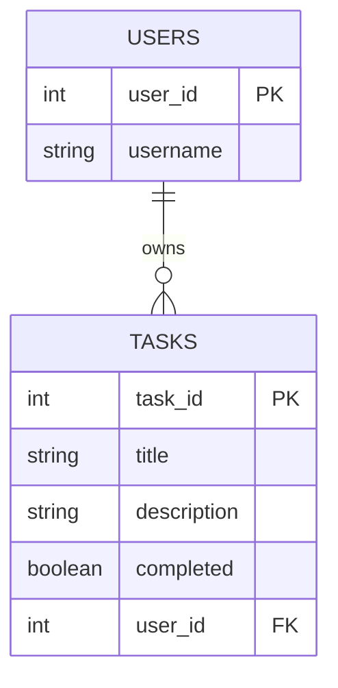
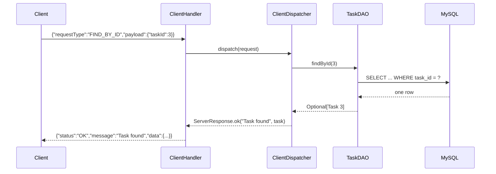
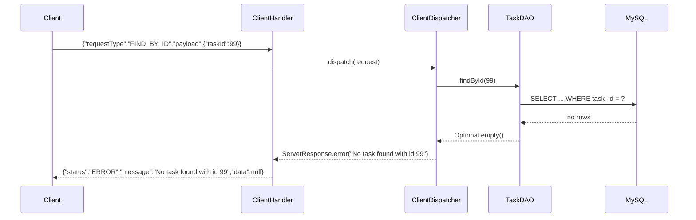
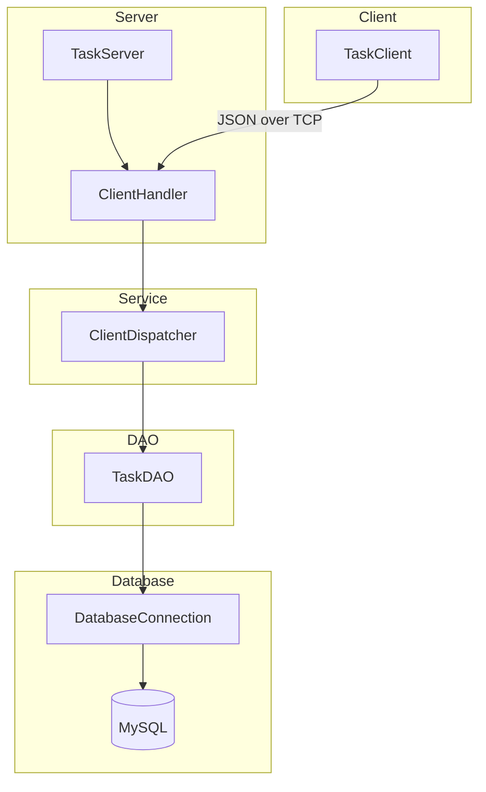
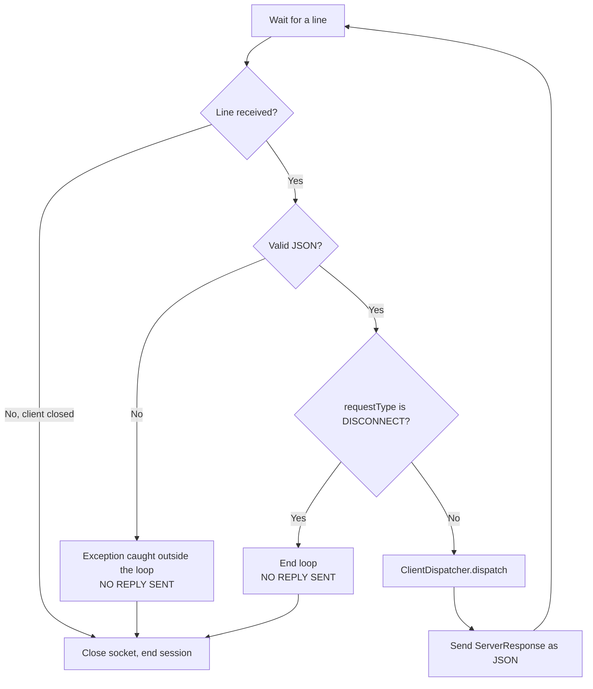

# Documenting a Project — Exercises

Like [t23](../../t23_unit_testing/exercises/t23_unit_testing_exercises.md), these exercises are about work you do **to** existing code, not new code you write. You will document the GCA2 reference in [`code/src/assessments/gca/gca2/`](../../../../code/src/assessments/gca/gca2/), whose database is set up by [`sql/mysqlSetup.sql`](../../../../code/src/assessments/gca/gca2/sql/mysqlSetup.sql).

Open these classes before you start:

| Tier | Class | What it does |
| :-- | :-- | :-- |
| Client | `client/TaskClient` | Sends requests and prints replies |
| Server | `server/TaskServer` | Accepts connections; starts one `ClientHandler` per client |
| Server | `server/ClientHandler` | Reads one client's requests and writes the replies |
| Service | `service/ClientDispatcher` | Chooses what to do for each request type |
| DAO | `dao/TaskDAO` | Runs the SQL for the `tasks` table |
| Database | `db/DatabaseConnection` | Opens and closes MySQL connections |

The four request types are `INSERT`, `FIND_BY_ID`, `LIST` and `DELETE_BY_ID`, plus `DISCONNECT`. The id travels in the payload under the key `taskId`.

Every exercise follows the same layout: a goal, the steps, the rules, hints, and a checklist. Because these exercises produce documents rather than code, each one ends with a **model answer** you can open once you have tried it yourself. Most answers are Mermaid diagrams: check that yours render in IntelliJ's Markdown preview or on GitHub.

| Exercise | You produce | Difficulty |
| :-- | :-- | :-- |
| 01 Method Javadoc | contracts for three DAO methods | Foundation |
| 02 Class Javadoc | summaries of two classes | Foundation |
| 03 Useless comments | a critique, no coding | Foundation |
| 04 ER diagram | the `tasks` table, then a `users` table | Foundation |
| 05 Sequence diagrams | a found task and a missing one | Intermediate |
| 06 Architecture diagram | the tiers and their classes | Intermediate |
| 07 Request flowchart | every path through `ClientHandler` | Intermediate |
| 08 README | a complete project README | Extension |

---

## Exercise 01 — Method Javadoc

**Goal:** Write Javadoc that tells a caller what a method **promises**: what goes in, what comes out, and what can go wrong. A caller should never need to read the method body.

**You will need:**
[Method-level Javadoc](../t25_documenting_a_project_notes.md#method-level-javadoc).

**Steps**

1. Open `TaskDAO` and read these three methods:

   ```java
   public Task insert(Task task) throws Exception
   public Optional<Task> findById(Integer id) throws Exception
   public boolean deleteById(Integer id) throws Exception
   ```

2. For each one, write a Javadoc comment with a one-sentence summary, then `@param`, `@return` and `@throws`.
3. For `findById`, say what happens for an unknown id, and for a `null` or negative id.
4. For `insert`, say what the returned `Task` contains that the one you passed in did not.

**Rules**

- Describe the **contract**, not the code. "Opens a connection and runs a SELECT" describes the code; "returns an empty `Optional` if no task has this id" describes the contract.

> **Watch out:** `@return the task` is not documentation: it repeats the type. `@return the same task, with its generated taskId filled in` tells the caller something they could not guess.

<details>
<summary>Hints</summary>

1. Read `findById` closely: it returns `Optional.empty()` *before* touching the database when the id is `null` or not positive.
2. `insert` changes the object you pass in. Say so: that is a side effect a caller must know.

</details>

**Done when**

- [ ] Each method has a summary, `@param`, `@return` and `@throws`.
- [ ] The unknown-id case of `findById` is described.

<details>
<summary>Answer</summary>

```java
/**
 * Saves a new task and gives it the id the database generated.
 *
 * @param task the task to save; its taskId is ignored
 * @return the same Task object, with its taskId set to the new primary key
 * @throws Exception if the database cannot be reached or the insert fails
 */
public Task insert(Task task) throws Exception

/**
 * Looks up one task by its id.
 *
 * @param id the task id to look for
 * @return the task, or an empty Optional if no task has this id, or if id is null or not
 *         positive (in which case the database is not queried)
 * @throws Exception if the database cannot be reached
 */
public Optional<Task> findById(Integer id) throws Exception

/**
 * Deletes one task by its id.
 *
 * @param id the task id to delete
 * @return true if a task was deleted; false if no task had this id, or id was null or not positive
 * @throws Exception if the database cannot be reached
 */
public boolean deleteById(Integer id) throws Exception
```

</details>

---

## Exercise 02 — Class Javadoc

**Goal:** Write a short class-level summary that tells a new developer what a class is **for**, what it **works with**, and what they **must know** before using it.

**You will need:** [Class-level Javadoc](../t25_documenting_a_project_notes.md#class-level-javadoc).

**Steps**

1. Read `ClientHandler` and `ServerResponse<T>`.
2. For each class, write a Javadoc block of three to five sentences that covers:
   - what the class is **responsible for**;
   - what it **collaborates with**;
   - anything a user **must know**: threading, when it stops, who closes what, what `T` means.

**Rules**

- Keep each block under about 80 words. Longer is not better.

<details>
<summary>Hints</summary>

1. For `ClientHandler`: which thread runs it, what ends its loop, and who closes the socket?
2. For `ServerResponse<T>`: what does `T` hold, and what is it when the status is `"ERROR"`?

</details>

**Done when**

- [ ] Each block covers responsibility, collaborators and must-knows.

**Think about it:** which of the two classes needs the longer comment, and why is length a poor measure of documentation quality?

<details>
<summary>Answer</summary>

```java
/**
 * Serves one connected client: reads one JSON request per line, passes it to the
 * ClientDispatcher, and writes the JSON reply. Runs on a pool thread started by TaskServer.
 * The session ends when the client sends DISCONNECT or closes the connection; the handler
 * then closes the socket itself. A line that is not valid JSON also ends the session,
 * without a reply.
 */
public class ClientHandler implements Runnable

/**
 * The reply envelope for every request: a status of "OK" or "ERROR", a message for people,
 * and the data. T is the type of the data, such as Task or List<Task>. Use the ok(...) and
 * error(...) factories; an error response always has null data.
 */
public class ServerResponse<T>
```

`ClientHandler` needs more words, because it has threading, a lifecycle and ownership of a resource. `ServerResponse` is simple, and padding its comment would hide the one rule that matters: error responses carry no data.

</details>

---

## Exercise 03 — Useless comments (no coding)

**Goal:** Learn to tell a useful comment from noise. For each comment below, say what is wrong, then rewrite it, or delete it and say why.

**You will need:** [What does NOT need Javadoc](../t25_documenting_a_project_notes.md#what-does-not-need-javadoc).

```java
/** This class is a class that handles handling of tasks. */
public class TaskDAO { ... }

/**
 * Gets the title.
 * @return the title
 */
public String getTitle() { return title; }

// increment i
i++;

/**
 * Sets the title.
 * @param title the title
 */
public void setTitle(String title) { ... }   // NOTE: this setter trims and rejects blanks
```

**Hint:** exactly one of these comments should be made **longer**, not deleted. Which one, and why?

<details>
<summary>Answer</summary>

1. **TaskDAO:** it says nothing the class name does not. Rewrite it: "Runs the SQL for the tasks table: insert, find by id, list, and delete. Every call opens and closes its own connection."
2. **getTitle:** it repeats the method name. Delete it; a simple getter needs no Javadoc.
3. **`// increment i`:** it repeats the code. Delete it.
4. **setTitle:** this is the one to **expand**. The useful facts, that it trims and rejects blanks, are hidden in an end-of-line note. Move them into the Javadoc: "Sets the title, removing spaces at both ends. @throws IllegalArgumentException if title is null or blank."

</details>

**Done when**

- [ ] You have a verdict and a reason for all four.

---

## Exercise 04 — ER diagram

**Goal:** Draw the database as an entity-relationship (ER) diagram, then extend the design so that each task belongs to a user.

**You will need:**
[Part 3 — ER Diagrams](../t25_documenting_a_project_notes.md#part-3--er-diagrams).

**Steps**

1. Read the `CREATE TABLE tasks` statement in `mysqlSetup.sql`.
2. Draw a Mermaid `erDiagram` showing every column of `tasks`, its type, and which column is the primary key (`PK`). Start from this:

   ```mermaid
   erDiagram
       accTitle: Tasks table
       accDescr: A single table, tasks, keyed by task_id and holding a title. Extend it with the remaining columns.
       TASKS {
           int task_id PK
           string title
       }
   ```

3. On paper first, add a `users` table, and make each task belong to exactly one user.
4. Add the `users` table, a foreign key (`FK`) in `tasks`, and the relationship line.
5. Write a **Diagram description** under the diagram, as in the notes.

**Rules**

- One user has many tasks; each task has exactly one user.

> **Watch out:** the cardinality marks are where most mistakes happen. `||--o{` reads "exactly one, to zero or more". Check which end is which.

<details>
<summary>Hints</summary>

1. The foreign key goes in the table on the "many" side.
2. `USERS ||--o{ TASKS : owns`

</details>

**Done when**

- [ ] All four `tasks` columns appear with their types.
- [ ] The relationship reads "one user owns zero or more tasks".

<details>
<summary>Answer</summary>



**Diagram description**
`USERS` has a primary key `user_id` and a `username`. `TASKS` has a primary key `task_id`, a `title`, a `description`, a `completed` flag, and a foreign key `user_id`. One user owns zero or more tasks, and each task belongs to exactly one user.

</details>

---

## Exercise 05 — Sequence diagrams

**Goal:** Show, step by step, which object talks to which during one request, first when the task exists and then when it does not.

**You will need:** [Part 5 — Sequence Diagrams](../t25_documenting_a_project_notes.md#part-5--sequence-diagrams).

**Steps**

1. Draw a Mermaid `sequenceDiagram` for a `FIND_BY_ID` request with five participants: Client, ClientHandler, ClientDispatcher, TaskDAO and MySQL.
2. Show the JSON request arriving, the dispatch, the DAO call, the SQL query, the row coming back, and the `ServerResponse` JSON going back to the client.
3. Draw a **second** diagram for an id that does not exist. Show where `Optional.empty()` appears, and what the client receives instead.
4. Write a **Diagram description** for each, as a numbered list of steps.

**Rules**

- Use solid arrows (`->>`) for calls and dashed arrows (`-->>`) for replies.

<details>
<summary>Hints</summary>

1. Read `ClientDispatcher.handleFindById`. It decides between "Task found" and "No task found".
2. The two diagrams are the same until the DAO returns.

</details>

**Done when**

- [ ] Both diagrams render and show five participants.
- [ ] The second diagram shows the error reply the client receives.

**Think about it:** the two diagrams differ in only a few messages. What does that tell you about where error handling lives in a tiered design?

<details>
<summary>Answer</summary>



**Diagram description**
1. The client sends a `FIND_BY_ID` request for task 3.
2. `ClientHandler` passes the request to `ClientDispatcher`.
3. The dispatcher calls `TaskDAO.findById(3)`, which queries MySQL.
4. MySQL returns one row; the DAO returns it inside an `Optional`.
5. The dispatcher builds an `OK` response; `ClientHandler` sends it to the client as JSON.



**Diagram description**
1. Steps 1 to 3 are the same as before, for task 99.
2. MySQL returns no rows, so the DAO returns `Optional.empty()`.
3. The dispatcher builds an `ERROR` response with a message and no data.
4. `ClientHandler` sends it to the client as JSON.

Only the last three messages change. The DAO reports "nothing found" in its return type, and the **service tier** turns that into an error reply. Neither the DAO nor `ClientHandler` needs to know.

</details>

---

## Exercise 06 — Architecture diagram

**Goal:** Draw one picture of the whole system: its tiers, the classes in each, and which tier depends on which.

**You will need:** [Part 6 — Architecture Diagrams](../t25_documenting_a_project_notes.md#part-6--architecture-diagrams).

**Steps**

1. List the tiers from the table at the top of this sheet, and the classes in each.
2. Draw a Mermaid `flowchart TD` with one `subgraph` per tier, containing its classes.
3. Draw an arrow from each class to the class it calls.
4. Write a **Diagram description** under it.

**Rules**

- No arrow may skip a tier, and none may point back up.

<details>
<summary>Hints</summary>

1. `subgraph Server` ... `end` groups classes into a box.
2. The client talks to the server only over the network, so its arrow goes to `ClientHandler`.

</details>

**Done when**

- [ ] Every class in the table appears once.
- [ ] Every arrow points one tier down.

**Check your work:** if your diagram shows the client calling `TaskDAO` directly, either the diagram is wrong or the design is. Say which.

<details>
<summary>Answer</summary>



**Diagram description**
Five tiers, top to bottom. `TaskClient` sends JSON over TCP to `ClientHandler`, which `TaskServer` creates for each client. `ClientHandler` calls `ClientDispatcher` in the service tier, which calls `TaskDAO`, which uses `DatabaseConnection` to reach MySQL. Every arrow points one tier down.

</details>

---

## Exercise 07 — Request flowchart

**Goal:** Draw every path a request can take through `ClientHandler`, including the failures, and check whether every path ends with a reply to the client.

**You will need:** [Part 4 — Flowcharts](../t25_documenting_a_project_notes.md#part-4--flowcharts).

**Steps**

1. Read `ClientHandler.run()` line by line.
2. Draw a Mermaid `flowchart` from "line arrives" to the end of the session.
3. Include every branch: `DISCONNECT`, valid JSON, **invalid** JSON, and the client closing the connection.
4. Follow each path with your finger. Mark any path that ends **without** sending a reply.
5. Write a **Diagram description**.

**Rules**

- Draw what the code **does**, not what it should do.

<details>
<summary>Hints</summary>

1. Where is `readValue` called, and what catches its exception if the line is not JSON?
2. Is there a reply for `DISCONNECT`?

</details>

**Done when**

- [ ] All four branches appear.
- [ ] Each path that ends without a reply is marked.

**Why this matters:** a path with no reply is a place where a real client waits for an answer that never comes.

<details>
<summary>Answer</summary>



**Diagram description**
1. The handler waits for a line. If the client has closed the connection, the session ends.
2. The line is parsed as JSON. **If parsing fails, the exception is caught outside the loop: the session ends and the client gets no reply.**
3. If the request type is `DISCONNECT`, the loop ends, also **without a reply**.
4. Otherwise the dispatcher handles it, the reply is sent, and the handler waits for the next line. The dispatcher turns DAO failures and unknown types into error replies, so this path always replies.

Two paths end without a reply: invalid JSON and `DISCONNECT`. For `DISCONNECT` that may be acceptable, if the protocol document says so. For invalid JSON it is a bug: one bad line disconnects the client with no explanation. The fix is to catch the parse error **inside** the loop and send an error reply, as `ClientHandler` does in [t22 Networking](../../t22_networking/t22_networking_notes.md).

</details>

---

## Exercise 08 — README (extension)

**Goal:** Write the README for the GCA2 reference as if it were your own submission. A good README gets a stranger from a fresh clone to a running system without asking you anything.

**You will need:** [Where each diagram goes in your repository](../t25_documenting_a_project_notes.md#where-each-diagram-goes-in-your-repository).

**Steps**

1. Write a one-paragraph overview of what the system does.
2. Write setup steps: create the database with `mysqlSetup.sql`, set the credentials, start `TaskServer`, then start `TaskClient`.
3. Add a protocol table: each request type, its payload fields, and the data in its reply.
4. Add your architecture diagram from Exercise 06.
5. Explain how to run the tests, including the ones tagged `database`.
6. Save it as `docs/README-draft.md`.

**Rules**

- Every command must be copy-and-paste ready.
- Do not include real passwords.

<details>
<summary>Hints</summary>

1. The request types and payload keys are in `ClientDispatcher`.
2. Test your README on someone who has never seen the project.

</details>

**Done when**

- [ ] Someone else can get the system running using only your README.
- [ ] Every request type is in the protocol table.

<details>
<summary>Answer: the protocol table</summary>

| Request type | Payload | Data in an OK reply |
| :-- | :-- | :-- |
| `INSERT` | `title`, `description`, `completed` | the saved task, with its new `taskId` |
| `FIND_BY_ID` | `taskId` | the task |
| `LIST` | none | a list of every task |
| `DELETE_BY_ID` | `taskId` | `true` |
| `DISCONNECT` | none | no reply; the session ends |

Every failure replies with status `ERROR`, a message, and `null` data, except invalid JSON, which ends the session (see Exercise 07).

</details>
